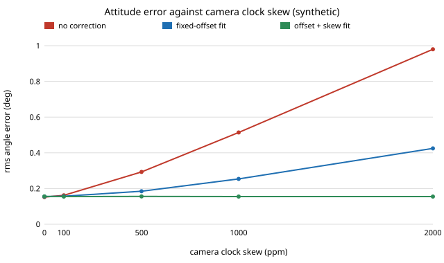

# sensing-syncskew: how much motion does a camera-to-gyro offset fit need, and what does clock skew do to a one-off calibration?

A fixed camera-to-gyro time offset is easy to calibrate once, but two real clocks also drift apart. On a stylised single-axis simulation (30 Hz camera, 200 Hz gyro, 40 s windows): **the alignment fit needs motion of roughly 16 deg/s rms or more to recover a 20 ms offset reliably (8 of 8 runs within 5 ms; 2 of 8 at 1 deg/s and 0 of 8 at 0.3 deg/s), and a camera clock that runs 1000 ppm fast makes a fixed-offset calibration leave 0.254 deg of attitude error against 0.152 deg with perfect sync, while fitting the offset and the skew together returns 0.155 deg at every skew tried up to 2000 ppm.** Produced with AI assistance (Claude). Fourth project of track 15 (`PROJECTS.md`, milestone 3 follow-up), picked because `sensing-timesync` listed clock skew and the excitation needed as next steps. It builds on none of the CU Boulder groups in `prompt.md`. Everything here is synthetic; nothing is measured on a real camera or IMU.

**Live page:** https://duncan-haywood.github.io/oss-monorepo/research/sensing-syncskew/

**Builds on.** [`sensing-timesync`](../sensing-timesync) (same world, constant offset only), and the temporal calibration literature: Furgale, Rehder and Siegwart, "Unified temporal and spatial calibration for multi-sensor systems", IROS 2013 (Kalibr), and Qin and Shen, "Online temporal calibration for monocular visual-inertial systems", IROS 2018. This project reproduces neither; it is a small independent simulation.

## Method
Same motion, gyro and camera as `sensing-timesync`, except that the sample stamped `t` observes the angle at `t − (td0 + skew·t)`. The fitter integrates the gyro and searches for the shift (and, optionally, the skew) that best aligns it with the camera angles after removing a free constant and linear term (nested golden-section search). The filter is the same fixed-gain complementary filter, with each camera stamp shifted by the fitted `td0 + skew·t`. Error is the rms of `estimate − truth` after a 5 s warm-up, mean of 4 seeds (section B) or 8 (A, C).

## Reproduce
```bash
pip install numpy matplotlib pytest
cd research/sensing-syncskew
python -m pytest -q tests          # 6 tests
python experiments/run.py          # writes experiments/results.txt (about 1.5 min)
python experiments/figure.py       # writes experiments/error_vs_skew.svg
```

## Results (from `experiments/results.txt`)
- **Excitation** (true 20 ms, no skew, camera noise 0.3 deg, 40 s): runs within 5 ms of the truth: 0/8 at 0.3 deg/s, 2/8 at 1, 5/8 at 2, 5/8 at 4, 6/8 at 8, 8/8 at 16 and 8/8 at 30 deg/s; rms error 59.9, 33.9, 10.7, 7.7, 3.0, 1.4 and 0.9 ms. Below about 8 deg/s the fit is unreliable at this camera noise.
- **Clock skew** (true offset 0): skew of 0, 100, 500, 1000 and 2000 ppm drifts the offset by 0, 4, 20, 40 and 80 ms over 40 s. Uncorrected error: 0.152, 0.162, 0.293, 0.514 and 0.980 deg. A fixed-offset fit: 0.155, 0.157, 0.185, 0.254 and 0.425 deg. Offset plus skew fit: 0.156, 0.155, 0.156, 0.155 and 0.155 deg.
- **Skew recovery against window length** (true 500 ppm): mean estimate 173, 281, 485 and 545 ppm for 10, 20, 40 and 80 s windows, with rms error 563, 268, 75 and 106 ppm. A 10 to 20 s window is too short here.
- **Scale.** Typical crystal skews are tens to a few hundred ppm; at 100 ppm the drift reaches 12 ms (the `sensing-timesync` doubling point) after 120 s, so skew matters for long recordings rather than short calibration runs. The 1000 and 2000 ppm rows are deliberate exaggerations to make the effect measurable in 40 s.
- With no skew, the skew fit reads 36 ppm (an average of 4 seeds); its resolution in a 40 s window is therefore about that size, and the 100 ppm row (137 fitted) is within it.



## Tests
Determinism and shapes, skew raises error, a constant offset is corrected by its own stamp, the fit recovers 20 ms with motion, the skew fit recovers 1000 ppm and cuts the error, and the fit fails with almost no motion.

## Limitations
- Single axis, angle measurements only; no rolling shutter, extrinsics or feature tracking. White camera noise independent of motion.
- Skew is linear and constant over the window; real oscillators also wander with temperature.
- Batch fit, not a recursive estimator. Filter gains are fixed. Noise levels are illustrative, not from datasheets. The success threshold (5 ms) and the 8-seed counts are coarse; the 5/8 at both 2 and 4 deg/s shows the sample is small.
- The excitation threshold depends on camera noise and window length, neither of which was swept here.

## Next steps
Sweep camera noise and window length against the excitation threshold; replace the batch fit with a recursive estimator; test on a licensed visual-inertial dataset with injected skew.

## Owner steps
Record a phone or camera with its IMU for several minutes with hardware timestamps, fit offset and skew in the first and last minute, and compare with this curve (hardware is the owner's; no purchase was made or recommended).

## Outside dependencies (vitamins)
Open-source Python packages only (numpy, matplotlib; pytest for tests). No hardware, no datasets.
