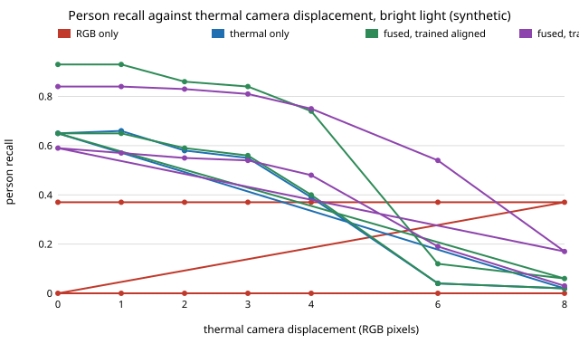
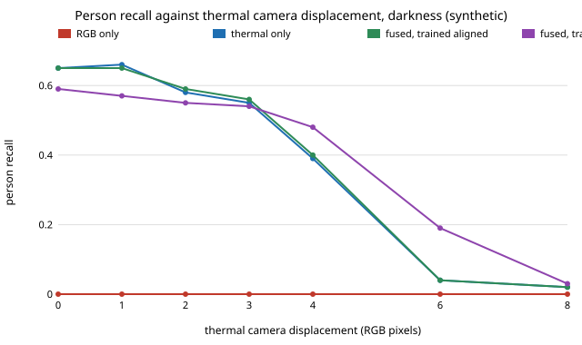

# sensing-thermalfuse: does a low-resolution thermal camera find people in darkness and smoke, and how much does misalignment cost?

On synthetic scenes (64×64 grey RGB plus a 16×16 thermal camera, people among cold clutter and warm non-person decoys): **RGB alone finds 36% of people in bright, clear conditions and none in the dark or in dense smoke; the thermal camera alone finds 65% in every condition, capped by warm decoys it cannot tell from people; fusing the two reaches 94% in bright clear light and falls back to the thermal-only level (65–66%) in darkness or dense smoke. A thermal camera displaced by 2 px (half a thermal pixel, under half a person's width) costs the fused detector about 7 points of recall, 4 px (one thermal pixel) about 19, and 6 px or more destroys the benefit; training with displacement jitter widens the tolerance at the price of 9 points when the cameras are aligned.** Produced with AI assistance (Claude). Track 15 (`PROJECTS.md`, milestone 7). It builds on none of the CU Boulder groups in `prompt.md` (ARPG is perception and mapping, but this project uses no ARPG data or method). Everything here is synthetic; nothing is measured on a real camera, and no open dataset was used.

**Live page:** https://duncan-haywood.github.io/monorepo-projects/research/sensing-thermalfuse/

**Why this was done on synthetic data.** The brief asks for "open data". A real RGB–thermal person dataset needs a licence check, a download that the cloud container could not make, and a detector far heavier than a CPU run allows. This project instead builds a scene model in which every effect is a knob (light, smoke, thermal noise, decoys, displacement) and measures how the *fusion* behaves. It does not claim any number transfers to real cameras; the owner step below is the real test.

**Builds on.** RGB–thermal pedestrian detection is a standing topic: for example Hwang et al., "Multispectral pedestrian detection: benchmark dataset and baseline", CVPR 2015 (KAIST), and FLIR's public ADAS thermal dataset. This project does not reproduce them; it is a small independent simulation of the fusion question.

## Method
- **Scene** (`make_scene`): 64×64 truth of reflectance and temperature. Background 285 K with ±1 K smooth texture. 2–4 *cold clutter* rectangles (RGB contrast 0.05–0.15, no thermal signature), 0–2 *warm decoys* (rectangles +3 K, ordinary reflectance: a warm engine or rock), and 1–3 upright-elliptical *people* (+6 K, RGB contrast ±0.15–0.30 of either sign, about 5×12 px). People and decoys are not told apart by shape in the detectors, only by the local-contrast features below.
- **RGB camera** (`render`): signal `light·(t·R + (1−t)·0.8)` (smoke transmittance `t` plus airlight), shot noise (100 photons at signal 1 and light 1) and read noise 0.01.
- **Thermal camera**: temperature mixed toward ambient by `1 − 0.1(1−t)` (the thermal band is assumed to lose 10% of the visible smoke extinction; an assumption, not a measurement), displaced `shift` RGB pixels sideways, block-averaged 4×4 to 16×16, noise 0.3 K, bilinear upsampled.
- **Detectors** (`features`, `Detector`): per pixel, the contrast of a 3×3 and a 7×7 box against 9×9 and 21×21 boxes, normalised by the image's own robust (MAD) scale. RGB contrast enters as a magnitude (clothing sign unknown); thermal contrast is signed. *RGB-only* and *thermal-only* are logistic regressions on their own features. *Early fusion* is one joint logistic regression with three cross-sensor products. *Late fusion* adds the two single-sensor log-odds. Scores are box-smoothed over 5×5.
- **Metric** (`evaluate`): the threshold is set so that 10% of person-free test images contain a false alarm (the 90th percentile of per-image maximum score over 150 scenes with clutter and decoys but no people); recall is the share of people whose (dilated) region has a maximum score above it, over 150 scenes. Detectors are retrained on 40 scenes at each light/smoke setting, so the detector knows the condition. Cells average 3 seeds (A) or 2 seeds (B).

## Reproduce
```bash
pip install numpy matplotlib pytest
cd research/sensing-thermalfuse
PYTHONPATH=src python -m pytest -q tests   # 10 tests
python experiments/run.py                  # writes experiments/results.txt (~4 min)
python experiments/figure.py               # writes experiments/recall_vs_shift*.svg
```

## Results (from `experiments/results.txt`)
- **Light and smoke** (aligned, recall at 10% false alarms per image, mean over 3 seeds): bright and clear: RGB 0.36, thermal 0.65, early fusion 0.94, late 0.93. Bright with smoke transmittance 0.4: RGB 0.13, thermal 0.65, early 0.83. Transmittance 0.1: RGB 0.00, thermal 0.66, early 0.67. At light 0.03 (3% of bright) RGB is already 0.01 and fusion gives 0.71/0.72; at light 0.001 fusion equals thermal alone (0.66 vs 0.65). Seed ranges are about ±0.02 (see the file).
- **Fusion helps only where RGB still sees.** In bright light the fused detector recovers decoy-versus-person decisions that the thermal camera alone cannot make (0.65 → 0.94). Once RGB contrast is gone, fusion is no better than the thermal camera, and costs nothing.
- **Thermal-only is capped at about 0.65 here** because a warm decoy is as hot as a person's cooler half; that ceiling is a property of this scene (decoy density and temperature), not a general number.
- **Displacement** (thermal camera shifted sideways relative to the RGB frame, detectors trained aligned): in bright light fused recall is 0.93, 0.93, 0.86, 0.84, 0.74, 0.12, 0.06 at 0, 1, 2, 3, 4, 6, 8 px; thermal-only is 0.65, 0.66, 0.58, 0.55, 0.39, 0.04, 0.02. In the dark fused equals thermal-only throughout. Misalignment beyond about one thermal pixel (4 px) is worse than having no thermal camera in bright light: at 6 px the fused detector (0.12) is below RGB alone (0.37).
- **Training with displacement jitter** (shift drawn from ±4 px) lifts fused recall at 6 px from 0.12 to 0.54 in bright light, but lowers it at 0 px from 0.93 to 0.84, and at 8 px it is still only 0.17.




## Tests
Determinism and shapes, empty mask with no people, box filter against a direct mean, sideways shift and its identity, thermal upsampling, a thermal hot spot moving with `shift`, darkness removing RGB contrast but not thermal contrast, the logistic fit separating Gaussians, person labelling, and the headline ordering (fusion beats both sensors in light and matches thermal in darkness).

## Limitations
- Synthetic, one scene family, 64×64 pixels, grey RGB. Real thermal images have halos, emissivity and clothing effects, calibration drift and non-uniform noise, and real detectors are deep networks, not 7-feature logistic regressions. The absolute recalls mean nothing outside this simulation; the ordering and the displacement scale are the findings.
- Displacement is a pure sideways shift; a real rig has rotation, parallax that depends on range, and lens distortion (`lens-twin`).
- The 10% thermal smoke leakage and the per-image robust normalisation are assumptions; the normalisation hides uniform attenuation, which is why thermal-only barely moves with smoke here.
- Detectors are retrained at each condition, an upper bound for a deployed system that must infer the condition.
- Pixel-neighbourhood features cannot use person shape; a shape-aware detector would raise every number, RGB especially.
- Recall at one false-alarm rate (10% of images), on 150 scenes per cell: differences under about 3 points are noise.
- No tracking or identification of any person is attempted; the task is detecting a human-shaped warm region for rescue and safety.

## Next steps
Replace the scene with a licensed RGB–thermal dataset (cite its licence) and a small convolutional detector, estimate displacement online from edges visible in both bands, and add range-dependent parallax.

## Owner steps
Capture RGB and thermal frames of volunteers who have agreed in an indoor space in low light with a low-cost thermal module and a phone, at several known mounting offsets, and compare the recall-against-offset curve with this one (hardware is the owner's; no purchase was made or recommended).

## Outside dependencies (vitamins)
Open-source Python packages only (numpy, matplotlib; pytest for tests). No hardware, no datasets.
