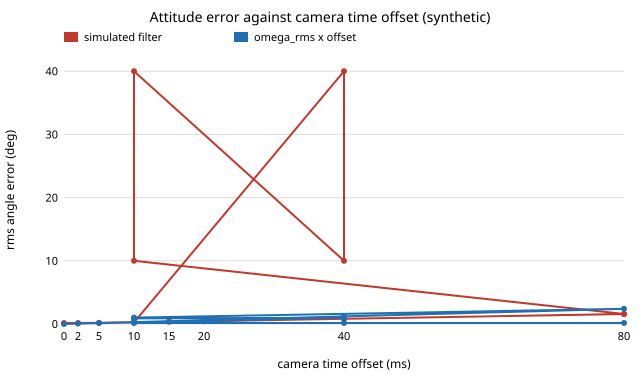

# sensing-timesync: how many milliseconds of camera-to-gyro time offset double the attitude error, and can online calibration fix it?

A camera and a gyro whose clocks disagree by a few milliseconds feed a fused attitude filter wrong data. On a stylised single-axis simulation (30 Hz camera, 200 Hz gyro, 30 deg/s rms motion): **a 12–14 ms offset doubles the fused attitude error, the offset that doubles it shrinks with faster motion (32–34 ms at 10 deg/s and 8–10 ms at 90 deg/s at the same camera noise) and grows with camera noise, and a simple alignment fit recovers the offset to about 1 ms rms from 10 s of motion, which brings the error back to within 0.005 deg of the zero-offset value. With a nearly still platform the same fit fails (errors of tens of ms).** Produced with AI assistance (Claude). Third project of track 15 (`PROJECTS.md`, milestone 3). It builds on none of the CU Boulder groups in `prompt.md`. Everything here is synthetic; nothing is measured on a real camera or IMU.

**Live page:** https://duncan-haywood.github.io/monorepo-projects/research/sensing-timesync/

**Builds on.** Online temporal calibration of camera-IMU systems is studied in Kalibr (Furgale, Rehder and Siegwart, "Unified temporal and spatial calibration for multi-sensor systems", IROS 2013) and in visual-inertial estimators that carry the offset as a state (Qin and Shen, "Online temporal calibration for monocular visual-inertial systems", IROS 2018). This project does not reproduce either: it is a small independent simulation that asks how large the offset has to be to matter, and where a plain alignment fit stops working.

## Method
One axis. The true angle is the integral of a band-limited random rate (first-order low-pass, 2 Hz, rms `omega_rms`). The gyro reports the rate at 200 Hz plus a constant bias (0.5 deg/s) and white noise (0.2 deg/s/√Hz). The camera reports the angle at 30 Hz plus white noise (`cam_noise`), but each sample stamped `t` actually observes the angle at `t − td`. The attitude filter is a fixed-gain complementary filter: integrate the gyro minus a bias estimate, and correct both with camera residuals, rolling the gyro prediction back to the stamped time. The error is the rms of `estimate − truth` after a 5 s warm-up, mean of 4 seeds. The online estimator integrates the gyro, then finds the shift `td` that best aligns it with the camera angles after removing a free constant and linear drift (golden-section search on the residual).

## Reproduce
```bash
pip install numpy matplotlib pytest
cd research/sensing-timesync
PYTHONPATH=src python -m pytest -q tests   # 7 tests
python experiments/run.py                  # writes experiments/results.txt (~25 s)
python experiments/figure.py               # writes experiments/error_vs_offset.svg
```

## Results (from `experiments/results.txt`)
- **Error against offset** (30 deg/s, camera noise 0.3 deg): 0.152 deg at 0 ms, 0.187 at 5 ms, 0.259 at 10 ms, 0.344 at 15 ms, 0.816 at 40 ms, 1.59 at 80 ms. The error doubles between 12 and 14 ms. At large offsets it is below the first-order bound `omega_rms × td` (the filter partly trusts the gyro), at about 0.66 of it at 80 ms.
- **What moves the doubling offset** (bracket from a 2 ms grid): with camera noise 0.3 deg, 32–34 ms at 10 deg/s, 12–14 ms at 30 deg/s, 8–10 ms at 90 deg/s. With 30 deg/s, camera noise 0.1/0.3/1.0 deg gives 8–10, 12–14 and 30–32 ms. A noisy camera hides the offset; a clean camera and fast motion expose it.
- **Online estimate** (6 seeds per cell): 10 ms offset estimated as 9.4 ms (rms error 0.9–1.0 ms), 40 ms as 39.2–39.3 ms (1.0 ms rms), for 10 s and 40 s windows alike. The zero-offset control reads between −1.0 and +1.0 ms. A residual bias of about −0.7 ms remains and is not explained here.
- **Feeding the estimate back** gives 0.157, 0.156 and 0.157 deg at true offsets of 10, 40 and 80 ms, against 0.152 deg with no offset and 0.26, 0.82 and 1.59 deg uncorrected.
- **Excitation matters.** At 1 deg/s rms motion and a true 20 ms offset, six runs estimate −2.5, −45.8, 42.1, 40.5, 5.8 and −25.8 ms: the fit has nothing to align.



## Tests
Determinism and shapes, error grows with offset, large-offset error against the first-order bound, faster motion is more sensitive, the estimator recovers 0, 20 and 50 ms within 4 ms, correction restores the error, and the estimator degrades without motion.

## Limitations
- Single axis, angle measurements only: no rolling shutter, no camera extrinsics, no 3D rotation, no feature tracking. A real visual-inertial system measures through image features, whose sensitivity to timing differs.
- The offset is constant; real offsets drift with clock skew and exposure time. Camera noise is white and independent of motion blur, which a real fast motion would add.
- The filter gains are fixed, not tuned per setting. A different filter changes where the error doubles.
- The estimator is batch (it uses the whole window), not an online recursive filter, and the window length hardly mattered between 10 s and 40 s here. Its small constant bias is unexplained.
- All noise levels are illustrative, not from datasheets.

## Next steps
Run `sensing-vio` (milestone 2) with a real feature-based pipeline on an openly licensed dataset, then inject offsets there to test whether the 12 ms figure transfers. Add clock skew and a recursive estimator, and sweep the excitation needed for the fit to work.

## Owner steps
Log a phone or camera with its IMU while shaking it by hand, with hardware timestamps if available, and compare the fitted offset with the vendor's stated one (hardware is the owner's; no purchase was made or recommended).

## Outside dependencies (vitamins)
Open-source Python packages only (numpy, matplotlib; pytest for tests). No hardware, no datasets.
