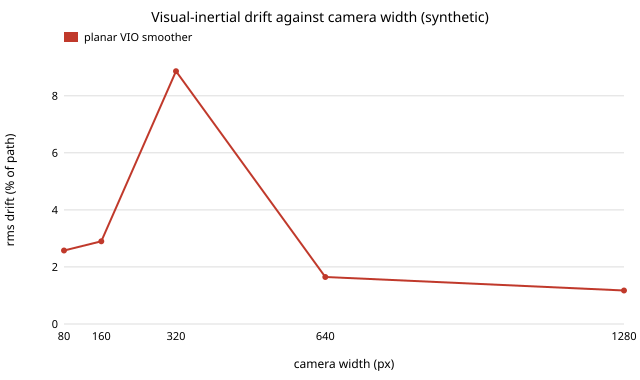

# sensing-vio: which sensor upgrade buys the most visual-inertial accuracy, a sharper camera or a better IMU?

On a stylised planar visual-inertial smoother, **camera resolution was the only knob that moved drift detectably: 1280 px gave 1.18 % rms drift (of path length) against 1.65 % at 640 px, and 320 px gave 8.9 %. Changing the gyro or accelerometer noise by 0.25× to 4× changed it by under 10 % in either direction on 12 s paths, which is inside the noise of 8 seeds.** Produced with AI assistance (Claude). Second project of track 15 (`PROJECTS.md`, milestone 2). It builds on none of the CU Boulder groups in `prompt.md`. Everything here is synthetic; nothing is measured on a real camera or IMU, and **this is not a run on EuRoC** (see Limitations).

**Live page:** https://duncan-haywood.github.io/monorepo-projects/research/sensing-vio/

**Builds on.** Sliding-window visual-inertial estimation with IMU preintegration: Forster et al., "On-manifold preintegration for real-time visual-inertial odometry", *IEEE T-RO* 2017; Qin, Li and Shen, VINS-Mono, *IEEE T-RO* 2018; Mourikis and Roumeliotis, MSCKF, ICRA 2007. IMU noise magnitudes are of the order of those published with the EuRoC MAV dataset (Burri et al., *IJRR* 2016). This is a small independent planar re-implementation, not a reproduction of any of them.

## Method
A vehicle drives a smooth random path (1 m/s ± 0.3, turn rate rms ~0.3 rad/s) in a plane past 120 point landmarks scattered 2–14 m from the path. A forward camera (90° field of view, 1–15 m range, known data association) measures landmark bearings with noise `0.5 px / focal length`, so resolution sets bearing noise. A 100 Hz gyro and body-frame accelerometer have white noise and bias random walk (baseline 1.7e-4 rad/s/√Hz, 2e-5, 2e-3 m/s²/√Hz, 3e-3). The estimator is a fixed-lag smoother (`scipy.optimize.least_squares`): per keyframe a pose, velocity and gyro and accelerometer biases; landmark positions; 2D IMU preintegration factors and bearing factors; a window of 0.6 s (4 to 13 keyframes); the oldest pose pinned to its previous estimate. Error is the rms position error over the keyframes, as a percentage of path length, with paired seeds (same world and noise draws) across settings. The "ratio" column is the geometric-mean paired ratio to the baseline.

## Reproduce
```bash
pip install numpy scipy matplotlib pytest
cd research/sensing-vio
PYTHONPATH=src python -m pytest -q tests          # 8 tests, ~1 min
OMP_NUM_THREADS=1 python experiments/run.py 8 12 # writes experiments/results.txt (~15 min on 4 cores)
python experiments/figure.py                      # writes experiments/drift_vs_width.svg
```
Set `OMP_NUM_THREADS=1`: without it the four worker processes oversubscribe the cores and the run took hours.

## Results (from `experiments/results.txt`; 8 seeds, 12 s paths, about 12 m)
- **Camera width** (rms drift, % of path): 80 px 2.58, 160 px 2.90, 320 px 8.86, 640 px (baseline) 1.65, 1280 px 1.18 (ratio 0.71). The curve is not monotonic below 640 px (320 px is worse than 160 px) with a standard error up to 3.6, so only "1280 px is better than 640 px, and a low-resolution camera is worse" is supported, not a shape.
- **IMU grade** (gyro and accelerometer noise density and bias walk scaled together or one at a time, 0.25× to 4×): ratios 0.91 to 1.37, no trend with grade; 0.5× gyro (1.37) is within the noise. Scaling both by 0.25× or 4× gave 0.99 and 1.07.
- **Frame rate** (window fixed at 0.6 s): 5 fps 1.18×, 20 fps 2.41× the baseline drift. The 20 fps case is likely an estimator artefact (shorter baselines between keyframes make landmark triangulation poor, and the solver is capped at 15 iterations); do not read it as "faster cameras hurt".
- **Combined**: 1280 px with a 4× worse IMU matched 1280 px alone (ratio 0.71); 160 px with a 4× better IMU stayed worse than the baseline (1.67). On these paths the camera dominated.
- **Which upgrade per dollar?** No prices are used, because none were sourced. An upgrade is worth buying only if its price multiple is below the drift reduction it gives: going from 640 px to 1280 px cut drift by about 29 %; the IMU changes cut it by nothing measurable.



## Tests
Determinism and sizing of the world, focal length and bearing noise against resolution, a fixed-time smoother window, IMU scaling, recovery of the path from noiseless sensors (final error under 0.01 %), observations inside the field of view, noisy runs drift more than noiseless ones, a much worse camera drifts more.

## Limitations
- **Short paths only.** On 30 s paths the estimator diverged in some runs (error jumping after ~16 s, up to 10 % of path), and a first 4-seed 30 s experiment gave results that did not order sensibly (better IMU sometimes worse); it was discarded and is not reported. The cause is that old information is not marginalised: the window forgets everything and the oldest pose is simply pinned, so velocity and bias errors accumulate. Loosening the priors made it far worse; a robust loss did not help. A proper marginalisation prior is the first thing to fix, and it would likely make IMU grade matter more over long runs, where bias drift dominates. The IMU finding above is therefore for 12 s only.
- Planar, point landmarks, known association, no rolling shutter, no feature loss or outliers, no loop closure. A 3D system with unknown biases and gravity alignment behaves differently.
- Resolution only changes the bearing noise; real low-resolution cameras also lose features. Frame rate is confounded with window size and the solver cap.
- **Not EuRoC.** No dataset was used; EuRoC's licence terms were not checked and its data were not fetched. Degrading the real camera and IMU is the obvious next step.
- Noise levels are illustrative.

## Next steps
Add marginalisation (a Schur-complement prior) and rerun on long paths; add 3D and rolling shutter; run on a licensed public dataset; attach sourced prices to the sensor grades to turn the sensitivities into accuracy per dollar (owner step: confirm prices).

## Owner steps
Log a real camera and IMU on owned hardware, replay them degraded, and compare against this curve. No hardware was bought or recommended.

## Outside dependencies (vitamins)
Open-source Python packages only (numpy, scipy, matplotlib; pytest). No hardware, no datasets.
