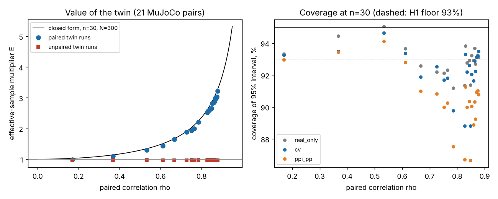

# Sim-to-real inference: how few real trials certify a robot policy when a biased simulator supplies the rest?

**Status: open research programme, milestone 4 of 7 started: SIMPLER policy-level real data logged (3b to 3e follow-ups also logged).** First results below: on 21 MuJoCo twin-real model pairs, context-paired twin runs multiply the effective real sample by up to 3.2x and match the closed form 1/(1 - rho^2 (1 - n/N)) within 6%, unpaired twin runs give none, and plug-in 95% intervals undercover (hypothesis H1 refuted as pre-registered). This directory is where
the work toward one publishable paper accumulates across sessions; it consolidates about 130
small twin projects in this repository into one question (see [`PROPOSAL.md`](PROPOSAL.md)).

**Live page:** https://duncan-haywood.github.io/oss-monorepo/research/sim2real-inference/

**The question.** A digital twin (a simulator of a real robot) is biased, so evaluating a policy on
the twin alone gives the wrong answer however many runs you make. Real trials are unbiased but
scarce. The programme asks for estimators and tests that use many twin runs and a few real ones,
keep their guarantee *whatever* the twin's bias, and say exactly how many real trials they save:
for a policy's mean return, its failure rate, and comparisons between policies.

**Why it is open.** Control-variate and prediction-powered inference arguments promise savings that
grow with the twin's correlation with reality; a worst-case argument (`twin-certification`) says a
twin cannot shorten a failure-rate certificate at all. The programme looks for the checkable
assumptions in between, and tests them on real paired sim and real data (SIMPLER, Li et al. 2024) as
well as on MuJoCo model pairs.

- [`PROPOSAL.md`](PROPOSAL.md): question, related work (13 checked references), gap, hypotheses
  H1 to H6, method, evaluation, milestones, target venue.
- [`src/sim2real_inference/`](src/sim2real_inference): milestone 2, one estimator library (real-only,
  PPI, PPI++, classical control variate, optimal allocation, exact failure-rate threshold test) and
  [`tests/`](tests) that reproduce numbers from `twin-evaluation`, `twin-pilot` and
  `twin-certification` (0.072 and 0.172 cost-ratio thresholds, `rho*(0.05)` = 0.426, context-share
  equivalents 1.04/1.33/2.78 and 1.25/2.0/5.0, the 299-trial zero-failure test) and check the
  variance formulas and interval coverage by simulation. Run:
  `PYTHONPATH=src python3 -m unittest discover -s tests` (11 tests, about 14 s); the benchmark tests are `tests/test_benchmark.py` (needs numpy and mujoco).
- [`experiments/m3_benchmark/`](experiments/m3_benchmark): milestone 3, the benchmark. `pairs.py` (a MuJoCo pendulum arm; twin = nominal, "real" = disturbance plus one omitted effect: friction, delay, sensor noise, actuator gain, payload mass, each at four swept magnitudes), `run_pool.py` (4 minutes on 4 cores), `analyse.py` (H1, H2, H6, about 5 minutes), `figure.py`. Results in [`results/`](experiments/m3_benchmark/results): `summary.txt`, `coverage.csv`, `h2.csv`, `h6.csv`, figure below.
  Model-versus-model pairs, never real-robot results; magnitudes are swept, not from a datasheet.

  Left: effective-sample multiplier E (variance of real-only over variance of the control variate, n = 30 pairs plus 270 twin-only runs) against the paired correlation; line is the closed form. Right: coverage of 95% intervals, n = 30. Results: H1 refuted (intervals undercover, partly because the bounded outcome is skewed and real-only undercovers too, 91.2% at worst); H2 supported on 13 of 21 pairs and failing where rho is under about 0.75; H6 mixed (rho predicts value better, Spearman 0.999, but detectability predicts it too, -0.95). Full account in [`LOG.md`](LOG.md).
- [`experiments/m3b_intervals/`](experiments/m3b_intervals): milestone 3b, finite-sample intervals. `intervals.py` (about 3 minutes on 4 cores) compares the plug-in t, percentile-bootstrap and studentised-bootstrap intervals for `cv` and `ppi_pp` on the same pools. Result: the studentised bootstrap lifts mean coverage at n = 30 from 92.0% to 93.6% (`cv`) with a worst pair at 90.8%, at 14% greater width; the percentile bootstrap is worse than t. Pre-registered H1b and H1c were both refuted; see [`LOG.md`](LOG.md) and `results/summary_3b.txt`.
- [`experiments/m3c_dfree/`](experiments/m3c_dfree): milestone 3c, a distribution-free interval. `dfree.py` (about 1 minute) builds an empirical-Bernstein interval for the control-variate estimand (lam from a third of the pairs, union bound over the residual mean and the twin mean) and compares it with a real-only empirical-Bernstein interval. Result: both cover 100% on all 21 pairs, but the control-variate interval is 2.1 to 3.1 times wider, because the bound is dominated by its range term (0.146 against a variance term of 0.027 on `none-0`, n = 60). A betting or observed-range interval is the next route; see [`LOG.md`](LOG.md) and `results/summary_3c.txt`.
- [`experiments/m3d_betting/`](experiments/m3d_betting): milestone 3d, a betting (hedged-capital) interval. `betting.py` (about 2 minutes) repeats 3c with the Waudby-Smith and Ramdas interval. Result: valid (coverage at least 99.5%) but again 2 to 3.4 times wider with the twin than without (mean 2.9 at n = 60); the plug-in bet cap binds on 99 to 100% of bets, so the width stays range-limited. Range-free routes are the next step; see [`LOG.md`](LOG.md) and `results/summary_3d_prior*.txt`.
- [`experiments/m3e_bounded_disc/`](experiments/m3e_bounded_disc): milestone 3e, a bounded-discrepancy lower bound (pilot-checked bound on |R - T|). `bounded.py` (seconds) compares it with a real-only empirical-Bernstein bound at n up to 240. Result: valid (100% coverage) but tighter on 0 of 21 pairs at every n; the pilot maximum of |R - T| stays near 0.3 and the check costs gamma = 0.056 at n = 240, so the proposal's H3 is refuted for a max-based bound here. See [`LOG.md`](LOG.md) and `results/summary_3e.txt`.
- [`experiments/m4_simpler/`](experiments/m4_simpler): milestone 4, real data. `data.py` holds SIMPLER's published paired real and SAPIEN success rates (Li et al. 2024, arXiv:2405.05941, Tables IV and V; 36 policy-task cells), `analyse.py` (seconds) asks how many real trials the twin is worth. Result: raw sim error is 5x the real-only variance; a leave-one-cell-out calibrated twin has RMSE 0.12 and a break-even of about 10 real trials [5, 26]; rank correlation is r = 0.90. Policy-level only, so the paired control variate (H1, H2) is untested on real data. See [`LOG.md`](LOG.md) and `results/summary_4.txt`.
- [`experiments/m4e_transfer/`](experiments/m4e_transfer): milestone 4e. Re-runs the SIMPLER calibration with a whole task, a whole policy, or both held out. Task held out: no change (n* 10.3); policy held out: n* 7.1; both: the calibrated twin is worse than the raw one (MSE 0.0290 against 0.0212). The m4 figure of about ten real trials is an in-sample-policy number. `results/summary_4e.txt`.
- [`experiments/m4f_ranking/`](experiments/m4f_ranking): milestone 4f. Prices the SIMPLER twin by order instead of level: it ranks 71 within-task policy pairs correctly 88.7% of the time [81.7, 96.6], which a real evaluation matches with 11 trials per policy [5, 38], agreeing with n* of about 10. Published rates taken as truth. `results/summary_4f.txt`.
- [`LOG.md`](LOG.md): the research log. Hypotheses are written down before experiments are run.
- How runs work on a programme: [`../PROGRAMMES.md`](../PROGRAMMES.md).

Produced with AI assistance (Claude Code). It builds on published work it cites and implies no
affiliation with or endorsement by any author or lab.

## Owner steps

- Real-robot trials, if a later milestone needs them, and submitting the paper (publishes under a
  name).

## Outside dependencies

MuJoCo (open source, pip) and numpy for the benchmark; planned: the published SIMPLER tables.
- [`experiments/m3f_failure_rate/`](experiments/m3f_failure_rate): milestone 3f, failure-rate certificates. `failrate.py` (seconds) compares a twin-informed upper bound on the failure rate (twin failure rate plus the exact bound on P(real fails, twin passes)) with Clopper-Pearson on the 21 pools; `breakeven.py` gives the plug-in break-even. Result: valid (coverage at least 98.6%) but tighter on 0 of 21 pairs at every n (n = 240: gap 0.056 against 0.041), because even the best twin passes about 55% of the real failures; it would need q10/p of roughly 0.04 to 0.10. H3 refuted in this benchmark. See [`LOG.md`](LOG.md) and `results/summary_3f.txt`.
- [`experiments/m5a_active/`](experiments/m5a_active): milestone 5a, active selection of real trials (H4). `active.py` (about 20 minutes on 4 cores) samples contexts for the real trials in proportion to a gradient-boosting prediction of the twin error |R - T| (an n/3 uniform pilot fits it), with an unbiased inverse-probability weight. Result: at n = 120 it cuts MSE against uniform by 17 to 35% on the three pairs where the twin error is predictable from the context (het_r2 above 0.45), is 8% worse in the median on the weakly predictable pairs, and at n = 30 to 60 loses on 18 to 19 of 21 pairs. Coverage is 92.4% at worst. See [`LOG.md`](LOG.md) and `results/summary_5a.txt`.
- [`experiments/m5b_anytime/`](experiments/m5b_anytime): milestone 5b, anytime confidence sequences. `anytime.py` (about 1 minute) runs hedged-capital sequences for real-only and for the twin as control variate (paired difference, or pilot-fitted lambda) and measures coverage under optional stopping and the number of real trials until a decision. Result: valid (miss at most 2.5%) but the twin is slower, 74 against 50 median trials at gap 0.10, on all 12 pairs with rho at least 0.8 (H5 refuted). See [`LOG.md`](LOG.md) and `results/summary_5b.txt`.
- [`experiments/m6b_dfloor/`](experiments/m6b_dfloor): milestone 6b, the floor scales with a known discrepancy bound D (any valid bound has gap above D x 2.3/m with probability 1/2 in the worst case), and with D and the twin law known E[T] - D is valid with no real runs. `dfloor.py` (seconds) checks it with the oracle D = max |R - T| on the 21 pools: D is 0.55 to 0.99, so the zero-run bound beats real-only empirical Bernstein on 1 of 21 pairs at n = 30 and 0 of 21 at n >= 60. A max-based discrepancy assumption cannot pay; a tail-aware one is the open step. See [`LOG.md`](LOG.md) and `results/summary_6b.txt`.
- [`experiments/m6c_quantile/`](experiments/m6c_quantile): milestone 6c, zero-real-run bounds from a quantile or mean discrepancy assumption (`L = E[T] - (1-q)D_q - q`). `quantile.py` (seconds) uses oracle inputs on the 21 pools: quantile bounds beat real-only empirical Bernstein at n = 30 but on 0 of 21 pairs at n >= 120; the mean bound wins on 21 of 21 only because the twin here is one-sided (R <= T), so E\|R - T\| equals the bias and knowing it is knowing E[R]. See [`LOG.md`](LOG.md) and `results/summary_6c.txt`.
- [`experiments/m6d_target_variance/`](experiments/m6d_target_variance): milestone 6d, is `|R - T|` a lower-variance target than `R`? `target_var.py` (seconds) on the 21 pools: Var(|R - T|) < Var(R) on 20/21 pairs (all 12 with rho >= 0.8), median ratio 0.30; the empirical-Bernstein half-width is smaller on 20/21 at n = 240. Model pairs only; the gain is the control variate with lam = 1, so it adds no new estimator.
- [`experiments/m7d_clip/`](experiments/m7d_clip): milestone 7d, a twin-chosen clip level c (the twin's 99.9th percentile) for the unbounded cost, with a real-only empirical-Bernstein lower bound on E[min(R, c)]. Result: clipping loses under 5% of the mean on 18 of 21 pairs; the median relative gap is 0.27 at n = 240; the twin quantile fails exactly on the large-friction pairs. See [`LOG.md`](LOG.md).
- [`experiments/m7e_clip_cv/`](experiments/m7e_clip_cv): milestone 7e, a twin-assisted lower bound on the clipped cost E[min(R, c)] (c a twin quantile; residual EB bound plus the twin's clipped mean). `clipcv.py` (about 10 seconds) on the 21 cart-pole cost pools: valid (100% coverage) but tighter than real-only on 0 of 21 pairs at every n up to 240 (median relative gap 0.333 against 0.271 at n = 240). See [`LOG.md`](LOG.md) and `results/summary.txt`.
- [`experiments/m7g_large_n/`](experiments/m7g_large_n): milestone 7g, does a fixed-weight PPI empirical-Bernstein interval beat real-only at n up to 1,920 (the regime in which the related SureSim paper, arXiv:2510.04354, reports a 14.4% gain)? `largen.py` (seconds): narrower on 0 of 21 pairs in each of two pools; with the twin mean exact the ratio falls to 1.04 to 1.13 on the pendulum and a plug-in crossover lies at n of about 2,600 to 45,000 (cart-pole: above 53,000). Negative; SureSim's gain is not reproduced and its text was not read.
- [`experiments/m7h_uncapped_betting/`](experiments/m7h_uncapped_betting): milestone 7h. `uncapped.py` (about 8 minutes) repeats the betting interval with a bet cap of 0.99/m instead of 1/2. Real-only betting is far narrower than empirical Bernstein, and with the twin mean treated as exact the twin-assisted interval is narrower than real-only on 20 of 21 pendulum pairs at n = 240 (reverses the "never tighter" reading; the valid version with a finite twin pool is next). See [`LOG.md`](LOG.md).
- [`experiments/m7i_finite_twin/`](experiments/m7i_finite_twin): milestone 7i. `finite_twin.py` (about 10 minutes) replaces 7h's exact twin mean with a betting interval from N iid twin runs and a union bound. With N = 4,000 the combined interval beats real-only on 8 of 21 pendulum pairs at n = 960 (best ratio 0.80, median 1.05); with N = 500 on none; cart-pole on none. Coverage at least 99%. See [`LOG.md`](LOG.md).
- [`paper/`](paper): milestone 7, a draft paper (`main.tex`, `refs.bib`, `reproduce.sh` with one command per figure and table). Framed as a measurement paper with a mostly negative certification result; not ready to submit (no real per-episode pairs, one task). See [`LOG.md`](LOG.md).
- [`experiments/m7j_n_sweep/`](experiments/m7j_n_sweep): milestone 7j. `n_sweep.py` (about 10 minutes) sweeps the twin pool size and the alpha share given to the twin mean. With 20,000 twin draws the valid twin-assisted betting interval is narrower than real-only on 20 of 21 pendulum pairs at n = 960 (median ratio 0.84 to 0.86); with 4,000 it is not typical (7 of 21). See [`LOG.md`](LOG.md).
- [`experiments/m7k_cartpole_large_n/`](experiments/m7k_cartpole_large_n): milestone 7k. `large_n.py` repeats the finite-twin betting interval on the 21 cart-pole pairs with 20,000 and 100,000 twin draws. It wins on at most 2 of 21 pairs at n = 960 (median ratio 1.22 to 1.40): the limit there is the pairs' residual, not the twin pool. A coarse-grid bug that made N = 100,000 look 2 to 15 times worse was caught and fixed. See [`LOG.md`](LOG.md).
- [`experiments/m7l_predictor/`](experiments/m7l_predictor): milestone 7l, an analysis of the 7j and 7k results. Neither rho nor the residual spread sd(R - T) / sd(R) predicts when the finite-twin interval beats real-only (pooled Spearman 0.17 and 0.09; best single cut 74% accurate), so 7k's "cart-pole has lower-quality pairs" reading is not supported. Post hoc: the real-only interval width predicts it (one cut, 97.6% at n = 960): the fixed twin-mean cost is a larger share of a narrow real-only interval. See [`LOG.md`](LOG.md).
- [`experiments/m7m_threshold/`](experiments/m7m_threshold): milestone 7m, a pre-registered out-of-sample test of 7l's post hoc reading (win iff real-only width exceeds a multiple of the twin-mean interval width). **Refuted:** the cut fitted on pendulum cells (168) classifies 4.2% of cart-pole cells correctly (cart-pole wins in 7 of 168). Post hoc: the twin-mean interval is only 22% (pendulum) and 5.6% (cart-pole) of the combined width; the residual-score interval, 0.70 and 1.37 times the real-only width at the median, decides the win. See [`LOG.md`](LOG.md).
- [`experiments/m7n_residual_width/`](experiments/m7n_residual_width): milestone 7n, the residual interval measured directly. The combined betting interval equals the residual interval plus the twin-mean interval to within 0.4% (median, 336 cells), so the win is decided by the residual interval against the real-only one; a variance-only model of that ratio is off by 33% (14% pendulum, about 48% cart-pole, where the residual interval alone is wider than the real-only one). Post hoc: the miss tracks the mean of the real outcome (Spearman 0.81), a hypothesis for 7o.
- [`experiments/m2s_twin_audit/`](experiments/m2s_twin_audit): milestone 2s, the synthesis of the 138 `*-twin` projects by evidence type (`audit.py`, under a second). Result: 137 are stylised, 3 name a real data source, 20 state a rho; none measures rho on a real system. See [`LOG.md`](LOG.md).
- [`experiments/m7u_suresim_code/`](experiments/m7u_suresim_code): milestone 7u, SureSim's own released interval code (`irom-princeton/rapid-policy-evaluation`, MIT, commit `e9e6cb5`) run unchanged in its stated setting (alpha 0.1, n 60, N 700) on our pairs. `suresim_code.py` (20 seconds). Result: their uniform-PPI interval is wider than their real-only interval on all 84 pair-by-k cells (median ratio 2.0 to 2.2), coverage at least 95.5%, so the missing gain is not the interval implementation; their paired hardware scores are not in the repository. See [`LOG.md`](LOG.md) and `results/summary.txt`.
