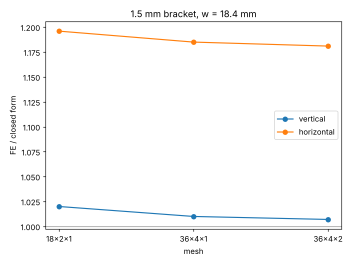

# simdesign-buckle15: does the lightest 1.5 mm bracket design clear buckling in a through-thickness-converged 3D model?

Follow-up in the simulation-first design track (`PROJECTS.md`, track 5), taking the "confirm the 1.5 mm design in the 3D shell model of `simdesign-webshell`" next step of `simdesign-bucklebound`. Produced with AI assistance (Claude). Stylised and preliminary: an ideal elastic perfect bar, nothing made or tested.

**Live page:** https://duncan-haywood.github.io/monorepo-projects/research/simdesign-buckle15/

**Builds on.** `simdesign-bucklebound` (the 1.5 mm design, w = 18.4 mm, 31.0 g, governed by a closed-form buckling factor of 3.5) and `simdesign-webshell` (the scikit-fem hexahedral eigenbuckling code, copied here unchanged as `src/simdesign_buckle15/eigbuckle.py`; its Euler-column validation is repeated in the tests). Closed forms are the cantilever lateral-torsional results of Timoshenko and Gere (1961), as in `simdesign-webbuckle`. It builds on none of the CU Boulder groups in `prompt.md`.

## Method
Same bracket: arms 80 mm, b = 1.5 mm, w = 18.4 mm, steel E = 200 GPa, ν = 0.30, F = 100 N. Vertical arm: cantilever of length 80 mm under end moment (F·(L − w/2) in the safety factor). Horizontal arm: cantilever of length L − w under a unit tip shear. Each is meshed with quadratic hexahedra at three resolutions, adding a second element layer through the thickness, which `simdesign-webshell` did not have.

## Reproduce
```bash
pip install numpy scipy scikit-fem pytest
cd research/simdesign-buckle15
python -m pytest -q tests        # 3 tests, about 20 s
python experiments/check.py      # about 5 min; writes experiments/check.txt
```

## Results (from `experiments/check.txt`)
Ratio of finite-element critical load to closed form:

| Mesh (nx, ny, nz) | vertical arm (governs) | horizontal arm |
|---|---|---|
| 18, 2, 1 | 1.020 | 1.196 |
| 36, 4, 1 | 1.010 | 1.185 |
| 36, 4, 2 | 1.007 | 1.181 |



Safety factor at 100 N on the finest mesh: vertical 3.49 (closed form 3.47), horizontal 15.6 (13.2).

- **The 3D model agrees with the closed form on the governing arm to under 1%, and the agreement improves with refinement, including through the thickness.** The 1.5 mm design's factor is 3.49, so it clears the floor of 3 used in `simdesign-bucklebound` in both the formula and the 3D model.
- **The horizontal-arm formula is conservative by about 18%**, as `simdesign-webshell` found at 2 mm; it never governs.
- **Refinement moved the ratios by 1 point or less** (vertical 1.020 → 1.007), shrinking monotonically; no extrapolation was done.

## Limitations
- One design, one gauge, one load case. Only the 1.5 mm design was checked; b = 1 mm remains blocked by the 1.2 mm minimum-wall rule, not buckling.
- Idealised boundary conditions: each arm is a full-clamped prismatic cantilever, not the L-bracket with a flexible corner. Perfect geometry, linear elastic, no imperfections or cut-edge residual stress, so the factors are upper bounds on real sheet and not margins.
- Mesh convergence is shown over three meshes, not proven; the finest has two layers through the thickness.
- Simulated (calculated) results only.

## Next steps
Model the whole L-shaped bracket as one 3D body to test the flexible corner; relax or justify the 1.2 mm minimum wall and rerun b = 1 mm with both the optimiser and this 3D check; repeat the mesh study at h = 1.0 mm in the stress model.

## Owner steps
None needed (simulation only).

## Outside dependencies (vitamins)
Open-source Python packages only (numpy, scipy, scikit-fem; pytest). Material, load and geometry are assumptions that real shop data would replace.
