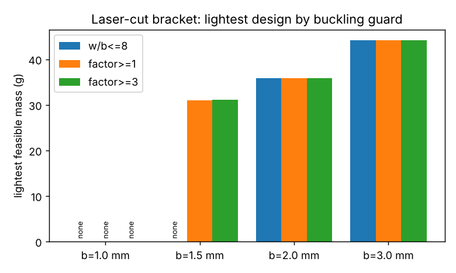

# simdesign-bucklebound: what changes when the w/b ≤ 8 slenderness ceiling is replaced by a buckling-factor floor?

Follow-up in the simulation-first design track (`PROJECTS.md`, track 5), taking the "replace the `MAX_SLENDER` guard with a lower bound on the governing factor and rerun the optimiser" next step of `simdesign-webbuckle`. Produced with AI assistance (Claude). Stylised; the buckling factor is a closed form that has not been validated against a shell model; preliminary.

**Builds on.** `simdesign-widerweb` (the bracket model, rule sets and optimiser, copied here so the project is self-contained) and `simdesign-webbuckle` (the lateral-torsional buckling closed forms in `src/simdesign_bucklebound/ltb.py`, copied unchanged; for their sources and caveats see that README). It builds on none of the CU Boulder groups in `prompt.md` and claims no connection to them.

## Method
Laser-cut steel sheet (E = 200 GPa, 100 MPa working stress, tip limit 4 mm, F = 100 N, arms 80 mm, assumed rule values as in `simdesign-dfm`). For each sheet gauge b in {1, 1.5, 2, 3} mm the optimiser (SciPy differential evolution, population 8, 25 generations, seeds 0 to 2, mesh h = 1.5 mm, peak von Mises) searches w in [2, 25] mm and r in [0, 15] mm for the least mass, under three guards against the out-of-plane buckling that the 2D model cannot see:

1. the old ceiling w/b ≤ 8;
2. a floor on the governing lateral-torsional buckling factor of 1;
3. a floor of 3 (an assumed round number, not a code requirement).

All other rules are unchanged. Reported: the lightest feasible design over the three seeds.

## Reproduce
```bash
pip install numpy scipy scikit-fem matplotlib shapely pytest
cd research/simdesign-bucklebound
python -m pytest -q tests        # 5 tests, under a second
python experiments/bound.py      # bound.txt, bound.json (about 2.5 minutes on 4 cores)
```

## Results (from `experiments/bound.txt`)
Lightest feasible design (mass in g; all peak stresses 99.8 to 100.0 MPa, i.e. the stress limit is active):

| Gauge b (mm) | w/b ≤ 8 | factor ≥ 1 | factor ≥ 3 |
|---|---|---|---|
| 1.0 | none | none | none |
| 1.5 | none | 31.00 (w 18.3, factor 3.45) | 31.06 (w 18.5, factor 3.48) |
| 2.0 | 35.79 (w 15.5) | 35.78 (w 15.5) | 35.82 (w 15.6) |
| 3.0 | 44.21 (w 12.6) | 44.21 | 44.21 |



- **At 1.5 mm the old ceiling makes the gauge infeasible, and the buckling floor does not.** w/b ≤ 8 caps w at 12 mm, where the stress limit cannot be met; with a buckling floor the optimiser finds a 31.0 g design with w ≈ 18.4 mm in all three seeds. That is 13% lighter than the best 2 mm design (35.8 g) and 30% lighter than the 3 mm one. Its buckling factor is 3.5, so it clears even the floor of 3 without the floor being active.
- **At 2 and 3 mm the guard does not matter.** The three guards give the same mass to within 0.1% (the differences are optimiser noise); the stress limit alone sets w, and the factor is 6.7 and 17.
- **At 1.0 mm nothing is feasible under any guard, and buckling is not the reason.** The geometric minimum-wall rule (1.2 mm for every process in `dfm.py`) rejects every 1.0 mm sheet before the simulation runs. Spot checks at b = 1 mm, w = 20 to 25 mm: the minimum-wall rule is violated by 17%, and the buckling factor is 1.1 to 1.5, which would pass a floor of 1 but not a floor of 3. So the rerun at b = 1 mm proposed in `simdesign-webbuckle` is blocked by that unrelated rule, which this project did not relax.

## Limitations
- The buckling factor is an ideal-bar closed form, unvalidated against a shell model (`simdesign-webshell` found its own gaps; read it before trusting the 1.5 mm design). Real sheet buckles earlier, so the factors are not margins. A design that passes a floor of 1 here may not be safe.
- One load case, one material, four gauges, three seeds, one mesh (h = 1.5 mm, which earlier projects show shifts feasible widths by about one scan step). The floor of 3 is an assumption. The differences at 2 and 3 mm are within optimiser noise and should not be read as an effect.
- The 1.5 mm gauge is a standard entry in the assumed stock list of this repository's rule set; real availability and cost per gauge were not looked at. Mass is the only objective.
- Simulated (calculated) results only; nothing was made or tested.

## Next steps
Relax or justify the 1.2 mm minimum wall and rerun b = 1 mm; confirm the 1.5 mm design (w = 18.4, r ≈ 10 to 13) in the 3D shell model of `simdesign-webshell`; repeat at h = 1.0 mm.

## Owner steps
None needed (simulation only).

## Outside dependencies (vitamins)
Open-source Python packages only (numpy, scipy, scikit-fem, shapely, matplotlib; pytest). Rule values, materials, load and the buckling floor are assumptions that real shop data would replace.
