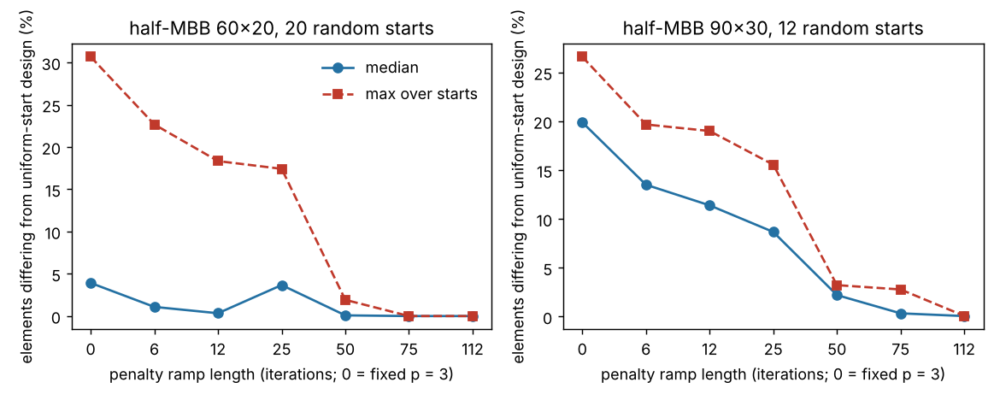

# simdesign-contlength: how short can SIMP penalty continuation be and still remove the start dependence?

How many iterations of penalty continuation (p ramped 1 → 3) does a SIMP topology optimiser need before its result stops depending on the starting density field? `simdesign-starts` found that continuation over half the run removes the dependence, but tried only that one length. I chose this because it is that project's first "next step", and it answers a practical question: how much of an iteration budget must go to the low-penalty phase. Answer on this problem: **a ramp of 25 iterations or fewer leaves most of the start dependence; 50 of 150 removes nearly all of it; a 112-iteration ramp is the most repeatable but ends at a worse compliance.** Produced with AI assistance (Claude). Stylised: 2D, dimensionless compliance, exactly 150 iterations, one problem, two meshes; nothing was made or tested physically.

**Live page:** https://duncan-haywood.github.io/monorepo-projects/research/simdesign-contlength/

**Builds on.** `simdesign-starts` (random starts, hole and disagreement measures, imported unchanged), `simdesign-topopt` (FE assembly, filter, half-MBB) and Sigmund (2001), "A 99 line topology optimization code written in Matlab", *Struct. Multidisc. Optim.* 21:120–127, <https://doi.org/10.1007/s001580050176>. Continuation: Sigmund and Petersson (1998), *Struct. Optim.* 16:68–75. It builds on none of the CU Boulder groups in `prompt.md`.

## Method
Half-MBB, volume fraction 0.5, final p = 3, sensitivity filter radius 1.5 elements, optimality-criteria update with move limit 0.2, **exactly 150 iterations**. The penalty goes 1, 1.5, 2, 2.5, 3 in equal steps over the first `ramp` iterations, then holds at 3; ramp 0 is plain fixed p = 3. Ramps 0, 6, 12, 25, 50, 75, 112. Starts: uniform noise of half-width 0.3 around 0.5, rescaled to volume 0.5, seeds 0..19 on 60×20 and 0..11 on 90×30, plus the uniform 0.5 start as the reference for each ramp. Reported: compliance at p = 3, spread (max/min − 1), the share of elements whose state (density > 0.5) differs from the uniform-start design *with the same ramp*, and enclosed holes. The ramp list and seeds were fixed before running.

## Reproduce
```bash
pip install numpy scipy matplotlib pytest
cd research/simdesign-contlength
python -m pytest -q tests          # 5 tests
python experiments/run.py          # writes experiments/results.txt and ramp.png (about 13 minutes)
```

## Results (from `experiments/results.txt`)
| mesh | ramp | uniform-start c | c min / median / max | spread | median / max element disagreement | holes (min–med–max) |
|---|---|---|---|---|---|---|
| 60×20 | 0 (fixed) | 203.21 | 203.19 / 203.58 / 206.10 | 1.43% | 3.9% / 30.7% | 2–2–5 |
| 60×20 | 6 | 203.19 | 202.87 / 203.25 / 203.84 | 0.48% | 1.1% / 22.7% | 2–2–4 |
| 60×20 | 12 | 203.20 | 202.78 / 203.19 / 204.22 | 0.71% | 0.3% / 18.3% | 2–2–4 |
| 60×20 | 25 | 203.09 | 202.87 / 203.11 / 204.60 | 0.85% | 3.7% / 17.4% | 4–4–4 |
| 60×20 | 50 | 203.04 | 203.03 / 203.04 / 203.06 | 0.01% | 0.08% / 1.9% | 4–4–4 |
| 60×20 | 75 | 203.08 | 203.07 / 203.08 / 203.08 | 0.01% | 0.0% / 0.0% | 4–4–4 |
| 60×20 | 112 | 203.55 | 203.55 / 203.55 / 203.56 | 0.00% | 0.0% / 0.0% | 4–4–4 |
| 90×30 | 0 (fixed) | 198.57 | 196.50 / 197.35 / 198.29 | 0.91% | 19.9% / 26.6% | 6–6–10 |
| 90×30 | 6 | 198.55 | 196.72 / 197.48 / 198.63 | 0.97% | 13.5% / 19.7% | 4–6–9 |
| 90×30 | 12 | 196.65 | 196.37 / 197.11 / 198.00 | 0.83% | 11.4% / 19.0% | 4–6–8 |
| 90×30 | 25 | 197.34 | 196.75 / 197.91 / 199.21 | 1.25% | 8.7% / 15.6% | 4–6–8 |
| 90×30 | 50 | 196.44 | 196.23 / 196.57 / 196.68 | 0.23% | 2.2% / 3.2% | 4–4–8 |
| 90×30 | 75 | 196.60 | 196.55 / 196.58 / 196.69 | 0.07% | 0.3% / 2.8% | 8–8–9 |
| 90×30 | 112 | 197.30 | 197.30 / 197.31 / 197.32 | 0.01% | 0.06% / 0.07% | 8–8–8 |

- **Short ramps do not help much.** For ramps of 6–25 iterations the worst random start still differs from the uniform-start design in 17–23% (60×20) and 16–20% (90×30) of elements, against 31% and 27% for a fixed penalty, and compliance spread is 0.5–1.3%. A short ramp is better than none but is not a fix.
- **The change happens between 25 and 50 iterations.** At 50 the spread is 0.01% (60×20) and 0.23% (90×30), and the worst disagreement 1.9% and 3.2%. At 75 (the `simdesign-starts` setting) it is smaller still on 60×20; on 90×30 the median disagreement is 0.3% but one start still differs in 2.8% of elements. Only the two meshes and these seven lengths locate the threshold, so "between 25 and 50" is a bracket, not a measured value.
- **Repeatability is not quality.** Longer ramps leave fewer iterations at full penalty, and the 112-iteration ramp ends worse: 203.55 against 203.04–203.08 (60×20) and 197.3 against 196.4–196.6 (90×30). In this budget the best compliance was at ramp 50 or 75, not at the most repeatable setting. Part of the 112 result may be unconverged designs; not tested.
- **The hole count depends on the ramp length too:** 4 holes at ramps ≥ 25 on 60×20, but 4 at ramp 50 and 8 at 75 on 90×30, so the same problem reaches different topologies at similar compliance (196.4 vs 196.6). Not explored further.
- Single-run uniform-start compliance varies with the ramp by up to about 1% on 90×30 (196.44–198.57), which is the same size as the start effect being measured.



## Tests
The schedule is fixed for ramp 0, rises 1 → 3 in five levels and holds; a short ramp reaches p = 3 early; the ramp-10 run over 20 iterations equals the `simdesign-starts` continuation run (same code path, to 1e-6); a short run holds the volume.

## Limitations
- One problem (half-MBB), two meshes, one filter radius, one volume fraction, one noise level (±0.3), a single 5-level penalty schedule varied only in length. 20 and 12 starts per cell; maxima over so few starts are noisy.
- 150 iterations, not run to convergence; compliance differences of a few tenths of a percent may be convergence rather than optima. Not checked with longer runs.
- Disagreement is measured against the uniform-start design of the same ramp, which is itself a single start.
- Not compared with published code or figures; no claim beyond this problem.

## Next steps
Run to convergence (e.g. 400 iterations) to separate slow convergence from distinct optima; refine the ramp between 25 and 50 and test whether the threshold scales with mesh size; repeat on a cantilever and a 3D case.

## Owner steps
None needed (simulation only).

## Outside dependencies (vitamins)
Open-source Python packages only (numpy, scipy, matplotlib; pytest for tests) plus `simdesign-topopt` and `simdesign-starts` in this repository. No hardware.
