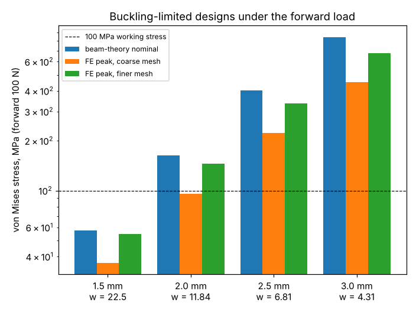

# simdesign-fwdcheck: do the reversed-load buckling-limited L-bracket designs also pass the forward-load buckling, stress and deflection checks?

Only the 1.5 mm design does. The lightest L-brackets that clear the reversed-load buckling floor of 3 (`simdesign-revgauge`) are 22.5, 11.84, 6.81 and 4.31 mm wide at 1.5, 2.0, 2.5 and 3.0 mm sheet. Under the ordinary forward 100 N load, all four clear buckling (factors 4.7 to 5.6), but the 2.5 and 3.0 mm designs are far over the 100 MPa stress and 4 mm deflection limits used elsewhere in the track, and the 2.0 mm design is over the stress limit once the mesh is refined (95.7 MPa coarse, 144.9 MPa finer). Follow-up in the simulation-first design track (`PROJECTS.md`, track 5), taking the "check the 2.0 mm, 11.8 mm design against the forward load, the stress and the minimum-wall constraints" next step of `simdesign-gaugelayers`. Produced with AI assistance (Claude). Stylised and preliminary: ideal elastic steel, sharp inner corner, assumed limits, nothing made or tested. It builds on none of the CU Boulder groups in `prompt.md`.

**Live page:** https://duncan-haywood.github.io/monorepo-projects/research/simdesign-fwdcheck/

**Builds on.** `simdesign-lbuckle` (the whole-L hexahedral model, imported from its `src/`), `simdesign-revgauge` (the four buckling-limited widths), `simdesign-revwidth` (plate mass) and, for the limits, `simdesign-minwall` and `simdesign-dfm` (100 MPa working stress, 4 mm tip limit, 1.2 mm minimum wall; all assumed values, not data). Peak-stress mesh dependence at a sharp corner is the finding of `simdesign-meshmargin` and `simdesign-patchstress`.

## Method
Steel (E = 200 GPa, &nu; = 0.3), 80 mm arms, 100 N downward on the end of the horizontal arm, vertical arm clamped on its top face. For each (b, w):
1. Forward buckling factor (critical load / 100 N), the same eigenbuckling as `simdesign-lbuckle` with the load sign reversed, coarse mesh (2, 18, 14, 1).
2. A linear static solve on the coarse mesh and on a finer in-plane mesh (4, 36, 28, 1): peak element-centroid von Mises stress outside the top w mm of the vertical arm (the clamp zone), and the mean end-face deflection.
3. A beam-theory nominal stress at the outer fibre of the vertical arm, F/(w b) + F (L &minus; w/2)(w/2)/(b w<sup>3</sup>/12), which has no corner concentration.

## Reproduce
```bash
pip install numpy scipy scikit-fem pytest matplotlib
cd research/simdesign-fwdcheck
python -m pytest -q tests        # 3 tests, about 35 s
python experiments/run.py        # about 7 min on one CPU core; writes experiments/results.txt
python experiments/plot.py       # writes experiments/stress.png
```

## Results (from `experiments/results.txt`)

| b (mm) | w (mm) | mass (g) | forward factor | nominal (MPa) | FE peak, coarse (MPa) | FE peak, finer (MPa) | deflection, coarse / finer (mm) |
|---|---|---|---|---|---|---|---|
| 1.5 | 22.5 | 36.4 | 5.61 | 57.3 | 36.7 | 54.7 | 0.142 / 0.143 |
| 2.0 | 11.84 | 27.5 | 5.15 | 162.8 | 95.7 | 144.9 | 0.944 / 0.949 |
| 2.5 | 6.81 | 20.5 | 4.92 | 402.3 | 222.8 | 337.0 | 4.45 / 4.47 |
| 3.0 | 4.31 | 15.8 | 4.67 | 845.9 | 452.7 | 676.0 | 15.5 / 15.5 |



- **Forward buckling never binds.** Every design has a forward factor of 4.7 or more, so the reversed load is the governing buckling case, as the earlier projects assumed.
- **Stress and deflection, not buckling, rule out the thick, narrow designs.** At 2.5 and 3.0 mm the stress is 2 to 8 times the limit on any measure and the deflection is 4.5 and 15.5 mm against 4 mm. The mass saving that `simdesign-revgauge` found for thicker sheet (36.4 g to 15.8 g) is a saving only if the stress and deflection limits are ignored.
- **The 2.0 mm, 11.84 mm design is marginal and its verdict depends on the mesh.** The coarse mesh gives 95.7 MPa (pass); the finer mesh gives 144.9 MPa and the beam-theory stress is 162.8 MPa (fail). Its deflection, 0.94 mm, is well inside 4 mm. As in `simdesign-patchstress`, a peak stress at a sharp corner is a moving target, so the pass on the coarse mesh should not be trusted.
- **The 1.5 mm, 22.5 mm design passes every check here**, with the stress at 37 to 57 MPa and deflection 0.14 mm; it is the only one of the four that does. Its mass, 36.4 g, is therefore the buckling-and-stress-feasible reference. The minimum wall (1.2 mm) is met by all four, both as sheet thickness and as width.
- The finer-mesh peaks are about 1.5 times the coarse ones at every gauge; the finer mesh is itself not shown to be converged, so they are lower bounds on the corner stress of the sharp-cornered model.

## Limitations
- Sharp inner corner (a fillet does not fit the tensor grid), so peak stresses are mesh-dependent and probably overstate what a real filleted part sees; the nominal stress, which has no concentration, still fails at 2.0 mm and above. A filleted check is a next step.
- Only one mesh refinement, one element layer through the thickness (`simdesign-gaugelayers` shows that layer count barely moves the buckling roots, not the stress).
- The limits (100 MPa working stress, 4 mm tip, 1.2 mm wall) and the 100 N load are assumptions inherited from earlier projects, not shop data. Whether a stress limit this low suits the steel is not examined. The clamp and the load application are idealised (full-face clamp, uniform end traction).
- Only the four buckling-limited widths are checked. A design that meets stress, deflection and buckling together would need its own search (`simdesign-minwall` and `simdesign-loadbind` do that in 2D with the closed-form buckling check).
- Simulated (calculated) results only.

## Next steps
Search for the lightest (b, w) that meets stress, deflection and reversed-load buckling together in the 3D model; add a true fillet on an unstructured mesh; check convergence of the stress with a third mesh.

## Owner steps
None needed (simulation only).

## Outside dependencies (vitamins)
Open-source Python packages only (numpy, scipy, scikit-fem, matplotlib; pytest).
