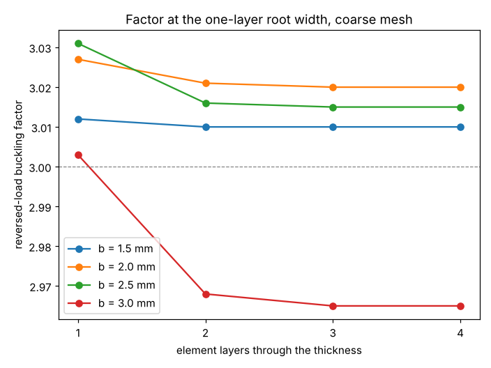

# simdesign-gaugelayers: do the reversed-load buckling widths of the L-bracket change with more element layers through the thickness?

Does a thicker sheet's lighter buckling-limited design survive a better through-thickness mesh? In the 3D eigenbuckling model of the L-bracket, going from one to two, three or four hexahedral layers through the sheet moves the buckling factor by 1.2% or less and the width needed for a factor of 3 by 0.07 mm or less, at 1.5, 2.0, 2.5 and 3.0 mm gauges. Follow-up in the simulation-first design track (`PROJECTS.md`, track 5), taking the "repeat the 2.0 and 2.5 mm cases with two or more element layers through the thickness" next step of `simdesign-revgauge`. Produced with AI assistance (Claude). Stylised and preliminary: ideal elastic sheet, sharp inner corner, buckling only, nothing made or tested. It builds on none of the CU Boulder groups in `prompt.md`.

**Builds on.** `simdesign-revgauge` (the one-layer roots 22.5, 11.84, 6.81 and 4.31 mm for 1.5, 2.0, 2.5 and 3.0 mm sheet, coarse mesh), `simdesign-revwidth` (width root-finding, plate mass) and `simdesign-lbuckle` (the whole-L hexahedral eigenbuckling model; geometry, load, clamp, material and the floor of 3 are its assumptions). Nothing of the model is changed here except the number of element layers.

## Method
Reversed load (vertical arm in compression), floor 3, coarse mesh (nw, nh, nl) = (2, 18, 14) in the plane, with nz = 1, 2, 3 or 4 layers of quadratic hexahedra through the thickness.
1. Part 1: at each gauge's one-layer root width from `simdesign-revgauge`, compute the lowest buckling factor (critical load / 100 N) for nz = 1 to 4. One layer gives about 3.0 by construction; the question is how far more layers move it.
2. Part 2: for nz = 2, compute the factor at w &minus; 0.3 mm and w + 0.3 mm around the one-layer root and interpolate linearly to the width where it equals 3 (the factor is near-linear over 0.6 mm; at 3.0 mm the two factors differ by 0.5, so that row is the least exact). Mass is the plan area times b times 7.85 g/cm&sup3;, as in `simdesign-revwidth`.

## Reproduce
```bash
pip install numpy scipy scikit-fem pytest matplotlib
cd research/simdesign-gaugelayers
python -m pytest -q tests        # 3 tests, about 1.5 min
python experiments/run.py        # about 25 min on one CPU core; writes experiments/layers.txt
python experiments/plot.py       # writes experiments/layers.png
```
`experiments/layers.txt` was produced in two invocations of `run.py`: the first (a bisection to a 0.1 mm bracket at two and three layers) was stopped after the first 11 rows of part 1, because part 2 would take most of an hour to confirm what part 1 already showed; `run.py` was then changed to the interpolation above and run to completion, skipping the rows already written. Those 11 rows are kept as written.

## Results (from `experiments/layers.txt`)
Factor at the one-layer root width:

| b (mm) | w (mm) | 1 layer | 2 | 3 | 4 |
|---|---|---|---|---|---|
| 1.5 | 22.5 | 3.012 | 3.010 | 3.010 | 3.010 |
| 2.0 | 11.84 | 3.027 | 3.021 | 3.020 | 3.020 |
| 2.5 | 6.81 | 3.031 | 3.016 | 3.015 | 3.015 |
| 3.0 | 4.31 | 3.003 | 2.968 | 2.965 | 2.965 |

Width at the floor of 3 with two layers (interpolated), against the one-layer root:

| b (mm) | one layer (mm) | two layers (mm) | shift (mm) | plate mass, two layers (g) |
|---|---|---|---|---|
| 1.5 | 22.50 | 22.45 | &minus;0.05 | 36.4 |
| 2.0 | 11.84 | 11.77 | &minus;0.07 | 27.4 |
| 2.5 | 6.81 | 6.78 | &minus;0.03 | 20.4 |
| 3.0 | 4.31 | 4.35 | +0.04 | 15.9 |



- **The through-thickness mesh does not move the roots.** Every gauge's factor changes by at most 1.2% (3.0 mm, one layer to two) and settles by three layers (the third and fourth layers change it in the fourth digit). The roots move 0.07 mm or less, inside the 0.1 mm bracket of `simdesign-revgauge`, so the 2.0 mm, 11.8 mm design and the mass ranking of gauges stand as that project reported them.
- The shift is the same sign for 1.5 to 2.5 mm (a little less width needed with more layers) and reverses at 3.0 mm; the sizes are small enough that this is not evidence of a trend.
- This removes one of the two modelling doubts `simdesign-revgauge` raised for gauges of 2.5 mm and above. It does not remove the other: a web 1.5 to 3 times as wide as the sheet is thick is outside the range where a plate-buckling picture is the only mode that matters.

## Limitations
- Coarse in-plane mesh only (2, 18, 14); `simdesign-revgauge` found the finer in-plane mesh moves the 1.5 mm root by 0.15 mm, and the two refinements were not combined here.
- Part 2 is an interpolation between two evaluations 0.6 mm apart, not a bisection, so its roots are accurate to a few hundredths of a millimetre at 1.5 to 2.5 mm and less so at 3.0 mm.
- Inherits every limitation of `simdesign-lbuckle` and `simdesign-revgauge`: sharp inner corner, idealised full-face clamp, uniform end traction, perfect elastic sheet (factors are upper bounds), an assumed floor of 3, buckling under the reversed load only (no stress, forward load or minimum-wall check), and that 2 to 3 mm sheet may not be available in the cutting process earlier projects assumed.
- Simulated (calculated) results only.

## Next steps
Check the 2.0 mm, 11.8 mm design against the forward load, the stress and the minimum-wall constraints; add a true fillet on an unstructured mesh; combine the finer in-plane mesh with two layers for the 2.0 mm root.

## Owner steps
None needed (simulation only).

## Outside dependencies (vitamins)
Open-source Python packages only (numpy, scipy, scikit-fem, matplotlib; pytest). Material, load, clamp and the floor of 3 are assumptions that real shop data would replace.
