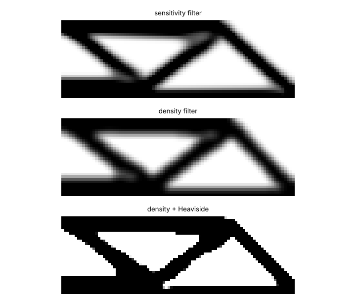

# simdesign-heaviside: does a density filter with Heaviside projection close the gap between a topology-optimised density field and the black-and-white part?

Follow-up to `simdesign-topopt` (track 5, `PROJECTS.md`), taking the next step listed in that README: a density filter with Heaviside projection and a minimum-feature check. It adds the filter, the projection and a beta continuation to the SIMP code, then compares three formulations on the half-MBB beam. Produced with AI assistance (Claude).

**Live page:** https://duncan-haywood.github.io/monorepo-projects/research/simdesign-heaviside/

**Builds on.** `simdesign-topopt` (this repository), whose finite-element solve, sensitivity and 99-line sensitivity filter are imported unchanged. Sigmund (2001), "A 99 line topology optimization code written in Matlab", *Struct. Multidisc. Optim.* 21(2):120–127, <https://doi.org/10.1007/s001580050176>. Density filtering: Bourdin (2001), "Filters in topology optimization", *Int. J. Numer. Methods Eng.* 50(2):2143–2158 (existence, title and journal confirmed from DTU and LSU records), and Bruns and Tortorelli (2001), "Topology optimization of non-linear elastic structures and compliant mechanisms", *Comput. Methods Appl. Mech. Eng.* 190(26–27):3443–3459 (title, year and role as a density-filter reference confirmed from secondary sources only; the volume and pages are from memory). Projection: Guest, Prévost and Belytschko (2004), "Achieving minimum length scale in topology optimization using nodal design variables and projection functions", *Int. J. Numer. Methods Eng.* 61(2):238–254, <https://doi.org/10.1002/nme.1064>; the tanh form and the continuation idea follow Wang, Lazarov and Sigmund (2011), "On projection methods, convergence and robust formulations in topology optimization", *Struct. Multidisc. Optim.* 43(6):767–784, <https://doi.org/10.1007/s00158-010-0602-y> (a correction notice exists, DOI 10.1007/s00158-022-03326-6; not consulted). Independent re-implementation from the published formulas; no code was copied and no published numbers are reproduced. It builds on none of the CU Boulder groups in `prompt.md` and claims no connection to them.

## Method
- `src/simdesign_heaviside/proj.py`: row-normalised cone density filter x̃ = H x (weights max(0, r_min − distance)); projection x_p = (tanh(βη) + tanh(β(x̃ − η))) / (tanh(βη) + tanh(β(1 − η))) with η = 0.5; compliance of x_p with SIMP p = 3; sensitivities by the chain rule through projection and filter (checked against finite differences in the tests); optimality-criteria update with the volume constraint (0.5) applied to the *projected* field; β continuation 1, 2, 4, 8, 16, 32, 64 with 30 iterations at each β (210 in all). The "density filter" mode is the same code with β = 0 and the 99-line stopping rule (change < 0.01, at most 200 iterations).
- Measures: *model compliance* (the field the optimiser sees); *discrete compliance* (threshold at the quantile that keeps the field's volume, re-analyse with solid 1 and void 0.001); their *gap*; grey share (0.1 < x < 0.9); checkerboard share; and a *minimum length scale* of the solid and void phases: the largest odd disc diameter (pixels) for which a morphological opening keeps at least 98% of the phase. The 98% allowance exists because round discs always round off convex corners; the measure is my own convenience measure, not a published standard, and is conservative for blocky shapes.
- Units are dimensionless (E_0 = 1, unit load, unit element), as in `simdesign-topopt`.

## Reproduce
```bash
pip install numpy scipy matplotlib pytest
cd research/simdesign-heaviside
python -m pytest -q tests            # 7 tests
python experiments/run.py            # writes experiments/results.txt and designs.png (about 3 minutes)
```
Runs are deterministic; each setting was run once.

## Results (from `experiments/results.txt`)
Half-MBB 90×30, volume fraction 0.5, p = 3, filter radius 3 elements:

| formulation | model compliance | discrete compliance | gap | grey share | iterations |
|---|---|---|---|---|---|
| sensitivity filter (`simdesign-topopt`) | 211.5 | 190.3 | −10.0% | 26.0% | 96 |
| density filter | 223.9 | 191.0 | −14.7% | 34.3% | 200 |
| density filter + Heaviside, β 1→64 | 192.1 | 192.0 | −0.1% | 0.6% | 210 |

- **The projection removes the gap between the model and the part, not the part's stiffness.** With the sensitivity or density filter the optimiser's field is grey, and re-analysing the thresholded part gives a compliance 10–15% below the model's, so the optimiser's number does not describe the part it hands over. With projection the two agree to 0.1%. The three discrete designs have the same compliance within 0.9% (190.3 to 192.0): in this problem the projection buys an honest model and a nearly black-and-white field, not a stiffer part. The Heaviside model value (192.1) looks best only because the other two models' values are inflated by grey.
- **Continuation matters.** At the same 210 iterations, starting at β = 16 gives 223.9 (model) and starting at β = 64 gives 344.8, against 192.1 with continuation: the late-β start freezes an early poor layout, a known weakness of projection without continuation (one run each, not a statistical claim).
- **Mesh refinement** at a fixed physical filter radius (3.33% of the beam length), 60×20, 120×40, 180×60: discrete compliance 189.6, 191.9, 193.9 with projection and 190.2, 190.7, 191.4 with the sensitivity filter; the model-to-part gap stays at 0.0 to −0.5% with projection and −9% to −11% with the sensitivity filter. Compliance is not converged in mesh (the projection values rise by 2.3% from the coarsest to the finest grid); three grids and one problem do not settle that.
- **Minimum length scale: the check did not show an advantage.** At 90×30 all three formulations score 3 px for solid and void. In the refinement study the minimum feature in pixels was 1, 3, 5/7 (projection) against 1, 3/5, 7 (sensitivity filter): features are about the same size relative to the beam (0.017 to 0.039 of the length) in both and neither formulation holds a constant physical minimum size as the mesh is refined. This is consistent with the literature's point that a single projection (η = 0.5) controls the filter-scale transition but does not by itself guarantee a length scale; the robust eroded/intermediate/dilated formulation of Wang, Lazarov and Sigmund (2011) was not implemented here.



## Tests
Projection limits (identity at β = 0, step at large β, monotone, fixed point at η), derivative against finite differences, filter preserves constants and rows sum to 1, the full chain-rule sensitivity of compliance against central finite differences on a random field, the length-scale measure on synthetic bars and blocks, checkerboard and grey counters, and volume and compliance of short optimisation runs.

## Limitations
- 2D plane stress, dimensionless, compliance minimisation on one problem (half-MBB). No stress, buckling or manufacturability constraint; no physical material or load.
- Single deterministic run per setting; local minima and the choice of β schedule, η, p and filter radius are not explored. The continuation schedule was fixed in advance, not tuned.
- The discrete re-analysis uses void stiffness 0.001, which makes the discrete part slightly stiffer than a true void would; this affects the sign of the gap and is shared by all formulations.
- The minimum-length-scale measure is homemade, uses a 98% retention allowance and a coarse pixel grid, and does not separate formulations here; it is not evidence that projection enforces a length scale.
- No comparison with published figures or code; nothing was built or tested physically.

## Next steps
Implement the robust (eroded, intermediate, dilated) formulation so a minimum length scale is actually enforced and measure it at constant physical size across meshes; add a minimum-feature constraint and export the projected design as a smoothed outline for `simdesign-dfm`-style process rules; 3D extension.

## Owner steps
None needed (simulation only).

## Outside dependencies (vitamins)
Open-source Python packages only (numpy, scipy, matplotlib; pytest for tests) plus the `simdesign-topopt` code in this repository. No hardware.
