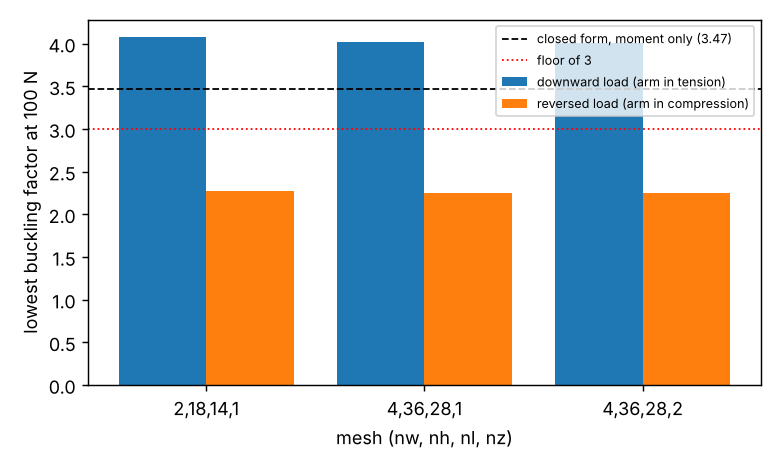

# simdesign-lbuckle: does the 1.5 mm bracket clear buckling when the whole L is one 3D body with a flexible corner?

Follow-up in the simulation-first design track (`PROJECTS.md`, track 5), taking the first next step of `simdesign-buckle15`: model the whole L-shaped bracket as one 3D body instead of two clamped arms. Produced with AI assistance (Claude). Stylised and preliminary: ideal elastic perfect sheet, sharp inner corner, nothing made or tested. It builds on none of the CU Boulder groups in `prompt.md`.

**Builds on.** `simdesign-bucklebound` (geometry, the 1.5 mm design w = 18.4 mm, load F = 100 N downward on the horizontal arm's end, vertical arm clamped at its top, closed-form factor 3.47) and `simdesign-buckle15` / `simdesign-webshell` (the scikit-fem hexahedral eigenbuckling procedure, re-implemented here for a non-prismatic body; it was validated against an Euler column and the cantilever formulas in those projects, and its pieces are reused unchanged).

## Method
One tensor hexahedral grid over the 80 × 80 mm square with the empty block (x > w, y > w) removed, giving an L with a **sharp** inner corner (a fillet does not fit a tensor grid; the real design has r of about 10 to 13 mm). Quadratic serendipity hexahedra, steel E = 200 GPa, ν = 0.30, b = 1.5 mm. Clamp: top face of the vertical arm. Load: uniform traction on the horizontal arm's end face, unit force, scaled by the eigenvalue. Linear buckling: solve K u = f, build the geometric stiffness from the stress, solve K φ = λ(−Kg)φ. Because the pre-stress comes from the full body, the **axial force and the corner flexibility that the closed form ignores are both included**. Two load directions: downward (the design case; vertical arm in tension) and reversed (vertical arm in compression), the latter as a sensitivity, not a stated requirement.

## Reproduce
```bash
pip install numpy scipy scikit-fem pytest matplotlib
cd research/simdesign-lbuckle
python -m pytest -q tests        # 3 tests, about 45 s
python experiments/check.py      # about 17 min; writes experiments/check.txt
python experiments/plot.py       # writes experiments/check.png
```

## Results (from `experiments/check.txt`)
Lowest buckling factor (critical load / 100 N):

| Mesh (nw, nh, nl, nz) | downward load | reversed load |
|---|---|---|
| 2, 18, 14, 1 | 4.078 | 2.267 |
| 4, 36, 28, 1 | 4.014 | 2.247 |
| 4, 36, 28, 2 | 4.006 | 2.245 |



- **Under the design load the whole-body factor is 4.01, above both the closed form (3.47) and the floor of 3.** The closed form is about 13% conservative here: it drops the tensile axial force, which stiffens the vertical arm against lateral-torsional buckling, and the flexible corner does not lower the factor below it.
- **Reversing the load drops the factor to 2.25, below the floor of 3 and 35% below the closed form.** The moment-only formula cannot see this case at all, so its 3.47 is not a bound on a bracket that may be pushed as well as pulled. If the reversed direction is a real use case, the 1.5 mm design does not clear a floor of 3 and would need a wider web or thicker sheet; this project did not redesign it.
- **Mesh refinement changed the factors by under 2% (downward 4.078 → 4.006; reversed 2.267 → 2.245) and monotonically**; no extrapolation was done.

## Limitations
- Sharp inner corner rather than the design's 10 to 13 mm fillet; a fillet would stiffen the corner and probably raise both factors, so the sharp-corner values are likely conservative. Not tested.
- One design, one gauge, one clamp (idealised full-face clamp), one load line (uniform end traction at the end face, not a bolt or contact load).
- Linear buckling of a perfect elastic body: no imperfections, residual stress or plasticity, so the factors are upper bounds on real sheet. The floor of 3 is an assumption from earlier projects.
- Three meshes, two layers through the thickness at most; convergence is shown, not proven.
- Simulated (calculated) results only; the sign convention for "downward" is read from `simdesign-bucklebound/model.py`.

## Next steps
Rebuild the corner with a true fillet on an unstructured hex or tetrahedral mesh; find the width that restores a factor of 3 for the reversed load and its mass cost; relax or justify the 1.2 mm minimum wall and rerun at b = 1 mm.

## Owner steps
None needed (simulation only).

## Outside dependencies (vitamins)
Open-source Python packages only (numpy, scipy, scikit-fem, matplotlib; pytest). Material, load, clamp and the floor of 3 are assumptions that real shop data would replace.
