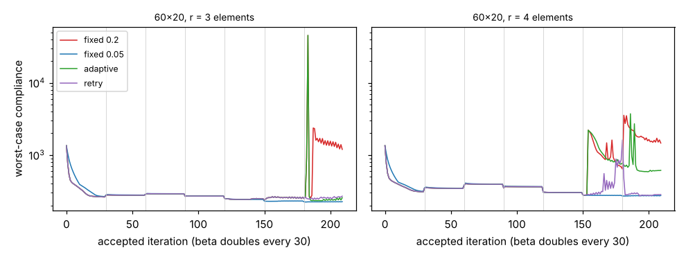

# simdesign-retry: does rolling back a robust topology-optimisation step that spikes compliance, and redoing it at half the move, beat shrinking the move afterwards?

Follow-up to `simdesign-robustadapt` (track 5, `PROJECTS.md`), taking the first of its listed next steps. Result: mostly, but not fully. On the same nine robust half-MBB cases, a fixed move of 0.2 failed in 5, the adaptive rule of `simdesign-robustadapt` in 2, reject-and-retry in 1, and fixed 0.1 and 0.05 in none. Retry fixed 60×20 r = 4 (adaptive did not) but only part-rescued r = 3.5 (364 against 737, still failing), and it still lost to a plain small fixed move on eroded-design quality. Produced with AI assistance (Claude). Stylised: 2D dimensionless compliance, one problem, one deterministic run per cell; nothing was made or tested physically.

**Live page:** https://duncan-haywood.github.io/monorepo-projects/research/simdesign-retry/

**Builds on.** `simdesign-robustadapt` (adaptive rule, imported for comparison; `MoveRule`, `run_rule`), `simdesign-robustmove` (spike counter and failure criterion), `simdesign-robust`, `simdesign-heaviside`, `simdesign-topopt`. Wang, Lazarov and Sigmund (2011), *Struct. Multidisc. Optim.* 43(6):767–784, <https://doi.org/10.1007/s00158-010-0602-y>, for the eroded / blueprint / dilated formulation. It builds on none of the CU Boulder groups in `prompt.md`.

## Method
Robust formulation (threshold gap 0.2), half-MBB, volume 0.5, p = 3, β = 1, 2, …, 64, 30 accepted iterations each. Cases as before: 60×20 at filter radii 2–5 elements (six) and 120×40 at 4, 6, 8. Rules for the optimality-criteria move limit: fixed 0.2, 0.1, 0.05; the adaptive rule (halve after a >3× spike, floor 0.025); and **retry**: after the OC update, evaluate the new field; if its worst-case compliance is more than 3× the previous accepted iteration's, discard it and redo the OC step from the previous field (same stored gradient) at half the move, up to 3 times and down to 0.025. The halved move persists and grows ×1.25 (cap 0.2) after 10 calm iterations. Constants were chosen before running, not tuned. A run *fails* if its blueprint compliance exceeds 1.5× the best of all rules at the same case (my criterion, as before). Retry costs extra finite-element evaluations, counted in the table.

## Reproduce
```bash
pip install numpy scipy matplotlib pytest
cd research/simdesign-retry
python -m pytest -q tests          # 4 tests
python experiments/run.py          # writes experiments/results.txt and history.png (about 25 minutes)
```

## Results (from `experiments/results.txt`)
Blueprint compliance; failures in bold. "rej" is the number of rolled-back steps.

| mesh | r | fixed 0.2 | fixed 0.1 | fixed 0.05 | adaptive | retry (rej) |
|---|---|---|---|---|---|---|
| 60×20 | 2.0 | 196.1 | 195.3 | 196.6 | 196.1 | 196.1 (0) |
| 60×20 | 2.5 | 202.0 | 198.0 | 199.9 | 201.9 | 202.3 (1) |
| 60×20 | 3.0 | **741.9** | 199.8 | 200.3 | 201.6 | 201.2 (1) |
| 60×20 | 3.5 | **737.2** | 206.3 | 200.6 | **746.9** | **364.3** (2) |
| 60×20 | 4.0 | **746.7** | 202.1 | 201.3 | **356.5** | 200.9 (3) |
| 60×20 | 5.0 | **949.9** | 236.6 | 230.7 | 229.3 | 228.2 (4) |
| 120×40 | 4.0 | 194.7 | 193.4 | 193.7 | 194.7 | 194.7 (0) |
| 120×40 | 6.0 | 200.4 | 197.9 | 198.3 | 200.4 | 200.4 (0) |
| 120×40 | 8.0 | **402.7** | 203.7 | 203.4 | 206.4 | 203.4 (2) |

Failures: fixed 0.2, 5 of 9; fixed 0.1, 0; fixed 0.05, 0; adaptive, 2; retry, 1. Mean blueprint compliance relative to the best rule: 2.37, 1.01, 1.00, 1.40, 1.10. Retry used 1–4 extra evaluations (at most 2% more) in the cases where it acted.

- **Reject-and-retry removes the "first bad step is taken" problem in 4 of the 5 cases where fixed 0.2 fails.** It rescues r = 3, 4, 5 and 120×40 r = 8, and halves the damage at r = 3.5. The one failure is a part-rescue at 60×20 r = 3.5 (364 vs 737, best 200).
- **Where a rollback is not enough:** at r = 3.5 two rollbacks were taken, but the damage is not a single spike the 3× test catches. This was not investigated further; the failure mechanism is still untested.
- **Eroded design quality is the weak spot of every non-small rule.** Mean eroded compliance relative to the best: fixed 0.05, 1.00; retry, 1.22 (max 2.14); adaptive, 2.67; fixed 0.2, 3.23; fixed 0.1, 3.77. Fixed 0.1 passes the blueprint test in all nine cases but at 60×20 r = 5 its eroded compliance is 9 762 against 385 for fixed 0.05, so blueprint-only criteria hide a poor robust design.
- **The cliff for the blueprint criterion is not between 0.05 and 0.1 here:** fixed 0.1 passes all nine. Whether it lies between 0.1 and 0.2 was not located (no intermediate values run).
- The simple answer from this chain still stands: **use a small fixed move (0.05 here)**. Retry is the best of the reactive rules and costs almost nothing, but it never beat fixed 0.05.



## Tests
With the spike threshold at infinity the run equals a fixed-0.2 run (to 6 places) with zero rollbacks and 6 evaluations; runs are deterministic; forced rollbacks respect the floor and cap and the evaluation count equals accepted iterations plus rollbacks; the default rule runs to full length.

## Limitations
- One problem (half-MBB), two meshes, one deterministic run per cell; one retry parameter set (spike 3, 3 retries, floor 0.025), not tuned or swept.
- Failure criterion is mine and blueprint-only; the eroded numbers show it is lenient.
- The failure mechanism (member break) is still untested: no eroded-field connectivity logging.
- 2D, dimensionless; not compared with published figures or code.

## Next steps
Log eroded-field connectivity per iteration to test the member-break mechanism; locate the blueprint cliff between 0.1 and 0.2 and the eroded-quality cliff around 0.05–0.1; a spike test on eroded compliance rather than the worst case; then the continuous thickness measure left open by `simdesign-robustmesh`.

## Owner steps
None needed (simulation only).

## Outside dependencies (vitamins)
Open-source Python packages only (numpy, scipy, matplotlib; pytest for tests) plus sibling `simdesign-*` projects in this repository. No hardware.
