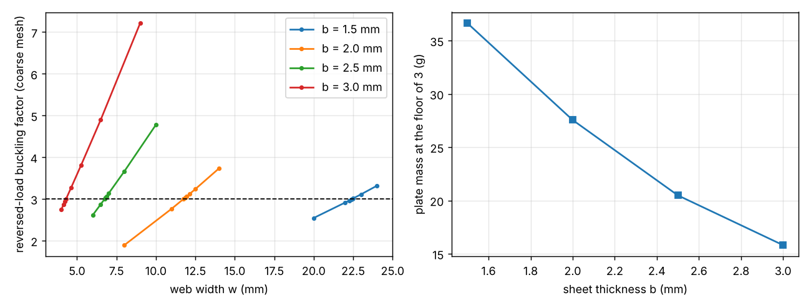

# simdesign-revgauge: is a thicker sheet lighter than a wider 1.5 mm web for the reversed-load buckling floor?

Follow-up in the simulation-first design track (`PROJECTS.md`, track 5), taking a next step of `simdesign-revwidth`: that project cleared the reversed-load buckling floor of 3 by widening the 1.5 mm web from 18.4 to about 22.6 mm (+5.9 g). Here the same floor is reached by raising the sheet thickness instead, and the plate masses are compared. Produced with AI assistance (Claude). Stylised and preliminary: ideal elastic sheet, sharp inner corner, buckling only, nothing made or tested. It builds on none of the CU Boulder groups in `prompt.md`.

**Live page:** https://duncan-haywood.github.io/monorepo-projects/research/simdesign-revgauge/

**Builds on.** `simdesign-revwidth` (width bisection, plate mass) and, through it, `simdesign-lbuckle` (whole-L 3D hexahedral eigenbuckling model; geometry, load, clamp, material and the floor of 3 are its assumptions).

## Method
For each gauge b = 1.5, 2.0, 2.5 and 3.0 mm and the reversed load (vertical arm in compression), bisect for the smallest web width w whose lowest buckling factor (critical load / 100 N) is at least 3, on the coarse mesh (2, 18, 14, 1) to a bracket under 0.1 mm. For 1.5, 2.0 and 2.5 mm repeat on the finer mesh (4, 36, 28, 1) in a bracket of plus or minus 0.6 mm around the coarse root. Mass is the L's plan area (160w &minus; w&sup2; mm&sup2;) times b times 7.85 g/cm&sup3;, as in `simdesign-revwidth` (corner fillet ignored). Each reported root is the upper end of the final bracket, which is up to about 0.1 mm wide.

## Reproduce
```bash
pip install numpy scipy scikit-fem pytest matplotlib
cd research/simdesign-revgauge
python -m pytest -q tests        # 4 tests, about 1 min
python experiments/run.py        # about 1.5 h on one CPU core; writes experiments/sweep.txt
python experiments/plot.py       # writes experiments/sweep.png
```

## Results (from `experiments/sweep.txt`)
| gauge b (mm) | width at floor, coarse (mm) | width at floor, finer mesh (mm) | plate mass at the floor, finer mesh (g) | change vs 1.5 mm |
|---|---|---|---|---|
| 1.5 | 22.50 | 22.65 | 36.6 | |
| 2.0 | 11.84 | 11.84 | 27.5 | &minus;25% |
| 2.5 | 6.81 | 6.81 | 20.5 | &minus;44% |
| 3.0 | 4.31 | not run | 15.8 (coarse) | &minus;57% |



- **In this model a thicker sheet is much lighter at the floor.** The factor rises steeply with b at fixed w, so the required width falls much faster than the thickness grows: 2 mm needs a web about half as wide as 1.5 mm and weighs about 9 g less than the 22.6 mm, 1.5 mm design.
- Coarse and finer meshes agree to within 0.15 mm in width at 1.5 mm and to within the 0.1 mm bracket at 2.0 and 2.5 mm (the two roots coincide at 11.844 and 6.812 mm only because the finer-mesh bisection's midpoints fell on them; the finer-mesh root is bracketed to (11.77, 11.84] and (6.74, 6.81] mm).
- The trend, not the last digit, is the result: the mass keeps falling to 3 mm, where the web is only 4.3 mm wide, which says the model is being pushed out of the range where it means much (see below).

## Limitations
- Inherits every limitation of `simdesign-lbuckle` and `simdesign-revwidth`: sharp inner corner, idealised full-face clamp, uniform end traction, perfect elastic sheet (factors are upper bounds), an assumed floor of 3, one through-thickness element layer.
- **One layer of hexahedra through the thickness is a weak model of a thick section**, and widths of 4 to 7 mm give a web only 1.5 to 3 times as wide as the sheet is thick, so plate-like buckling is no longer the only mode that matters. Gauges of 2.5 mm and above should be read as an indication, not a design.
- Buckling under the reversed load only. Not checked: the forward design load, stiffness, peak stress, the slenderness and minimum-wall rules of earlier projects, bending of the narrow web, and that 2 to 3 mm sheet may not be available in the cutting process the earlier projects assumed.
- The 3.0 mm row is coarse-mesh only; no finer-mesh run at 3.0 mm and none at gauges between those listed.
- Simulated (calculated) results only.

## Next steps
Check the 2.0 mm, 11.8 mm design against the forward load, the stress and the minimum-wall constraints; repeat the 2.0 and 2.5 mm cases with two or more element layers through the thickness to see if the roots move; add a true fillet on an unstructured mesh.

## Owner steps
None needed (simulation only).

## Outside dependencies (vitamins)
Open-source Python packages only (numpy, scipy, scikit-fem, matplotlib; pytest). Material, load, clamp and the floor of 3 are assumptions that real shop data would replace.
