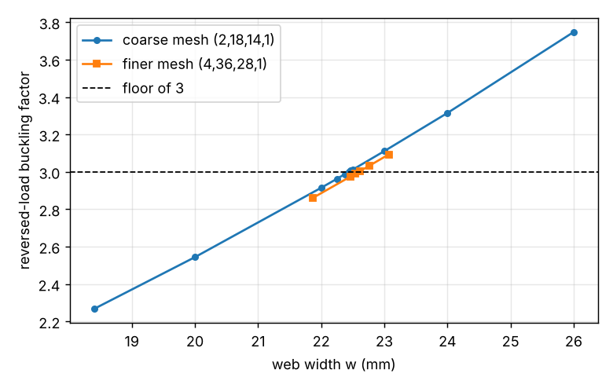

# simdesign-revwidth: how wide must the 1.5 mm L-bracket be to clear the buckling floor when the load is reversed?

Follow-up in the simulation-first design track (`PROJECTS.md`, track 5), taking a next step of `simdesign-lbuckle`: that project found the 1.5 mm, w = 18.4 mm bracket clears the floor of 3 under the design load (4.01) but not reversed (2.25) and did not redesign it. Here the web width is increased until the reversed-load factor reaches 3, and the mass cost is reported. Produced with AI assistance (Claude). Stylised and preliminary: ideal elastic sheet, sharp inner corner, nothing made or tested. It builds on none of the CU Boulder groups in `prompt.md`.

**Live page:** https://duncan-haywood.github.io/monorepo-projects/research/simdesign-revwidth/

**Builds on.** `simdesign-lbuckle` (the whole-L 3D hexahedral eigenbuckling model, imported unchanged from its `src/`; geometry, load, clamp, material and the floor of 3 are all its assumptions).

## Method
For b = 1.5 mm and the reversed load (vertical arm in compression), compute the lowest buckling factor (critical load / 100 N) at widths w = 18.4 to 26 mm, then bisect for the smallest w whose factor is at least 3. Done on the coarse mesh of `simdesign-lbuckle` (2, 18, 14, 1), then on its finer mesh (4, 36, 28, 1) in a bracket of plus or minus 0.6 mm around the coarse root, stopping at a bracket under 0.1 mm. Mass is the L's plan area (160w &minus; w&sup2; mm&sup2;) times b times 7.85 g/cm&sup3;; it ignores the design's corner fillet, so it is about the plate mass of the sharp-cornered model, not the 31.0 g of earlier projects.

## Reproduce
```bash
pip install numpy scipy scikit-fem pytest matplotlib
cd research/simdesign-revwidth
python -m pytest -q tests        # 4 tests, about 35 s
python experiments/run.py        # about 20 min; writes experiments/sweep.txt
python experiments/plot.py       # writes experiments/sweep.png
```

## Results (from `experiments/sweep.txt`)
| w (mm) | factor, coarse mesh | factor, finer mesh | mass (g) |
|---|---|---|---|
| 18.4 | 2.267 | 2.247 (from `simdesign-lbuckle`) | 30.68 |
| 20 | 2.544 | | 32.97 |
| 22 | 2.915 | | 35.75 |
| 22.469 | 3.006 | 2.976 | 36.39 |
| 22.544 | | 2.991 | 36.49 |
| 22.619 | | 3.005 | 36.59 |
| 24 | 3.315 | | 38.43 |
| 26 | 3.748 | | 41.02 |



- **Coarse-mesh root: w = 22.47 mm; finer-mesh root: between 22.54 (factor 2.991) and 22.62 mm (3.005).** The finer mesh moves the root by about 0.15 mm (under 1%).
- **Mass cost: from 30.68 g to 36.6 g, +5.9 g (+19%)** for a reversed-load factor of 3 at b = 1.5 mm in this model. The factor rises about 0.22 per extra mm of width near the root (finer mesh).
- The factor is monotone in w over the sweep, which the bisection assumes; only 5 widths were scanned beyond the bisection points.

## Limitations
- Inherits every limitation of `simdesign-lbuckle`: sharp inner corner (a fillet would probably raise the factor and lower the needed width, not tested), idealised full-face clamp, uniform end traction, perfect elastic sheet (factors are upper bounds), and a floor of 3 that is an assumption.
- A wider web may violate other constraints of earlier projects (the slenderness rule, peak stress, the fitted envelope); this project checks buckling only.
- Reversed loading is a sensitivity case, not a stated requirement.
- One gauge (1.5 mm), two meshes, one through-thickness layer; the finer-mesh root is a bracket, not an extrapolated value.
- Simulated (calculated) results only.

## Next steps
Check the 22.6 mm design against the stress, slenderness and minimum-wall constraints; rebuild the corner with a true fillet on an unstructured mesh; ask whether a thicker gauge (2 mm) is lighter than a wider 1.5 mm web for the reversed case.

## Owner steps
None needed (simulation only).

## Outside dependencies (vitamins)
Open-source Python packages only (numpy, scipy, scikit-fem, matplotlib; pytest). Material, load, clamp and the floor of 3 are assumptions that real shop data would replace.
