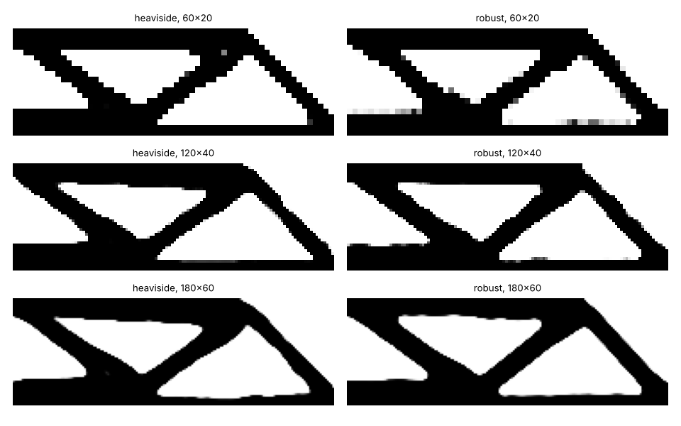

# simdesign-robust: does a topology-optimised beam survive a 0.2 threshold error, and what does the robust formulation cost?

Follow-up to `simdesign-heaviside` (track 5, `PROJECTS.md`), taking the next step listed in that README: implement the robust eroded / blueprint / dilated formulation and ask whether it enforces a minimum length scale across meshes. It does not (negative result below); what it buys is robustness to over- and under-etch. Produced with AI assistance (Claude). Stylised: 2D dimensionless compliance, one problem, one run per setting; nothing was made or tested.

**Live page:** https://duncan-haywood.github.io/monorepo-projects/research/simdesign-robust/

**Builds on.** `simdesign-heaviside` (density filter, tanh projection and measures, imported unchanged) and `simdesign-topopt` (this repository). Wang, Lazarov and Sigmund (2011), "On projection methods, convergence and robust formulations in topology optimization", *Struct. Multidisc. Optim.* 43(6):767–784, <https://doi.org/10.1007/s00158-010-0602-y> (a correction notice exists, DOI 10.1007/s00158-022-03326-6; not consulted). Independent re-implementation of the idea from that paper's description; no code copied, no published numbers reproduced, and the thresholds and the worst-case rule below are my choices. It builds on none of the CU Boulder groups in `prompt.md` and claims no connection to them.

## Method
- The filtered field is projected at three thresholds: eroded η = 0.7, blueprint η = 0.5, dilated η = 0.3 (Δη = 0.2, arbitrary). Each iteration solves all three finite-element problems, takes the one with the largest compliance, and uses its sensitivity; the volume fraction 0.5 is held on the blueprint. β continuation 1, 2, 4, 8, 16, 32, 64, 30 iterations each, as in `simdesign-heaviside`. Δη = 0 reduces to that code (tested).
- Comparison: the plain Heaviside design (η = 0.5 only) is re-analysed at the same three thresholds, so both are judged by the same erosion and dilation. Half-MBB beam, volume 0.5, p = 3, cone filter radius 3.33% of the beam length, meshes 60×20, 120×40, 180×60.
- Measures: compliance at the three thresholds; spread c_eroded / c_dilated − 1; grey share and the 98% opening-rule minimum length scale of `simdesign-heaviside` on the blueprint thresholded at 0.5.

## Reproduce
```bash
pip install numpy scipy matplotlib pytest
cd research/simdesign-robust
python -m pytest -q tests          # 3 tests
python experiments/run.py          # writes experiments/results.txt and designs.png (about 11 minutes)
```

## Results (from `experiments/results.txt`)
| mesh | formulation | c eroded | c blueprint | c dilated | grey (blueprint) | Ms / Mv (px) |
|---|---|---|---|---|---|---|
| 60×20 | Heaviside | 4.4×10⁹ | 189.6 | 181.6 | 0.2% | 1 / 1 |
| 60×20 | robust | 223.8 | 196.1 | 170.8 | 2.2% | 1 / 1 |
| 120×40 | Heaviside | 2.1×10⁹ | 192.9 | 173.4 | 1.4% | 3 / 3 |
| 120×40 | robust | 226.3 | 194.7 | 177.0 | 1.4% | 3 / 5 |
| 180×60 | Heaviside | 1.2×10⁵ | 194.7 | 174.9 | 1.2% | 5 / 7 |
| 180×60 | robust | 223.5 | 196.3 | 178.6 | 1.7% | 5 / 7 |

- **The plain Heaviside design is not robust to a 0.2 threshold error.** Eroding it (η = 0.7) disconnects at least one member on every mesh: compliance 10⁵ to 10⁹ against about 190, i.e. the structure no longer carries the load. (The huge values are the stiffness-floor artefact of a disconnected model, not a quantity to quote; the point is only "fails".) The robust design's eroded compliance is 224–226 on all three meshes, 14–16% above its blueprint.
- **The price is small on the nominal design.** Blueprint compliance is 3.4%, 0.9% and 0.8% higher than Heaviside's (196.1 vs 189.6, 194.7 vs 192.9, 196.3 vs 194.7), at three finite-element solves per iteration (about 2.5× the wall time here: 343 s against 140 s at 180×60).
- **No length-scale gain (negative).** The minimum feature in pixels is 1/1, 3/5, 5/7 for the robust design against 1/1, 3/3, 5/7 for Heaviside; as a share of the beam length it is the same to within a pixel (Ms/nx 0.017, 0.025, 0.028 in both). This repeats the `simdesign-heaviside` finding for the robust formulation: it controls how the part degrades under an etch error, but this measure does not show it fixing a physical minimum size. The measure is homemade and coarse, so this says "not shown", not "absent".



## Tests
Δη = 0 reproduces the Heaviside design and compliance to 1e-9; eroded ≤ blueprint ≤ dilated in material, blueprint volume at 0.5, eroded compliance ≥ dilated, and determinism.

## Limitations
- One problem (half-MBB), one run per setting, 2D plane stress, dimensionless. Δη, β schedule, the worst-of-three rule and the volume on the blueprint are not tuned or varied.
- Thresholding the filtered field stands in for etch error; real over/under-etch is geometric, not a density threshold. The spread says nothing about a physical process.
- Meshes are not converged in the length scale (it grows with mesh in pixels); three grids do not settle how it scales.
- Not compared with published figures or code.

## Next steps
Vary Δη and the filter radius (the length-scale control in the paper comes from their relation); try a minimum-feature constraint or the robust formulation with a larger radius; export the blueprint for `simdesign-dfm`-style process rules; 3D.

## Owner steps
None needed (simulation only).

## Outside dependencies (vitamins)
Open-source Python packages only (numpy, scipy, matplotlib; pytest for tests). The beam, material, load and thresholds are assumptions.
