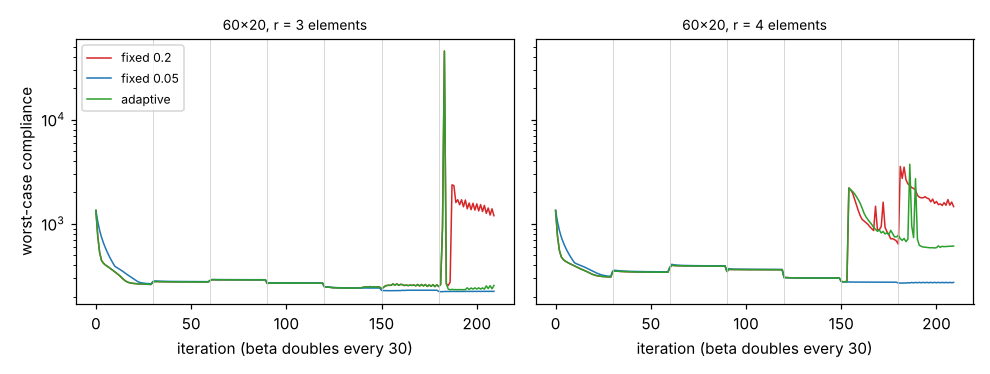

# simdesign-robustadapt: can an adaptive move limit that shrinks after a compliance spike rescue a robust topology optimisation as well as a fixed small one?

Follow-up to `simdesign-robustmove` (track 5, `PROJECTS.md`), taking the first of its listed next steps: does a move limit that shrinks after a spike do as well as a fixed small one? Result: not reliably. On the same nine cases, a fixed move of 0.2 failed in 5, a fixed 0.05 in none, and the adaptive rule in 2, because it can only react after the damaging step has been taken. Produced with AI assistance (Claude). Stylised: 2D dimensionless compliance, one problem, one deterministic run per cell; nothing was made or tested physically.

**Live page:** https://duncan-haywood.github.io/monorepo-projects/research/simdesign-robustadapt/

**Builds on.** `simdesign-robustmove` (spike counter and failure criterion, imported), `simdesign-robust` (the robust loop, re-written here with a per-iteration move limit; same formulas, a fixed 0.2 run reproduces `robust_topopt` to 6 places, tested), `simdesign-heaviside`, `simdesign-topopt`. Wang, Lazarov and Sigmund (2011), *Struct. Multidisc. Optim.* 43(6):767–784, <https://doi.org/10.1007/s00158-010-0602-y>, for the eroded / blueprint / dilated formulation. It builds on none of the CU Boulder groups in `prompt.md`.

## Method
Robust formulation (threshold gap 0.2), half-MBB, volume 0.5, p = 3, β = 1, 2, …, 64, 30 iterations each. Cases as in `simdesign-robustmove`: 60×20 at filter radii 2–5 elements (six) and 120×40 at 4, 6, 8. Three rules for the optimality-criteria move limit: fixed 0.2; fixed 0.05; adaptive: start at 0.2, halve (floor 0.025) after an iteration whose worst-case compliance is more than 3× the previous one, multiply by 1.25 (cap 0.2) after 10 calm iterations. The adaptive constants were chosen by me before running and not tuned. A run *fails* if its blueprint compliance exceeds 1.5× the best of the three rules at the same case (my criterion, as before).

## Reproduce
```bash
pip install numpy scipy matplotlib pytest
cd research/simdesign-robustadapt
python -m pytest -q tests          # 4 tests
python experiments/run.py          # writes experiments/results.txt and history.png (about 15 minutes)
```

## Results (from `experiments/results.txt`)
Blueprint compliance; failures in bold.

| mesh | r | fixed 0.2 | fixed 0.05 | adaptive |
|---|---|---|---|---|
| 60×20 | 2.0 | 196.1 | 196.6 | 196.1 |
| 60×20 | 2.5 | 202.0 | 199.9 | 201.9 |
| 60×20 | 3.0 | **741.9** | 200.3 | 201.6 |
| 60×20 | 3.5 | **737.2** | 200.6 | **746.9** |
| 60×20 | 4.0 | **746.7** | 201.3 | **356.5** |
| 60×20 | 5.0 | **949.9** | 230.7 | 229.3 |
| 120×40 | 4.0 | 194.7 | 193.7 | 194.7 |
| 120×40 | 6.0 | 200.4 | 198.3 | 200.4 |
| 120×40 | 8.0 | **402.7** | 203.4 | 206.4 |

Failures: fixed 0.2, 5 of 9; fixed 0.05, 0 of 9; adaptive, 2 of 9. Mean blueprint compliance relative to the best of the three: 2.36, 1.00 and 1.39.

- **The adaptive rule rescues three of the five failures** (60×20 r = 3 and 5, 120×40 r = 8) and only part-rescues r = 4 (356 against 747, still failing). At r = 3.5 it changed nothing (747).
- **Why it cannot be as good as a fixed small move:** it shrinks the step after the 3× jump has happened, so the first bad step is taken at 0.2 in every failing case. Runs that never spike stay at 0.2 and are identical to fixed 0.2 (e.g. 120×40 r = 4 and 6, 60×20 r = 2).
- **Blueprint compliance hides a poor eroded design in one case:** 120×40, r = 8, adaptive: blueprint 206.4 (passes) but eroded compliance 2 838.9 against 284.0 for fixed 0.05. By the blueprint-only criterion this "ok"; as a robust design it is poor. Eroded values for every run are in `results.txt`.
- The simple answer from this chain stays: **use a small fixed move (0.05 here)**. It cost nothing visible in the blueprint in any of these nine cases.



## Tests
Fixed rule never changes; adaptive halves on a spike and respects its floor; adaptive recovers after calm iterations but not above its start; runs are deterministic and a fixed-0.2 run matches `simdesign-robustmove`'s run to 6 places.

## Limitations
- One problem (half-MBB), two meshes, one deterministic run per cell; one adaptive parameter set, not tuned or swept. A more cautious rule (smaller spike factor, or reject-and-retry the step) might do better and was not tried.
- Failure criterion is mine and blueprint-only (see the eroded caveat above).
- The failure mechanism is still untested (no eroded-field connectivity logging).
- 2D, dimensionless; not compared with published figures or code.

## Next steps
Reject-and-retry: roll the step back and redo it at half the move when the 3× spike appears, which removes the "first bad step is taken" problem; log eroded-field connectivity per iteration to test the member-break mechanism; locate the cliff between 0.1 and 0.2; then the continuous thickness measure left open by `simdesign-robustmesh`.

## Owner steps
None needed (simulation only).

## Outside dependencies (vitamins)
Open-source Python packages only (numpy, scipy, matplotlib; pytest for tests) plus sibling `simdesign-*` projects in this repository. No hardware.
