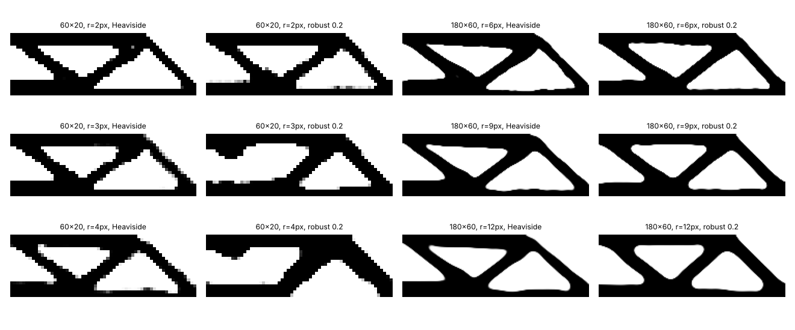

# simdesign-robustmesh: does the minimum feature of a robust topology-optimised beam follow the filter radius when the mesh is refined?

Follow-up to `simdesign-robustradius` (track 5, `PROJECTS.md`), taking its first listed next step: repeat the sweep on a second mesh to separate the radius in elements from the radius as a share of the beam. Result: it is the grid, not the radius, that sets the smallest member here (negative for radius control). Produced with AI assistance (Claude). Stylised: 2D dimensionless compliance, one problem, one run per row; nothing was made or tested.

**Live page:** https://duncan-haywood.github.io/monorepo-projects/research/simdesign-robustmesh/

**Builds on.** `simdesign-robustradius` (the 120×40 rows are read from its `results.txt`), `simdesign-robust`, `simdesign-heaviside`, `simdesign-topopt` (imported unchanged). Wang, Lazarov and Sigmund (2011), *Struct. Multidisc. Optim.* 43(6):767–784, <https://doi.org/10.1007/s00158-010-0602-y>; its length-scale claims were not checked or reproduced. It builds on none of the CU Boulder groups in `prompt.md`.

## Method
Half-MBB beam, volume 0.5, p = 3, β 1…64 (30 iterations each). Meshes 60×20 and 180×60; filter radius 1/30, 1/20, 1/15 of the beam length (2, 3, 4 and 6, 9, 12 elements; 1/60 was dropped because a 1-element radius is no filter and the update divides by zero). Plain Heaviside (gap 0) and robust (gap 0.2); every design re-analysed at 0.5 ± 0.2. Ms, Mv: 98% opening-rule minimum length scale of solid and void, in pixels and as a share of the beam length.

## Reproduce
```bash
pip install numpy scipy matplotlib pytest
cd research/simdesign-robustmesh
python -m pytest -q tests          # 3 tests
python experiments/run.py          # writes experiments/results.txt and designs.png (about 22 minutes)
```

## Results (from `experiments/results.txt`)
| mesh | r (px) | formulation | c eroded | c blueprint | c dilated | Ms / Mv (px) |
|---|---|---|---|---|---|---|
| 60×20 | 2 | Heaviside | 4.4×10⁹ | 189.6 | 181.6 | 1 / 1 |
| 60×20 | 2 | robust | 223.8 | 196.1 | 170.8 | 1 / 1 |
| 60×20 | 3 | Heaviside | 1.8×10⁵ | 194.1 | 169.9 | 1 / 1 |
| 60×20 | 3 | robust | 1347 | **741.9** | 474.1 | 1 / 3 |
| 60×20 | 4 | Heaviside | 5.3×10⁹ | 201.2 | 159.3 | 1 / 1 |
| 60×20 | 4 | robust | 1442 | **746.7** | 460.4 | 3 / 3 |
| 180×60 | 6 | Heaviside | 1.2×10⁵ | 194.7 | 174.9 | 5 / 7 |
| 180×60 | 6 | robust | 223.5 | 196.3 | 178.6 | 5 / 7 |
| 180×60 | 9 | Heaviside | 4.7×10⁵ | 194.2 | 168.2 | 5 / 7 |
| 180×60 | 9 | robust | 251.6 | 198.1 | 174.5 | 5 / 7 |
| 180×60 | 12 | Heaviside | 8.1×10⁸ | 195.7 | 162.0 | 5 / 7 |
| 180×60 | 12 | robust | 413.8 | 205.5 | 171.9 | 5 / 9 |

- **At 180×60 the minimum solid feature is 5 px (2.8% of the beam) at all three radii.** Doubling the radius from 6 to 12 elements leaves Ms unchanged for both formulations; only the void scale moves, from 7 to 9 px, in a single robust cell.
- **Across meshes the feature follows the grid.** At the share 1/30, Ms is 1, 3 and 5 px on 60×20, 120×40 (`simdesign-robustradius`, r = 4) and 180×60, i.e. 0.017, 0.025 and 0.028 of the beam: it grows with the pixel count, not with a fixed physical size. So the filter radius shown here does not fix a minimum size; the pixel grid does. The measure is coarse and each cell is one run.
- **Two robust runs on 60×20 (r = 3 and 4) ended at poor designs**: blueprint compliance 742 and 747 against about 195 for every other row, i.e. a stiffness lost to an optimiser that did not converge to a good layout (the cause was not investigated). They are reported as they came out and are not used in the conclusions above.
- **The robust design's cost grows with the radius at 180×60**: eroded compliance 223.5, 251.6, 413.8 against a blueprint of 196.3, 198.1, 205.5; the plain design fails (disconnects) when eroded at every radius.



## Tests
Radius in elements scales with the mesh at a fixed share; the length-scale share equals Ms / nx; determinism of design and measures; eroded compliance ≥ dilated.

## Limitations
- One problem, three meshes (one reused from another project), one run per row, 2D, dimensionless; Δη fixed at 0.2 here.
- The opening-rule measure returns integer pixels and is blunt; a continuous thickness measure might separate cases it cannot.
- The two poor 60×20 robust results are unexplained.
- Not compared with published figures or code.

## Next steps
A continuous thickness measure (medial-axis distribution) in place of the integer opening rule; the explicit minimum-feature constraint of the paper; diagnose the failed 60×20 robust runs (move limit or the worst-case switching).

## Owner steps
None needed (simulation only).

## Outside dependencies (vitamins)
Open-source Python packages only (numpy, scipy, matplotlib; pytest). Beam, material, load and thresholds are assumptions.
