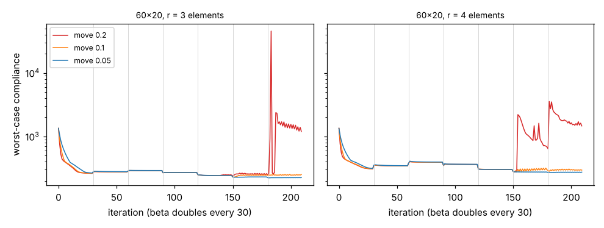

# simdesign-robustmove: does the optimality-criteria move limit decide whether a robust topology optimisation survives its beta steps?

Follow-up to `simdesign-robustmesh` (track 5, `PROJECTS.md`), taking its third listed next step: diagnose the two poor 60×20 robust runs it reported but could not explain. Result: the cause is the move limit of 0.2 used by every earlier project in this chain. At a move limit of 0.1 or 0.05, none of nine mesh-and-radius cases failed; at 0.2, five of nine did (four of six on 60×20, one of three on 120×40). Produced with AI assistance (Claude). Stylised: 2D dimensionless compliance, one problem, one deterministic run per cell; nothing was made or tested physically.

**Live page:** https://duncan-haywood.github.io/monorepo-projects/research/simdesign-robustmove/

**Builds on.** `simdesign-robust` (`robust_topopt`, which already takes a `move` argument; imported unchanged), `simdesign-robustmesh`, `simdesign-robustradius`, `simdesign-heaviside`, `simdesign-topopt`. Wang, Lazarov and Sigmund (2011), *Struct. Multidisc. Optim.* 43(6):767–784, <https://doi.org/10.1007/s00158-010-0602-y>, for the eroded / blueprint / dilated formulation; its move-limit or convergence advice was not checked. It builds on none of the CU Boulder groups in `prompt.md`.

## Method
Robust formulation (threshold gap 0.2), half-MBB beam, volume 0.5, p = 3, β = 1, 2, 4, …, 64 with 30 iterations each. Only the move limit of the optimality-criteria update changes: 0.2, 0.1, 0.05. Cases: 60×20 at filter radii 2, 2.5, 3, 3.5, 4, 5 elements, and 120×40 at 4, 6, 8 (nine cases, 27 runs). Every design is re-analysed at thresholds 0.5 ± 0.2, as in the earlier projects. A run is called a *failure* if its blueprint compliance is more than 1.5× the best of the three moves at the same mesh and radius (my own criterion). A *spike* is an iteration whose worst-case compliance is more than 3× the previous iteration's.

## Reproduce
```bash
pip install numpy scipy matplotlib pytest
cd research/simdesign-robustmove
python -m pytest -q tests          # 6 tests
python experiments/run.py          # writes experiments/results.txt and history.png (about 15 minutes)
```

## Results (from `experiments/results.txt`)
Blueprint compliance (the design as drawn); failures in bold. Full table with eroded and dilated values is in `results.txt`.

| mesh | r (elements) | move 0.2 | move 0.1 | move 0.05 |
|---|---|---|---|---|
| 60×20 | 2.0 | 196.1 | 195.3 | 196.6 |
| 60×20 | 2.5 | 202.0 | 198.0 | 199.9 |
| 60×20 | 3.0 | **741.9** | 199.8 | 200.3 |
| 60×20 | 3.5 | **737.2** | 206.3 | 200.6 |
| 60×20 | 4.0 | **746.7** | 202.1 | 201.3 |
| 60×20 | 5.0 | **949.9** | 236.6 | 230.7 |
| 120×40 | 4.0 | 194.7 | 193.4 | 193.7 |
| 120×40 | 6.0 | 200.4 | 197.9 | 198.3 |
| 120×40 | 8.0 | **402.7** | 203.7 | 203.4 |

- **Failures at 0.2 are the earlier poor runs, reproduced exactly** (741.9 and 746.7 at r = 3 and 4 on 60×20, as in `simdesign-robustmesh`), and they are not confined to one case: two more on 60×20 and one on 120×40 at the larger radii. With a smaller move limit all 18 runs landed within 1.5× of the best (blueprint 193 to 237).
- **The failure is a step, not a slow drift.** The failing runs have 1 to 4 spikes in their worst-case history, up to 50× (r = 3) and 409× (r = 5) in one iteration; runs at move 0.1 and 0.05 have none, except one spike of 7.1× at 60×20, r = 5, move 0.1. In the 60×20, r = 3 run the worst-case compliance sits near 250 through β = 32, jumps to 918 and then 45 567 within three iterations of β reaching 64, partly recovers, jumps again, and ends near 1 200 (`history.png`). The plausible mechanism is that the eroded field breaks a thin member at the higher β and the large allowed step then reshapes the layout; I did not test that mechanism directly (for example by logging connectivity of the eroded field).
- **A smaller step costs nothing visible in the blueprint** where the larger one worked: at the four cases that succeeded at 0.2 the blueprint compliance differs by under 3% between moves. The eroded value is not always better at a smaller move (60×20, r = 5, move 0.1: eroded 9 762 against a blueprint of 237, so that run did not fail by my criterion but is poor when eroded; at 0.05 it is 385).
- **Exploratory, not in `results.txt` (60×20, r = 3, one run each, run interactively):** doubling the iterations per β to 60 gave blueprint 203.5, and a slower β ramp of about ×1.5 per stage did not help (568). So more iterations can mask the problem, and a gentler ramp alone did not fix it here; the move limit did. These are single runs and are not a sweep.
- The plain-Heaviside `simdesign-robustmesh` rows were not rerun, and the earlier chain's conclusion (the grid sets the smallest member, not the filter radius) is untouched: those 180×60 and 120×40 rows were mostly cases that did not fail.



## Tests
Spike counter on flat and jumping histories; failure criterion; move list starts at the earlier default and is decreasing; a small run is deterministic and eroded compliance is not below dilated; the move limit changes the trajectory.

## Limitations
- One problem (half-MBB), two meshes, one run per cell; no seeds exist to vary since the code is deterministic, but a different load case or start could behave differently.
- The failure criterion is mine (1.5× the best at the same case) and uses the blueprint only; eroded-field quality is reported in `results.txt`, not in the verdict.
- The mechanism (member breaks at high β) is a hypothesis consistent with the history, not demonstrated.
- 0.2 is the only value that failed and 0.1 and 0.05 the only others tried; where between 0.1 and 0.2 the cliff sits is not located.
- 2D, dimensionless; not compared with published figures or code.

## Next steps
Locate the threshold (0.12–0.2) and test whether an adaptive move limit that shrinks after a compliance spike does as well as a fixed small one; log eroded-field connectivity per iteration to confirm the mechanism; then return to the continuous thickness measure left open by `simdesign-robustmesh`, now on runs that did not fail.

## Owner steps
None needed (simulation only).

## Outside dependencies (vitamins)
Open-source Python packages only (numpy, scipy, matplotlib; pytest for tests) plus the sibling `simdesign-*` projects in this repository. No hardware.
