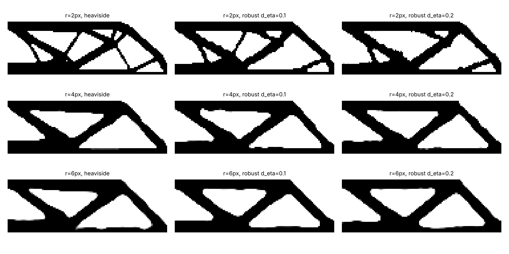

# simdesign-robustradius: does the filter radius, rather than the robust threshold gap, set the minimum feature of a topology-optimised beam?

Follow-up to `simdesign-robust` (track 5, `PROJECTS.md`), taking the first step listed in its "Next steps": vary the threshold gap Δη and the filter radius. It asks which of the two sets the smallest member in the blueprint, and what a larger radius costs in robustness. The answer here is mostly negative: the minimum feature does not follow the radius on this beam. Produced with AI assistance (Claude). Stylised: 2D dimensionless compliance, one problem, one run per setting; nothing was made or tested.

**Live page:** https://duncan-haywood.github.io/monorepo-projects/research/simdesign-robustradius/

**Builds on.** `simdesign-robust`, `simdesign-heaviside` and `simdesign-topopt` (this repository; imported unchanged). Wang, Lazarov and Sigmund (2011), "On projection methods, convergence and robust formulations in topology optimization", *Struct. Multidisc. Optim.* 43(6):767–784, <https://doi.org/10.1007/s00158-010-0602-y>, whose length-scale argument relates Δη to the filter radius; that relation was not checked against the paper's text or reproduced here. It builds on none of the CU Boulder groups in `prompt.md` and claims no connection to them.

## Method
Half-MBB beam, mesh 120×40, volume 0.5, p = 3, β continuation 1…64 (30 iterations each). Cone filter radius rmin = 2, 4, 6 elements (1.7%, 3.3%, 5.0% of the beam length). Per radius three formulations: plain Heaviside, robust with Δη = 0.1, robust with Δη = 0.2. The Heaviside design is re-analysed at 0.5 ± Δη so every row is judged by the same erosion. Measures: compliance at the three thresholds, grey share, and the 98% opening-rule minimum length scale of solid (Ms) and void (Mv) from `simdesign-heaviside`, on the blueprint thresholded at 0.5.

## Reproduce
```bash
pip install numpy scipy matplotlib pytest
cd research/simdesign-robustradius
python -m pytest -q tests          # 3 tests
python experiments/run.py          # writes experiments/results.txt and designs.png (about 6 minutes)
```

## Results (from `experiments/results.txt`)
| r (px) | formulation | Δη | c eroded | c blueprint | c dilated | Ms / Mv (px) |
|---|---|---|---|---|---|---|
| 2 | Heaviside | 0.2 | 3.6×10⁹ | 187.0 | 179.6 | 1 / 1 |
| 2 | robust | 0.1 | 208.8 | 200.3 | 197.0 | 1 / 3 |
| 2 | robust | 0.2 | 219.4 | 200.9 | 184.2 | 3 / 1 |
| 4 | Heaviside | 0.2 | 2.1×10⁹ | 192.9 | 173.4 | 3 / 3 |
| 4 | robust | 0.1 | 212.1 | 195.3 | 185.8 | 3 / 5 |
| 4 | robust | 0.2 | 226.3 | 194.7 | 177.0 | 3 / 5 |
| 6 | Heaviside | 0.2 | 6.2×10⁷ | 196.8 | 166.9 | 3 / 3 |
| 6 | robust | 0.1 | 215.5 | 195.5 | 182.3 | 3 / 5 |
| 6 | robust | 0.2 | 261.0 | 200.4 | 173.6 | 3 / 5 |

- **The minimum feature does not follow the radius (negative).** Ms is 1–3 px in all nine cells and 3 px for every r ≥ 4; tripling the radius from 2 to 6 px does not change it, so Ms/r falls from 0.5–1.5 to 0.5. Neither Δη = 0.1 nor 0.2 changes this. The measure is homemade and coarse (integer pixels, one run per cell), so this says "not shown", not "absent"; a 2D half-beam with a 40-pixel height may also be too small to expose a radius-controlled length scale.
- **The plain design fails when eroded at every radius** (eroded compliance 6×10⁷ to 4×10⁹, the stiffness-floor artefact of a disconnected model: it carries no load). The robust designs stay at 209–261.
- **The robustness guarantee costs more with a larger radius at Δη = 0.2.** Eroded compliance is 9%, 16% and 30% above the blueprint at r = 2, 4, 6 (4%, 9%, 10% at Δη = 0.1). The nominal price against the Heaviside design is +7% at r = 2 and between −1% and +2% at r = 4 and 6.



## Tests
Δη = 0 robust equals plain Heaviside (blueprint and compliance, 1e-9); determinism; eroded ≥ dilated compliance, measures in range; an unknown formulation raises.

## Limitations
- One problem (half-MBB), one mesh, one run per cell, 2D plane stress, dimensionless. Three radii and two gaps only; β schedule and worst-of-three rule untouched.
- The length-scale measure is coarse and the Ms = 1 versus 3 differences at r = 2 are within one-pixel noise of a single run.
- Thresholding the filtered field stands in for etch error; real over/under-etch is geometric. Not compared with published figures or code.

## Next steps
A finer mesh at the same physical radii (Ms at 180×60 or 240×80) to see whether the length scale emerges once radii span many pixels; an explicit minimum-feature constraint; export the blueprint to process rules (`simdesign-dfm`-style); 3D.

## Owner steps
None needed (simulation only).

## Outside dependencies (vitamins)
Open-source Python packages only (numpy, scipy, matplotlib; pytest). The beam, material, load and thresholds are assumptions.
