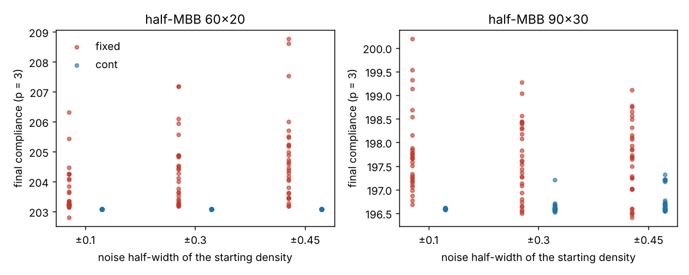

# simdesign-starts: how much does SIMP topology optimisation depend on its starting density field?

Does the design a SIMP compliance minimiser returns depend on the starting density field, and does penalty continuation remove that dependence? I chose this because the track's recent `simdesign-robust*` chain had narrowed to micro-variants of one result, and none of the 54 earlier `simdesign-*` projects start the standard topology optimiser from anything but a uniform field. Answer on this problem: **with the penalty fixed at 3, the start matters a little (1.4–2.8% in compliance, but 2–23% of elements change state); with continuation 1 → 3 it hardly matters (0.0–0.4%).** Produced with AI assistance (Claude). Stylised: 2D, dimensionless compliance, 150 iterations, one problem, two meshes; nothing was made or tested physically.

**Live page:** https://duncan-haywood.github.io/monorepo-projects/research/simdesign-starts/

**Builds on.** `simdesign-topopt` (FE assembly, filter matrix, half-MBB problem, imported unchanged) and Sigmund (2001), "A 99 line topology optimization code written in Matlab", *Struct. Multidisc. Optim.* 21:120–127, <https://doi.org/10.1007/s001580050176>, whose uniform start and fixed penalty this varies. Penalty continuation is the standard remedy for local optima in SIMP (Sigmund and Petersson 1998, *Struct. Optim.* 16:68–75). It builds on none of the CU Boulder groups in `prompt.md`.

## Method
Half-MBB, volume fraction 0.5, p = 3, sensitivity filter radius 1.5 elements, optimality-criteria update with move limit 0.2, **exactly 150 iterations** (no convergence stop). Meshes 60×20 and 90×30. Starting fields: the uniform 0.5 field (one run), and uniform noise of half-width 0.1, 0.3 or 0.45 around 0.5, shifted to volume 0.5 and clipped to [0.01, 1], 30 seeds each. Two modes: fixed p = 3, and continuation (p from 1 to 3 in steps of 0.5 over the first 75 iterations, then held). Reported: compliance at p = 3 (spread = max/min − 1), the share of elements whose state (density > 0.5) differs from the uniform-start design of the same mesh and mode, and the number of enclosed void regions. All settings were fixed before running.

## Reproduce
```bash
pip install numpy scipy matplotlib pytest
cd research/simdesign-starts
python -m pytest -q tests          # 6 tests
python experiments/run.py          # writes experiments/results.txt and spread.png (about 25 minutes)
```

## Results (from `experiments/results.txt`)
| mesh | mode | noise | compliance min / median / max | spread | random starts beating uniform | median element disagreement | holes (min–median–max) |
|---|---|---|---|---|---|---|---|
| 60×20 | fixed | ±0.1 | 202.81 / 203.26 / 206.33 | 1.7% | 7/30 | 1.9% | 2–2–6 |
| 60×20 | fixed | ±0.3 | 203.19 / 204.20 / 207.18 | 2.0% | 3/30 | 11.9% | 2–3–5 |
| 60×20 | fixed | ±0.45 | 203.17 / 204.53 / 208.76 | 2.8% | 2/30 | 17.5% | 2–4–5 |
| 60×20 | cont | ±0.1…0.45 | 203.07 / 203.08 / 203.08 | 0.0% | 2–4/30 | 0.0% | 4–4–4 |
| 90×30 | fixed | ±0.1 | 196.69 / 197.66 / 200.19 | 1.8% | 25/30 | 13.7% | 5–6–8 |
| 90×30 | fixed | ±0.3 | 196.50 / 197.56 / 199.27 | 1.4% | 28/30 | 20.9% | 5–6–10 |
| 90×30 | fixed | ±0.45 | 196.41 / 197.69 / 199.11 | 1.4% | 26/30 | 23.2% | 5–7–8 |
| 90×30 | cont | ±0.1 | 196.58 / 196.60 / 196.61 | 0.0% | 17/30 | 0.1% | 8–8–9 |
| 90×30 | cont | ±0.3 | 196.53 / 196.59 / 197.21 | 0.3% | 15/30 | 0.3% | 8–8–9 |
| 90×30 | cont | ±0.45 | 196.55 / 196.66 / 197.32 | 0.4% | 10/30 | 1.8% | 8–8–9 |

Uniform-start single runs: 60×20 fixed 203.21 (2 holes), continuation 203.08 (4 holes); 90×30 fixed 198.57 (6 holes), continuation 196.60 (8 holes).

- **A fixed-penalty run lands in a slightly different local optimum for each start.** The compliance differences are small (at most 2.8%), but the layouts are not: a median of 12–23% of elements change state for noise ±0.3 and above, and the hole count ranges from 2 to 10 on a mesh where the uniform start gives 2 or 6.
- **The uniform start is not special.** On 90×30 at fixed p, 25–28 of 30 random starts beat it. On 60×20 it is near the best (2–7 of 30 beat it). So "the 99-line code's start is a good one" is true on one mesh here and false on the other; no general claim.
- **Continuation removes nearly all of the start dependence.** On 60×20 every one of 90 random starts reaches the same compliance (203.07–203.08) and a design that differs from the uniform-start one in 0.0% of elements. On 90×30 the spread is 0.0–0.4% and the median disagreement 0.1–1.8%.
- **Continuation also finds a lower optimum on the finer mesh** (196.6 against a fixed-penalty median of about 197.6 and 198.57 for the uniform start), but on 60×20 the two modes differ by under 0.5%, with different hole counts (4 against 2–4).
- The effect of the start is plausibly the same thing continuation is known for (starting convex at p = 1 forgets the initial field); this run does not test that mechanism.



## Tests
Random starts hit the target volume and bounds and are seeded and deterministic; the hole counter ignores voids that touch the border; the disagreement measure is exact on a 2×2 example; a short OC run holds the volume (±0.005) and lowers compliance; runs are deterministic.

## Limitations
- One problem (half-MBB), two meshes, one filter radius, one volume fraction; the 30 seeds per cell bound the spread estimate but a maximum over 30 is itself noisy.
- 150 iterations, not run to convergence: some of the fixed-penalty spread may be slow convergence rather than distinct optima. Not checked with longer runs.
- Disagreement is measured against the uniform-start design, not between random starts; "differs in 20% of elements" does not say the layouts differ in topology.
- Continuation schedule is one choice, not swept. Compliance is on the grey field at p = 3, not on a thresholded part.
- Not compared with published code or figures.

## Next steps
Run to convergence to separate slow convergence from distinct optima; compare random starts with each other; sweep the continuation length; repeat on the cantilever and a 3D case.

## Owner steps
None needed (simulation only).

## Outside dependencies (vitamins)
Open-source Python packages only (numpy, scipy, matplotlib; pytest for tests) plus `simdesign-topopt` in this repository. No hardware.
