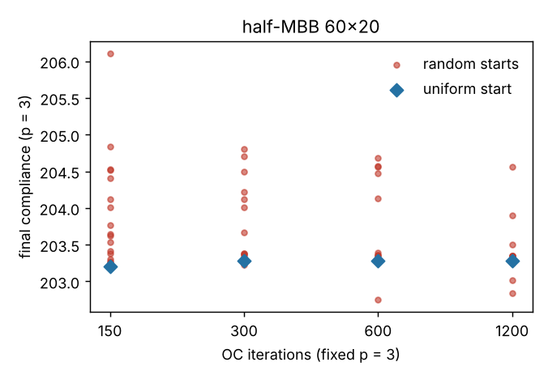

# simdesign-startsconverge: does SIMP's dependence on its starting density field survive running to convergence?

Is the start-dependence of fixed-penalty SIMP topology optimisation just slow convergence? I chose this because it is the first "Next step" of `simdesign-starts`, which stopped at 150 iterations and could not tell slow convergence from distinct local optima. Answer on this problem: **mostly slow convergence for the typical start, not for all of them.** At 1200 iterations the median random start reaches the uniform-start design (0.0% of elements differ, median pair disagreement 0.5%, down from 15.4% at 150), but the compliance spread across 20 starts only falls from 1.43% to 0.85%, and the hole count still ranges 2 to 5, so a minority of starts stay in a different, slightly worse local optimum. Produced with AI assistance (Claude). Stylised: 2D, dimensionless compliance, one problem, one mesh; nothing was made or tested physically.

**Live page:** https://duncan-haywood.github.io/monorepo-projects/research/simdesign-startsconverge/

**Builds on.** `simdesign-starts` (random-start generator, hole counter, element-disagreement measure, imported unchanged), `simdesign-topopt` (FE assembly, filter, half-MBB problem), and Sigmund (2001), "A 99 line topology optimization code written in Matlab", *Struct. Multidisc. Optim.* 21:120–127, <https://doi.org/10.1007/s001580050176>. It builds on none of the CU Boulder groups in `prompt.md`.

## Method
Half-MBB 60×20, volume fraction 0.5, fixed p = 3, sensitivity filter radius 1.5 elements, optimality-criteria update with move limit 0.2. Starts: the uniform 0.5 field (one run) and 20 random starts of noise half-width 0.3 (seeds 0–19). Each start is run once for 1200 iterations and the design is snapshotted at 150, 300, 600 and 1200 (a test checks snapshots equal independent runs of that length). Reported per snapshot: compliance at p = 3 over the starts, the number of starts beating the uniform start, the median share of elements (x > 0.5) differing from the uniform-start design and between pairs of random starts, enclosed holes, the share of grey elements, and the median largest density change in the last update. Settings were fixed before running.

## Reproduce
```bash
pip install numpy scipy matplotlib pytest
cd research/simdesign-startsconverge
python -m pytest -q tests          # 4 tests
python experiments/run.py          # writes experiments/results.txt and converge.png (about 7 minutes)
```

## Results (from `experiments/results.txt`)
| iterations | uniform c | random c min / median / max | spread | starts beating uniform | median differs from uniform | median pair disagreement | holes (min–med–max) | median max density change |
|---|---|---|---|---|---|---|---|---|
| 150 | 203.21 | 203.19 / 203.58 / 206.10 | 1.43% | 3/20 | 3.9% | 15.4% | 2–2–5 | 0.0053 |
| 300 | 203.28 | 203.23 / 203.36 / 204.81 | 0.78% | 4/20 | 1.0% | 14.8% | 2–2–5 | 0.0009 |
| 600 | 203.29 | 202.75 / 203.29 / 204.68 | 0.95% | 7/20 | 0.2% | 14.6% | 2–2–5 | 0.0001 |
| 1200 | 203.29 | 202.84 / 203.29 / 204.56 | 0.85% | 5/20 | 0.0% | 0.5% | 2–2–5 | 0.0000 |

- **The typical start converges to the uniform-start design.** The median start differs from it in 3.9% of elements at 150 iterations and 0.0% at 1200. By 1200 the optimiser has stopped moving (largest density change 0.0000 to four decimals).
- **Pair disagreement lags.** It stays near 15% through 600 iterations and only drops to 0.5% at 1200, so many starts need 600 to 1200 iterations to settle even when they end at the same design. The 150-iteration figures in `simdesign-starts` (12–17% at this noise level) are therefore largely unconverged layouts.
- **Some starts do not join.** The compliance maximum is still 0.85% above the minimum and the hole count still reaches 5 at 1200 iterations, so at least one start has stopped in a distinct local optimum. The minimum, 202.84, is below the uniform start's 203.29 (about 0.2%), so the uniform start is not the best optimum found either. This run does not count how many starts are stuck and does not show their layouts.
- Continuation (`simdesign-starts`) removed the spread at 150 iterations; this result says fixed-penalty runs reach much of the same agreement given about 8× the iterations, but not all of it.



## Tests
Snapshots equal independent runs of the same length (against `simdesign-starts`'s `run_from`); volume held and the density change reported; pair disagreement exact on a three-design example; runs deterministic.

## Limitations
- One problem, one 60×20 mesh, one noise level (±0.3), one filter radius, 20 seeds; the 90×30 mesh, where `simdesign-starts` found a larger start effect, was not run. A maximum over 20 seeds is itself noisy.
- "Converged" means the largest density change is below 0.0001 to four decimals, not that a KKT condition holds; a tiny move can still lie on a slow path.
- Whether the residual 0.85% spread comes from distinct optima or from still-slow drifts in a few starts is not separated; no per-start counts were recorded.
- Compliance is on the grey field at p = 3 (21% of elements remain grey), not a thresholded part.

## Next steps
Record per-start final compliance and layout to count the stuck starts; repeat on 90×30; start from the stuck designs with continuation to see whether they escape.

## Owner steps
None needed (simulation only).

## Outside dependencies (vitamins)
Open-source Python packages only (numpy, scipy, matplotlib; pytest for tests) plus `simdesign-starts` and `simdesign-topopt` in this repository. No hardware.
