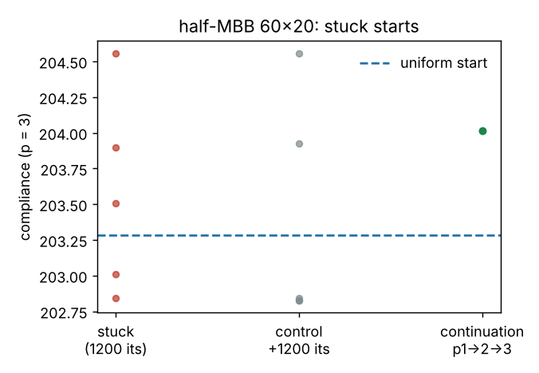

# simdesign-stuck: can penalty continuation free the SIMP designs that stay stuck in a different local optimum?

After 1200 iterations at fixed p = 3, 5 of 20 random starting fields of a half-MBB topology optimisation still end in a layout that differs from the uniform-start design (`simdesign-startsconverge` could not count them). I chose this because it is that project's first "Next step". Answer on this problem: **no, and "stuck" is the wrong word.** Penalty continuation (p = 1, then 2, then 3) sends all five stuck starts to one and the same design, but it is not the uniform-start design (20.4% of elements differ) and its compliance, 204.01, is worse than the 202.83 that three of the five reach by simply running 1200 more iterations at p = 3. The uniform start's 203.29 is not the best optimum found either. Produced with AI assistance (Claude). Stylised: 2D, dimensionless compliance, one problem, one mesh, 20 seeds; nothing was made or tested physically.

**Live page:** https://duncan-haywood.github.io/monorepo-projects/research/simdesign-stuck/

**Builds on.** `simdesign-startsconverge` (run-to-snapshot SIMP, imported unchanged), `simdesign-starts` (random-start generator, hole counter, layout distance), `simdesign-topopt` (FE assembly, filter, half-MBB problem), and Sigmund (2001), "A 99 line topology optimization code written in Matlab", *Struct. Multidisc. Optim.* 21:120–127, <https://doi.org/10.1007/s001580050176>. Penalty continuation as a remedy for local optima is standard in the SIMP literature (see Sigmund and Maute 2013, "Topology optimization approaches", *Struct. Multidisc. Optim.* 48:1031–1055, <https://doi.org/10.1007/s00158-013-0978-6>); this project only tests it on these starts. It builds on none of the CU Boulder groups in `prompt.md`.

## Method
Half-MBB 60×20, volume fraction 0.5, sensitivity filter radius 1.5 elements, optimality-criteria update with move limit 0.2. Stage 1 reproduces `simdesign-startsconverge`: the uniform 0.5 start and 20 random starts (noise ±0.3, seeds 0–19), 1200 iterations at p = 3. A start is *stuck* if the share of elements whose 0/1 state (x > 0.5) differs from the uniform-start design is at least 1% (threshold fixed before running). Each stuck start then gets two treatments: **control**, 1200 more iterations at p = 3; **continuation**, 100 iterations at p = 1, 100 at p = 2, then 1000 at p = 3. Reported: compliance at p = 3, layout difference from the uniform-start design, enclosed holes.

## Reproduce
```bash
pip install numpy scipy matplotlib pytest
cd research/simdesign-stuck
python -m pytest -q tests          # 4 tests
python experiments/run.py          # writes experiments/results.txt and stuck.png (about 8 minutes)
```

## Results (from `experiments/results.txt`)
Uniform start after 1200 iterations: c = 203.29, 2 holes.

| seed | c at 1200 | differs from uniform | control c (+1200 its) | continuation c | continuation differs from uniform |
|---|---|---|---|---|---|
| 7 | 203.90 | 24.8% | 202.83 | 204.01 | 20.4% |
| 9 | 204.56 | 27.3% | 204.56 | 204.01 | 20.4% |
| 11 | 203.50 | 14.2% | 203.92 | 204.01 | 20.4% |
| 12 | 202.84 | 23.3% | 202.84 | 204.01 | 20.4% |
| 17 | 203.01 | 22.5% | 202.83 | 204.01 | 20.4% |

- **Continuation freed 0 of 5** (none ends within 1% of the uniform-start layout), but it collapses all five onto one design (identical compliance and layout difference). The p = 1 stage is convex, so it forgets the start; the later stages then take every start along the same path.
- **That design is not the best one.** Its compliance, 204.01, is above the uniform start's 203.29 and above the 202.83 that three stuck starts (7, 12, 17) reach with no continuation (about 0.6% lower than continuation's). Continuation lowered compliance below the stuck design's in 1 of 5 cases (seed 9). The control lowered it by more than 0.01 in 2 of 5 (seeds 7 and 17, to 202.83) and raised it in one (seed 11); `results.txt` counts 4 of 5 "below" because it uses a 1e-6 tolerance and seeds 9 and 12 changed by amounts below the printed precision.
- **The stuck starts were not all converged.** Seeds 7 and 17 moved from 203.90 and 203.01 to 202.83 with more iterations, and seed 11 moved to a *different* layout (14.2% to 20.5% from uniform) at a slightly higher compliance (203.50 to 203.92), so a fixed-penalty OC run at 1200 iterations can still drift between optima, and compliance is not monotone for it. The optimiser's move limit and the grey field mean this is a drift of a still-unconverged design rather than a clean escape.
- **Two layouts matter.** Three controls end at 202.83–202.84 and about 23.3% from the uniform design (same compliance to two decimals; I did not compare the layouts element by element beyond that distance), so there appears to be a better optimum than the uniform start's, reached from 3 of the 20 random starts.



## Tests
Stuck threshold on a hand-built example; a one-stage schedule equals a plain run; stages chain (a two-stage schedule equals two manual runs) and hold the volume; input not mutated.

## Limitations
- Five stuck starts out of 20 seeds on one 60×20 mesh, one noise level and one continuation schedule; a different schedule (longer p = 1 stage, finer steps up to 3) could land elsewhere. Nothing here says continuation never helps.
- "Stuck" is defined by layout difference at 1200 iterations, and the control shows some of these starts were still moving, so the count of 5 is an upper bound on true local optima.
- Compliance is on the grey field at p = 3, not a thresholded part. Layout equality was checked by compliance and distance, not by plotting the designs.

## Next steps
Repeat on 90×30 where `simdesign-starts` found larger start effects; run to a real convergence criterion (change < 1e-6) before calling a start stuck; try the better 202.83 design as the reference instead of the uniform start.

## Owner steps
None needed (simulation only).

## Outside dependencies (vitamins)
Open-source Python packages only (numpy, scipy, matplotlib; pytest for tests) plus `simdesign-startsconverge`, `simdesign-starts` and `simdesign-topopt` in this repository. No hardware.
