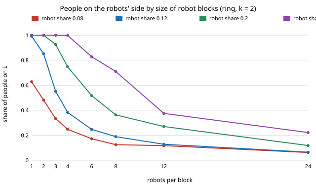

# society-allies: how big a block of committed robots can a ring crowd take before the passing-side convention stops tipping?

`society-robotnorms` placed robots on a ring only as "evenly spread" or "one block" (next step 2 there). Here the block
size is swept between the two. **On a ring where people meet partners within 2 sites (memory 9, 200 people, 20 seeds),
robots 0.12 of the crowd tip every crowd when walking alone (block 1: 0.992 of people switch) but only 0.25 of crowds at
blocks of 2, and none at blocks of 3 or more; at 0.20, blocks of 3 still tip 70% of crowds and blocks of 4 none. Widening
the neighbourhood buys back the loss: at 0.20, blocks of 8 tip no crowd at k = 3, 10% at k = 5 and every crowd at k = 10.**
Roughly, allies stop helping when a block is wider than the neighbourhood people meet within. Results are about simulated people
following a stated rule, not real crowds.

**Live page:** https://duncan-haywood.github.io/oss-monorepo/research/society-allies/

## Why this question

A designer cannot always spread robots evenly: they cluster at charging points, doors and shifts. The block-size curve says
how much of the evenly-spread threshold (0.12 to 0.14 on this ring, against 0.22 well-mixed) survives clustering.

## Builds on

`society-robotnorms` (same rule; the `block = 1` and `block = all robots` columns below reproduce its section E exactly,
checked in section A of `results.txt`), whose people-and-robots model follows the committed-minority literature (Xie et al. 2011;
Centola et al. 2018). **Lab tags:** none; no lab's work is built on.

## Model

Agents on a ring of `N = 200` sites meet in pairs (each picks a side, L or R; unequal sides is a conflict). People take the
majority side of their last `M = 9` partners, with error `ε = 0.02`, starting on R. A share `ρ` of sites hold committed robots
that always walk L, in blocks of `b` adjacent sites, blocks evenly spaced. A partner sits within `k` sites. 500 rounds.

## Results (`experiments/results.txt`, seeded; `experiments/run.py`, 1.5 minutes)

Mean final share of people on L, `k = 2`:

| robots per block | ρ = 0.08 | 0.12 | 0.20 | 0.30 |
|---|---|---|---|---|
| 1 | 0.628 | 0.992 | 1.000 | 1.000 |
| 2 | 0.481 | 0.852 | 1.000 | 1.000 |
| 3 | 0.333 | 0.551 | 0.926 | 1.000 |
| 4 | 0.248 | 0.383 | 0.747 | 0.998 |
| 6 | 0.172 | 0.247 | 0.517 | 0.828 |
| 8 | 0.125 | 0.189 | 0.363 | 0.710 |
| 12 | 0.117 | 0.128 | 0.270 | 0.375 |
| 24 | 0.062 | 0.065 | 0.118 | 0.222 |



**Neighbourhood size** (ρ = 0.20, share of crowds with at least 90% of people on L):

| block | k = 1 | 2 | 3 | 5 | 10 |
|---|---|---|---|---|---|
| 1 | 1.00 | 1.00 | 1.00 | 1.00 | 1.00 |
| 2 | 1.00 | 1.00 | 1.00 | 1.00 | 1.00 |
| 4 | 0.00 | 0.00 | 0.85 | 1.00 | 1.00 |
| 8 | 0.00 | 0.00 | 0.00 | 0.10 | 1.00 |
| 16 | 0.00 | 0.00 | 0.00 | 0.00 | 0.00 |

The block size that still tips tracks `k`: 2 at k = 1 and 2, 4 at k = 3 and 5 (the 4-block at k = 3 tips 85%),
8 at k = 10. Conflicts per human meeting peak for partial blocks (0.11 to 0.15 at ρ = 0.20, b = 3 to 8, against 0.046 for singles) because the robots
disturb their neighbours without converting them; single block 24 costs little (0.055) and changes little.

## What this does and does not show

- Clustered allies lose most of their effect once a block exceeds the neighbourhood: the all-or-nothing threshold becomes
  a gradual, partial conversion, and a fleet that clusters pays conflicts for a small shift.
- It does not show real crowds meet on a 1D ring or follow this rule. The "block ≲ k" rule is read off a grid of four block
  sizes per `k`, not derived. No lab tag, no real-people data.
- Norm-shifting raises consent questions; this reports a cost, it is not a recipe for steering crowds.

## Limitations

Stylised: binary choice, 1D ring, one memory length, noiseless robots, a 500-round horizon ("no tip" means not within the run).
No input is from a source other than `society-robotnorms`' own (ε = 0.02, M = 9); sweeps cover ρ, block and k, not ε or M.

## Next steps

1. A 2D grid where a block is a patch, to see whether the block-to-neighbourhood ratio carries over.
2. Mean-field for the ring: a pair approximation for local share thresholds.

## Reproduce

```
cd research/society-allies
python3 -m unittest discover -s tests
PYTHONPATH=src python3 experiments/run.py
python3 experiments/figure.py
```

## Owner steps

None.

## Outside dependencies

None: Python standard library only.

*Produced with AI assistance (Claude).*
