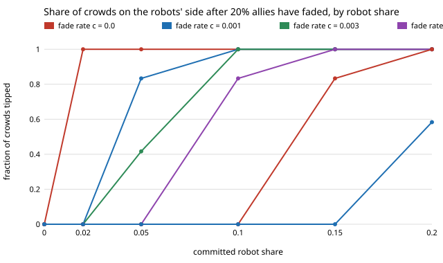

# society-allyfade: if the people on the robots' side fade away, does the crowd stay tipped?

`society-blocs` showed that a bloc of people who always walk the robots' side cuts the robot share that tips a
crowd's walking side, from 0.217 to 0.023 at 20% allies. Real allies do not stay committed forever. This
asks how fast they can fade before the robots have to make up the difference.
**With 20% allies who each turn into an ordinary memory-rule walker with probability `c` per round, the least grid robot
share at which at least half of 12 crowds tip rises from 0.02 (`c = 0`, mean field 0.023) to 0.05, 0.10, 0.10, 0.15 and 0.20 at
`c` = 0.001, 0.003, 0.01, 0.03 and 0.1 (memory 9, 200 people), against 0.2165 with no allies at all.** Once the allies have gone
the tip stays: it happens in about 40 to 55 rounds, so the question is whether the allies last that long. Ten percent
holdouts on the status-quo side who never fade make the marginal cells worse (3 of 12 crowds tip instead of 10 at
`c` = 0.001, ρ = 0.05); holdouts that fade at the same rate change little.
Produced with AI assistance (Claude). Next step from `society-converts` and `society-blocs` in research track 17
(`society`, `PROJECTS.md`). Every result is about simulated people following a stated rule, not real crowds.

**Live page:** https://duncan-haywood.github.io/monorepo-projects/research/society-allyfade/

## Why this question

`society-converts` made the status-quo bloc convert slowly; `society-blocs` fixed the allies. Its next step 3 asked for
both together. A fleet planning on a cheap ally bloc needs to know whether allies who drift back leave the
convention tipped or take it with them.

## Builds on

`society-blocs` (mean-field tipping share, same model; `critical_share` is imported from it); `society-converts`
(per-round conversion); `society-robotnorms`; Young (1993), *Econometrica* 61(1):57–84; Centola et al. (2018),
*Science* 360(6393):1116–1119. **Lab tags:** HIRO and CAIRO only in the loose sense of `society-robotnorms`.

## Model

As `society-blocs`, well-mixed, `N = 200`, memory `M = 9`, error `ε = 0.02`. A share `sl = 0.2` of humans always walks L
(the robots' side), optionally `sr = 0.1` always R; committed robots (share `ρ`) walk L; the rest take the majority of
their last 9 partners. Everyone, stubborn or not, keeps that memory, so a convert starts with what they have watched.
After each round every stubborn person turns adaptive with probability `c` (allies at `c_l`, holdouts at `c_r`).
Memories start all R. A crowd is *tipped* if after 4000 rounds most humans have an L majority in memory.
Conversion rates are swept, not measured (nothing here is fitted to real people).

## Results

From `experiments/results.txt` (`experiments/run.py`, seeded, 12 seeds per cell). Crowds tipped, of 12, `sr = 0`:

| c | ρ=0 | 0.02 | 0.05 | 0.10 | 0.15 | 0.20 |
|---|---|---|---|---|---|---|
| 0 (never fade) | 0 | 12 | 12 | 12 | 12 | 12 |
| 0.001 | 0 | 0 | 10 | 12 | 12 | 12 |
| 0.003 | 0 | 0 | 5 | 12 | 12 | 12 |
| 0.01 | 0 | 0 | 0 | 10 | 12 | 12 |
| 0.03 | 0 | 0 | 0 | 0 | 10 | 12 |
| 0.1 | 0 | 0 | 0 | 0 | 0 | 7 |



- **Tipping is a race.** Among crowds that tip, the first round at which most humans lean L is a median 54, 53 and 41
  at `c` = 0, 0.001 and 0.003 (robot share 0.05). Allies who are mostly still there at round ~50 (`c` below about 0.01) lock the
  tip in; at faster fading the crowd never gets there and falls back to the no-ally mean-field threshold 0.2165
  (`society-blocs`), which the `c = 0.1` row approaches (7 of 12 at 0.20).
- **Holdouts who stay** (`sr = 0.1`, about 19 people, none converting) lower the tipped count wherever it is marginal:
  3 of 12 against 10 at `c` = 0.001, ρ = 0.05; 7 against 10 at `c` = 0.01, ρ = 0.10; 7 against 10 at `c` = 0.03, ρ = 0.15;
  2 against 7 at `c` = 0.1, ρ = 0.20. The cells that are already 12/12 or 0/12 do not move.
- **Holdouts that fade at the same rate** are close to the no-holdout table (5 of 12 at `c` = 0.001, ρ = 0.05; 7 at
  `c` = 0.01, ρ = 0.10; 10 at `c` = 0.03, ρ = 0.15; 8 at `c` = 0.1, ρ = 0.20): a fading opposition costs little.
- A bloc that stays (`c = 0`) at ρ = 0.02 tips 12/12, mean field 0.023; any fading at all (0.001) takes that cell to 0/12.

## Limitations

Stylised: no geometry, one binary decision per meeting; conversion is spontaneous and independent of what people
see, with the rate swept rather than measured; the all-R start is a worst case for the allies; thresholds are read from
a 0.05-wide grid of 12 crowds, so differences below that are not resolved; `N = 200`. Results about simulated walkers,
not real people. Recruiting allies is a consent question (track 17 guardrails); nothing here designs covert recruiting.

## Reproduce

```
cd research/society-allyfade
python3 -m unittest discover -s tests            # 6 tests, ~1 s
PYTHONPATH=src python3 experiments/run.py        # writes results.txt (~25 min)
python3 experiments/figure.py
```

## Next steps

1. Fading that depends on what allies see (they convert when the crowd moves away from them) instead of a constant rate.
2. Robots that replace allies as they fade (a hand-over schedule), to price the fade in robots.
3. Fit `c` to measured persistence of side preference rather than sweeping it.

## Owner steps

None.

## Outside dependencies

None: Python standard library only.
