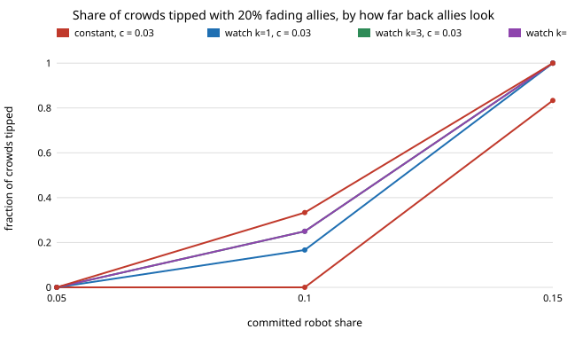

# society-allyrecent: does it matter how far back a fading ally looks?

`society-allywatch` faded allies in proportion to the share of R in their whole 9-partner memory. A real ally may react only to
the last few encounters. This asks whether the look-back `k` (the last 1, 3, 5 or all 9 partners) changes whether the robots' tip survives.
**It barely does: with 20% allies in a 200-person crowd, every look-back from 1 to 9 tips 11–12 of 12 crowds at `c` = 0.01 and robot share 0.10
(constant fading: 10), and 12 of 12 at robot share 0.15 for `c` = 0.01 and 0.03 (constant at `c` = 0.03: 10). The longer look-back is a little better in the marginal cell
(`c` = 0.03, robots 0.10: 2, 3, 3 and 4 of 12 for `k` = 1, 3, 5, 9, against 0 for constant), but 1 or 2 crowds out of 12 is within noise.**
Produced with AI assistance (Claude). Next step 1 of `society-allywatch`, research track 17 (`society`). Every result is
about simulated people following a stated rule, not real crowds.

**Live page:** https://duncan-haywood.github.io/oss-monorepo/research/society-allyrecent/

## Builds on

`society-allywatch` (the fading rule; `k` = 9 reproduces it exactly, a test checks identical output for the same seeds), `society-allyfade`,
`society-blocs`, `society-robotnorms`; Young (1993), *Econometrica* 61(1):57–84. **Lab tags:** HIRO and CAIRO only in the loose sense of `society-robotnorms`.

## Model

As `society-allywatch` (`N = 200`, memory 9, error 0.02, 20% of humans allies, 1500 rounds, 12 seeds). After each round an ally
converts with probability `c` (constant) or `c·f` (watch), `f` = share of the ally's last `k` partners that walked R. `c` is swept, not measured.

## Results

From `experiments/results.txt` (`experiments/run.py`, seeded). Crowds tipped of 12 (mean allies left at the end):

| c | rule | ρ=0.05 | 0.10 | 0.15 |
|---|---|---|---|---|
| 0.01 | constant | 0 | 10 (0) | 12 (0) |
| 0.01 | k=1 | 0 | 11 (25) | 12 (28) |
| 0.01 | k=3 | 1 (2) | 12 (26) | 12 (27) |
| 0.01 | k=5 | 0 | 12 (26) | 12 (26) |
| 0.01 | k=9 | 2 (4) | 12 (26) | 12 (26) |
| 0.03 | constant | 0 | 0 | 10 (0) |
| 0.03 | k=1 | 0 | 2 (2) | 12 (15) |
| 0.03 | k=3 | 0 | 3 (3) | 12 (15) |
| 0.03 | k=5 | 0 | 3 (3) | 12 (14) |
| 0.03 | k=9 | 0 | 4 (3) | 12 (13) |



- The `k` = 9 rows reproduce the `society-allywatch` table (12 and 12 at `c` = 0.01; 4 and 12 at `c` = 0.03).
- Almost all of the gain over constant fading is already there at `k` = 1: allies who just stay when the last partner walked L keep the bloc in place
  once the crowd leans L. The ordering by `k` is monotone in the `c` = 0.03, ρ = 0.10 cell, but the steps are one crowd each, which 12 seeds cannot separate.
- Nothing tips at 0.05 robots in any rule except 1–2 crowds of 12 at `c` = 0.01 with `k` ≥ 3, again within noise.

## Limitations

Stylised: the `f` rule is one choice (a threshold rule is not tried); `c` is swept, not fitted; the all-R start; 12 seeds on a 0.05 grid; no geometry; `N = 200`.
Results about simulated walkers, not real people. Recruiting allies is a consent question (track 17 guardrails); nothing here designs covert recruiting.

## Reproduce

```
cd research/society-allyrecent
python3 -m unittest discover -s tests            # 7 tests, ~1 s
PYTHONPATH=src python3 experiments/run.py        # writes results.txt (~2 min)
python3 experiments/figure.py
```

## Next steps

1. A threshold rule (convert only if at least `j` of the last `k` were R) and more seeds to separate the one-crowd differences.
2. Robots that replace allies as they fade, to price the fade in robots (`society-allyfade` next step 2).
3. Fit `c` to measured persistence of side preference rather than sweeping it.

## Owner steps

None.

## Outside dependencies

None: Python standard library only.
