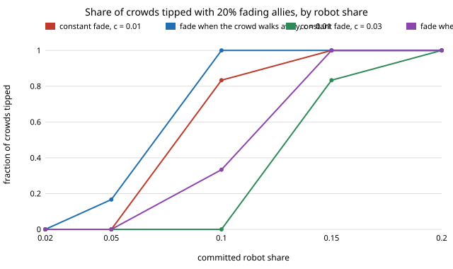

# society-allywatch: if allies fade when they see the crowd walking away, does the robots' tip survive?

`society-allyfade` faded allies at a constant rate. Real allies leave when they feel alone, not on a timer. This
asks whether fading that depends on what an ally has watched is better or worse for the robots than the same
rate applied blindly.
**With 20% allies in a 200-person crowd (memory 9), an ally who converts with probability `c` times the share of
their own memory that is R tips more crowds than one who converts at a flat `c`, but only once robots are at least about 0.10:
12/12 against 10/12 at `c` = 0.01 and robot share 0.10 (about 26 of 40 allies still present at the end), 4/12 against 0/12
at `c` = 0.03, and 12/12 against 10/12 at 0.15. At 0.05 robots it is 2/12 against 0/12 at `c` = 0.01, and at 0.02 robots or at
`c` ≥ 0.1 neither rule rescues the crowd.**
Produced with AI assistance (Claude). Next step 1 of `society-allyfade`, research track 17 (`society`). Every result is
about simulated people following a stated rule, not real crowds.

**Live page:** https://duncan-haywood.github.io/oss-monorepo/research/society-allywatch/

## Why this question

A first guess is that discouragement is worse than constant fading: allies leave exactly when the crowd is against them,
which is when the robots need them. The result goes the other way. Memories start all R, so every ally has `f` = 1 and fades at
the flat rate in the first rounds under both rules; the rules differ only after the tip begins, when allies who watch L stay.

## Builds on

`society-allyfade` (the constant-fade model and its table, same crowd and thresholds), `society-blocs`,
`society-robotnorms`; Young (1993), *Econometrica* 61(1):57–84. **Lab tags:** HIRO and CAIRO only in the loose sense
of `society-robotnorms`.

## Model

Well-mixed, `N = 200`, memory `M = 9`, error `ε = 0.02`. A share 0.2 of humans are allies who always walk L; committed
robots (share `ρ`) walk L; everyone else takes the majority of their last 9 partners, and allies keep a memory too. After each
round an ally converts to an ordinary walker with probability `c` (`fade="const"`) or `c·f` (`fade="watch"`), `f` = share of
the ally's memory that is R. Memories start all R; a crowd is tipped if after 1500 rounds most humans have an L majority.
`c` is swept, not measured.

## Results

From `experiments/results.txt` (`experiments/run.py`, seeded, 12 seeds per cell). Crowds tipped of 12 (allies left at the end, mean of 40 or so):

| c | rule | ρ=0.02 | 0.05 | 0.10 | 0.15 | 0.20 |
|---|---|---|---|---|---|---|
| 0.01 | constant | 0 | 0 | 10 | 12 | 12 |
| 0.01 | watch | 0 | 2 | 12 (26) | 12 (26) | 12 (25) |
| 0.03 | constant | 0 | 0 | 0 | 10 | 12 |
| 0.03 | watch | 0 | 0 | 4 (3) | 12 (13) | 12 (13) |
| 0.1 | constant | 0 | 0 | 0 | 0 | 6 |
| 0.1 | watch | 0 | 0 | 0 | 0 | 10 (1) |
| 0.3 | both | 0 | 0 | 0 | 0 | 0 |



- The constant-fade rows reproduce `society-allyfade` (10, 12 at `c` = 0.01; 10 at `c` = 0.03, ρ = 0.15). At `c` = 0.1, ρ = 0.20 this run
  gives 6 of 12 where that project's 4000-round table has 7: this run uses 1500 rounds and its own random streams, a one-crowd difference at 12 seeds.
- Discouragement helps where the tip is within reach: it keeps allies in place once the crowd leans L. The count of crowds
  tipped rises in the marginal cells (12 against 10 at `c` = 0.01, ρ = 0.10; 4 against 0 at `c` = 0.03, ρ = 0.10; 12 against 10
  at `c` = 0.03, ρ = 0.15; 10 against 6 at `c` = 0.1, ρ = 0.20). The least grid share at which half the crowds tip does not move
  (0.10, 0.15 and 0.20 at `c` = 0.01, 0.03 and 0.1 under both rules), so the gain is a firmer tip, not a cheaper one.
- It does not help the cheap end: below 0.05 robots no cell tips under either rule, so the ally bloc cannot be what carries a
  very small fleet once it is allowed to fade at all.

## Limitations

Stylised: the rule "fade in proportion to what you watched" is one choice among many (a threshold rule, or reacting to the
last few partners only, would differ); the rate `c` is swept; the all-R start is the worst case for allies; thresholds are read from a 0.05-wide grid
of 12 crowds, so differences of one or two crowds are within noise; no geometry; `N = 200`. Results about simulated walkers,
not real people. Recruiting allies is a consent question (track 17 guardrails); nothing here designs covert recruiting.

## Reproduce

```
cd research/society-allywatch
python3 -m unittest discover -s tests            # 5 tests, ~1 s
PYTHONPATH=src python3 experiments/run.py        # writes results.txt (~3 min)
python3 experiments/figure.py
```

## Next steps

1. Fading that depends on the crowd's recent behaviour only (last 3 partners) or on a threshold, to see how much the memory length of the ally matters.
2. Robots that replace allies as they fade (a hand-over schedule), to price the fade in robots (`society-allyfade` next step 2).
3. Fit `c` to measured persistence of side preference rather than sweeping it.

## Owner steps

None.

## Outside dependencies

None: Python standard library only.
