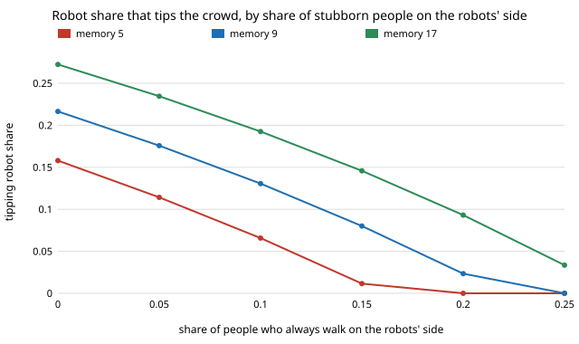

# society-blocs: how many robots does it take to change a crowd's walking side when some people always walk on the robots' side?

`society-stubborn` gave a crowd a block of people who always walk the status-quo side (right) and
found they raise the robot share that tips everyone else. This asks the mirror question: what if
a block always walks the robots' side (left), and what if there are blocs on both sides?
**An always-left person is worth almost exactly one robot: for people who remember 9 partners the
mean-field tipping robot share falls from 0.217 with no allies to 0.176, 0.131, 0.080 and 0.023 at 5, 10,
15 and 20% always-left people, and a crowd with 25% of them tips with no robots at all (memory 5
needs 16%, memory 17 needs 28%). An always-right bloc pushes the other way, and when the two blocs
are equal the crowd sits on a knife edge: a crowd with 20% on each side tips at 0.063 robots in
mean field, 0.06 in simulation,.** Simulation (200 people, 12 seeds,
grid step 0.02) agrees with the mean field within 0.01 at all seven bloc mixes tried. Opposing blocs
cost the people something even with no robots: 0.195 conflicts per human meeting at `sl = sr = 0.10`,
`ρ = 0`, against a 0.020 error floor for an adaptive crowd.
Produced with AI assistance (Claude). Next step from `society-stubborn` in research track 17
(`society`, `PROJECTS.md`). Every result is about simulated people following a stated rule, not real crowds.

**Live page:** https://duncan-haywood.github.io/monorepo-projects/research/society-blocs/

## Why this question

`society-stubborn` listed "stubborn people on the robots' side and mixed blocks" as its first next
step. A robot fleet that wants to change a convention can recruit allies, and a convention can be
defended by an opposing bloc; both change what share of robots is enough. The model has an exact
mean-field prediction, so the answer can be checked rather than only simulated.

## Builds on

`society-stubborn` (same model; `sl = 0, sr = s` reproduces its published 0.2165 and 0.2830); `society-robotnorms`;
Young (1993), *Econometrica* 61(1):57–84; Xie et al. (2011), *Phys. Rev. E* 84:011130 (committed
minorities, including opposed ones); Centola et al. (2018), *Science* 360(6393):1116–1119. **Lab
tags:** HIRO and CAIRO only in the loose sense of `society-robotnorms`; no method of theirs is used.

## Model

As `society-stubborn`, well-mixed. Of the humans, a share `sl` always walk L (the robots' side), a share `sr` always walk R
(the status quo), each erring with probability `ε = 0.02`; the rest are adaptive and take the majority of their
last `M` partners. Committed robots (share `ρ` of everyone) walk L. A random partner walks L with probability
`q = ρ + (1−ρ)[(1−sl−sr)(x(1−ε)+ε/2) + sl(1−ε/2) + sr ε/2]`, `x` being the share of adaptive people whose memory
majority is L; `F(x) = P(Bin(M,q) ≥ (M+1)/2)`; `ρ_c` is the least `ρ` at which iterating `F` from 0 passes 1/2
(`ρ_c = 0` if the crowd already tips at `ρ = 0`). Simulation: `N = 200`, 500 rounds, 12 seeds per cell; tipping
is judged on adaptive people.

## Results

From `experiments/results.txt` (`experiments/run.py`, seeded).

**A. Allies on the robots' side** (`sr = 0`, mean field):

| sl | M=5 | M=9 | M=17 |
|---|---|---|---|
| 0.00 | 0.158 | 0.217 | 0.273 |
| 0.05 | 0.114 | 0.176 | 0.235 |
| 0.10 | 0.066 | 0.131 | 0.193 |
| 0.15 | 0.012 | 0.080 | 0.146 |
| 0.20 | 0 | 0.023 | 0.093 |
| 0.25 | 0 | 0 | 0.034 |



At small `sl` the exchange rate is close to one for one (memory 9: 0.217 to 0.176 over 5 points of allies,
about 0.8 robots saved per ally; allies cost less than a robot because they still err and are counted among the
humans).

**B. Self-tipping.** The least `sl` at which the crowd tips with no robots is 0.219 (memory 9) with no opposing bloc,
and rises to 0.233, 0.254 and 0.300 at `sr` = 0.1, 0.2, 0.3. At `sr = 0.3` memory 5 and 9 coincide at 0.300: with
equal blocs the adaptive majority sits exactly at one half, so only the bloc ordering matters.

**C. Splitting a fixed bloc** (memory 9, total stubborn share `S`, fraction `f` on L): at `S = 0.2`, `ρ_c` falls
from 0.240 (`f = 0`) to 0.194, 0.144, 0.087 and 0.023 (`f = 1`); at `S = 0.4`, an even split already gives 0.063 and
`f ≥ 0.75` tips with no robots. Moving a bloc's balance toward the robots' side is worth more than adding robots.

**D–E. Simulation (M = 9).** Least grid robot share at which at least half of 12 crowds end with a majority of
adaptive people on L, against mean field: 0.22/0.2165 (0, 0), 0.18/0.176 (0.05, 0), 0.14/0.131 (0.10, 0), 0.08/0.080
(0.15, 0), 0.14/0.144 (0.10, 0.10), 0.16/0.161 (0.10, 0.20), 0.06/0.063 (0.20, 0.20) for (`sl`, `sr`).
The (0.20, 0.20) case is a symmetric knife edge, not a real threshold: at `ρ = 0` the mean final share is only 0.038, yet a
few robots (0.06) tip almost every crowd (0.848).

**F. Cost.** With `sl = sr = 0.10`, conflicts per human meeting are 0.195 at `ρ = 0` (two opposing blocs meet
adaptive people and each other), 0.236 at 0.05, 0.291 at 0.10, and 0.196 at 0.20, where most crowds have tipped.
A fleet that tips an unsettled crowd leaves people with more conflicts on the way, not fewer, as in `society-robotnorms`.

## Limitations

Stylised: no geometry or speed; blocs are fixed, share nothing with robots except a side, and never convert; the
equal-bloc case is a knife edge in mean field that finite-`N` drift decides; 12 seeds, 200 people. The "worth about
0.8 of a robot" exchange rate is for memory 9 at small `sl` only. Results about simulated walkers, not real people. Recruiting allies
to move a norm is a consent question (track 17 guardrails); nothing here designs a way to do it covertly.

## Reproduce

```
cd research/society-blocs
python3 -m unittest discover -s tests            # 11 tests, ~1 s
PYTHONPATH=src python3 experiments/run.py        # writes results.txt (~6 min)
python3 experiments/figure.py
```

## Next steps

1. Blocs that convert slowly (stubborn people who adapt with a small probability) instead of never.
2. Allies placed together in the ring/placement model of `society-robotnorms`.
3. Fit `sl`, `sr` to measured side preference (Moussaïd et al. 2009) rather than sweeping them.

## Owner steps

None.

## Outside dependencies

None: Python standard library only.
