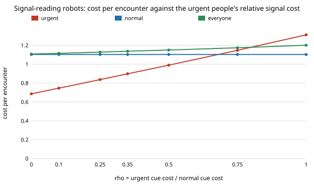

# society-cheapcue: how much cheaper must an urgency cue be for the urgent before a door robot can rely on it?

`society-fakeurgency` found that when everyone pays the same cost to signal urgency, a signal-reading robot fleet
gives urgent people almost nothing. Here the cue is **cheaper for the urgent** (a hurried gait is a by-product of
being in a hurry; imitating it costs a normal person effort), the standard route to a separating signal (Spence
1973). **Answer: the urgent must pay at most about half of what normal people pay (`rho ≤ 0.5`) for the fleet to
give them a clear gain (+0.14 of the 0.45 perfect reading would give, at a normal cost of 0.6); at `rho = 0.25` they
get +0.29, at `rho = 0` +0.44. At `rho ≥ 0.75` the cue leaves them no better off than yield-all. The crowd, robots
included, is worse off than under yield-all in every cell tried (+0.05 to +0.28 per encounter): the signal cannot
make the fleet a win for everyone, only a transfer to the urgent, paid by normal people and by the robots
themselves.** Produced with AI assistance (Claude). Track 17 (`society`, `PROJECTS.md`). Every result is about
simulated agents following a stated rule, not real people or robots.

**Live page:** https://duncan-haywood.github.io/oss-monorepo/research/society-cheapcue/

## Builds on

`society-fakeurgency` (door model, signalling logit and mean-field solver, imported unchanged; `rho = 1`
reproduces it, which a test checks), `society-urgentdoor` (perfect-reading reference) and Spence (1973), "Job market
signaling", *Quarterly Journal of Economics* 87(3):355–374. Nothing is reproduced. **Lab tags:** none used.

## Method

Urgent people pay `cU = rho · cN` to signal, normal people `cN`; everything else is as in `society-fakeurgency`
(30% robots, 20% urgent, waiting cost 3x, collision cost 3, dithering cost 1; robots yield to signallers and go
against the rest). `rho` is the one new parameter and is swept, not measured: no study of how much costlier a
faked gait or button press is than a real one was found for this model's units.

## Results (`experiments/results.txt`, deterministic)

Baseline yield-all: urgent 1.130, normal 1.051, robots 1.000, crowd 1.047.

**B. `cN = 0.6`.** Faking is set by the normal cost alone (2.5% of normal people fake at any `rho`); the urgent send
the cue almost always once `rho ≤ 0.5`.

| `rho` | urgent send | urgent cost | normal cost | crowd |
|---|---|---|---|---|
| 1.00 | 0.92 | 1.311 | 1.103 | 1.201 |
| 0.75 | 0.97 | 1.147 | 1.103 | 1.174 |
| 0.50 | 0.99 | 0.990 | 1.103 | 1.150 |
| 0.25 | 1.00 | 0.837 | 1.103 | 1.128 |
| 0.00 | 1.00 | 0.686 | 1.103 | 1.107 |

**C. Urgent gain over yield-all** (grid of `rho` by `cN`): positive in most cells with `rho ≤ 0.5`, largest
(+0.40 to +0.45) at `rho = 0`, `cN ≥ 0.4`; at `rho = 1` negative in all 5 cells.

**D. Crowd cost minus yield-all** is positive in all 35 cells (+0.045 to +0.280).

**E. Reading error.** The largest `rho` at which urgent people still gain (best `cN`) falls from 1.00 (`e = 0`, a
gain of only +0.018) to 0.75 (`e = 0.1`) and 0.40 (`e = 0.2`), with gains under 0.01 at the edge.

**F. Even perfect reading is a transfer.** Urgent people gain 0.453, normal people lose 0.036 and robots lose
0.294 (they go against non-signallers and collide more), so the crowd is 0.045 worse off. A reading fleet cannot
make this up with a better cue; the choice to favour the urgent costs the robots' own throughput.

**G. Robot share** (`rho = 0.25`, `cN = 0.6`): urgent gain is −0.014 at 10% robots, +0.293 at 30%, +0.436 at 50%;
the crowd's extra cost grows from +0.029 to +0.850 at 70%.

## Limitations

- `rho` and `cN` are swept, not sourced; no measured cost of a real cue. Whether real urgency gives a cue that is
  cheaper than imitation is an empirical question this model cannot answer.
- Costs are in the units of `society-doorway` (collision 3, dithering 1) and the crowd average counts robots as
  agents; weighting robots at zero would make some cells favourable to people, not tested here.
- Same model limits as `society-fakeurgency`: logit signalling, random pairing, no geometry, no robot learning,
  no continuation to find multiple equilibria. No agent-based check of the signalling equilibrium (the door part
  was checked in `society-fakeurgency`, unchanged).

## Next steps

1. Report crowd cost for people only, and for a social planner who weights urgent waiting more.
2. Robots that learn `gS` and `gQ` and so discount a cue when many people send it.
3. A cue that leaks in continuous space (speed, path) instead of a binary signal, in `society-plaza`.

## Reproduce

`python3 experiments/run.py && python3 experiments/figure.py`; tests: `python3 -m unittest tests/test_model.py`.

## Owner steps

None.
