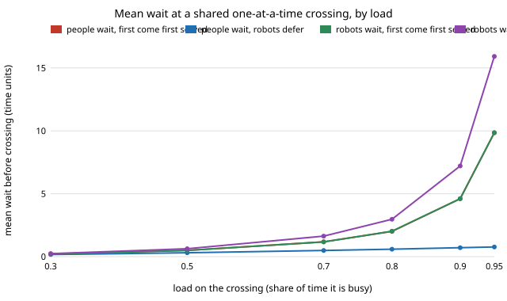
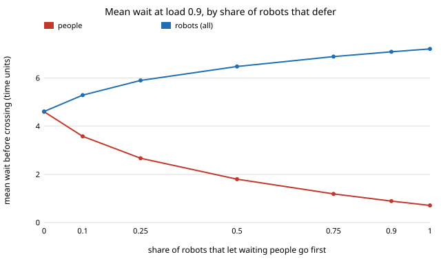

# society-commons: what does it cost robots to let people go first at a shared lift or narrow pavement?

When robots and people share something that only one can use at a time (a lift, a narrow
pavement, a charging point), how much robot waiting does deference buy in people's waiting?
In a queueing model checked against closed forms: **letting every waiting person go first cuts
people's mean wait 6.5× at load 0.9 (4.60 to 0.71 time units) and raises the robots' mean wait
by 2.6 units (4.61 to 7.21). The total is conserved: with equal waiting costs, every deference
share from 0 to 1 costs the same (4.14 to 4.15 per unit time), so deference moves waiting
between groups and does not remove it. It is the cheaper arrangement exactly when a person's
wait costs more than a robot's (break-even at cost ratio 1.0 for equal crossing times). An
individual robot always gains by not deferring (a lone selfish robot among deferential ones
waits 2.08, the deferential ones 7.65), which is the dilemma. When the crossing is overloaded
(load 1.2, everyone gives up after 20 time units), deference by half the robots is enough: it
costs the robots 10.5% of their crossings and lifts people's crossings by 20% (0.334 to
0.401 per unit time), to everyone served.** Produced with AI assistance (Claude). Fourth
project of research track 17 (`society`, `PROJECTS.md`, milestone 4). Every result is about
simulated agents following a stated rule, not about real people or robots.

**Live page:** https://duncan-haywood.github.io/monorepo-projects/research/society-commons/

## Why this question

A robot fleet that shares narrow spaces with people (hospital lifts, shop doors, pavements)
must pick a policy for who goes first. Letting people go first is the polite default, but it
has a price, and the price depends on how busy the space is. The track asks what deferential
robots cost and what they buy, and whether robots that defer are worse off than robots that
do not (the structure of a sequential social dilemma, Leibo et al. 2017). A one-server queue
is the smallest model with those features, and it has exact answers to check a simulation
against.

## Builds on

- Pollaczek–Khinchine mean wait for the M/G/1 queue, and Cobham (1954), *Operations Research*
  2(1):70–76: mean waits under non-preemptive priority. Used as the exact answer at the two
  ends of the deference scale.
- Kleinrock (1965), *Naval Research Logistics Quarterly* 12(2):181–192: the conservation law
  for work-conserving queue disciplines. It is why the total cost is flat in section C.
- Cox and Smith (1961), *Queues*: the `c·μ` rule (serve first the class with the highest
  waiting cost per unit of service), the reason section D breaks even at equal costs.
- Leibo, Zambaldi, Lanctot, Marecki and Graepel (2017), AAMAS: sequential social dilemmas, for
  the framing of section C.

Full entries are in `paper/whitepaper.md`. This project reproduces none of these papers; it
applies their standard results to a robot-and-people setting. **Lab tags:** HIRO (social
intelligence) and CAIRO (human-robot collaboration) only in the loose sense that the policy
under test is how robots behave among people; no method of theirs is used.

## Model

- One server crosses one agent at a time. Crossing takes 1.0 time unit for a person and
  `s_r` (default 1.0) for a robot. Arrivals are Poisson: people at `λ_h`, robots at `λ_r`;
  load is `ρ = λ_h·1 + λ_r·s_r`. People are 40% of the load unless stated.
- A **selfish** robot queues first come, first served, level with people. A **deferential**
  robot goes only when no person is waiting. A share `f` of robots is deferential (`f = 0`
  is plain first come first served; `f = 1` is non-preemptive priority for people).
- Wait is time in the queue before crossing. Optional **patience**: an agent that has waited
  that long leaves unserved (people walk round, robots re-route).
- 12 seeds of 20,000 time units after a 1,000 warm-up. Closed forms for `f = 0` and `f = 1`
  are in `society_commons.theory`.

## Results

All numbers are from `experiments/results.txt` (`experiments/run.py`, seeded).

**A. The simulation matches the closed forms.** For loads 0.5, 0.7 and 0.9, people's share
of the load 20%, 50% and 80%, and both rules, the 12-seed mean waits are within 2.7% of the
formulae (worst case 0.027, at load 0.9; within 1.4% at load 0.5).

**B. Deference grows with load.** People are 40% of the load:

| load | people wait, first come | people wait, robots defer | robots wait, first come | robots wait, robots defer |
|---|---|---|---|---|
| 0.30 | 0.22 | 0.17 | 0.21 | 0.24 |
| 0.50 | 0.50 | 0.31 | 0.50 | 0.63 |
| 0.70 | 1.18 | 0.49 | 1.17 | 1.63 |
| 0.90 | 4.60 | 0.71 | 4.61 | 7.21 |
| 0.95 | 9.84 | 0.77 | 9.86 | 15.92 |

At low load deference is nearly free for the robots (0.03 units at load 0.3). Near
saturation both effects are large: at 0.95 people save 9.1 units and the robots add 6.1.



**C. A conservation law and a dilemma.** At load 0.9, sweeping the share `f` of deferential
robots from 0 to 1: people's wait falls monotonically (4.60, 3.58, 2.67, 1.80, 1.19, 0.89,
0.71 at `f` = 0, 0.1, 0.25, 0.5, 0.75, 0.9, 1) while the robots' mean wait rises (4.61 to
7.21), and the equal-cost waiting cost per unit time stays between 4.14 and 4.15 for every
`f`. Deference moves waiting; it does not create or remove any. The robots that defer wait
much longer than those that do not within the same fleet: at `f = 0.1` a deferential robot
waits 18.97 and a selfish one 3.77; at `f = 0.9` they wait 7.65 and 2.08. Whoever defects
gains, whoever defers pays, and people pay for each defector.



**D. Whether deference pays depends on whose wait costs more.** At load 0.9 with a robot's
wait costing 1 per unit, deference is the cheaper arrangement from a person's cost of 1.1
upward (4.18 against 4.31 at 1.1; 4.92 against 9.11 at 4) and first come first served is
cheaper at 1.0 or less (4.14 against 4.15 at exactly 1.0). That matches the `c·μ` rule for
equal crossing times.

**E. Slower robots.** If robots take 0.5, 1, 2 or 3 units to cross (load held at 0.9), the
robots defer's benefit to people stays near 6.2–6.5× in people's wait (6.53, 6.47, 6.41, 6.22),
while people's wait without deference grows with robot slowness (3.23, 4.60, 7.26, 9.64).

**F. Overload.** At load 1.2 (people 0.4 and robots 0.8 per unit time, everyone gives up after
20 time units) the server is busy all the time under every rule, so total crossings per unit
time are about 1.0 either way, and deference changes who gets them:

| share deferential | people served | robots served | robot crossings / unit | people crossings / unit | people's mean wait |
|---|---|---|---|---|---|
| 0 | 83.3% | 83.4% | 0.666 | 0.334 | 17.31 |
| 0.25 | 97.1% | 76.3% | 0.610 | 0.389 | 11.55 |
| 0.50 | 100% | 74.6% | 0.596 | 0.401 | 4.34 |
| 0.75 | 100% | 74.7% | 0.597 | 0.401 | 2.08 |
| 1 | 100% | 74.9% | 0.599 | 0.401 | 0.83 |

Robots lose 10.5% of their crossings at `f = 0.5` (0.666 to 0.596), people gain 20%, and
every person is served. Beyond half the robots
deferring, the crossings no longer change, only people's wait falls.

## What this does and does not show

- It shows that in this model the cost of deference is a transfer of waiting from people to
  robots, that the transfer is cheap at low load and large near saturation, that it pays only
  if people's waiting costs more than robots', and that an individual robot has a reason not
  to defer. A deployer should expect to need a rule, a norm or a cost on defection to keep a
  fleet deferential, and should expect most of the benefit of deferring from half the fleet
  when the space is overloaded.
- It does not show how large real people's or robots' waiting costs are, or that people are
  Poisson arrivals with a fixed crossing time; real lifts and pavements are not one server.
  The cost ratio in D is a free parameter, not a measured one.
- Priority for people is a policy that humans would have to see and accept. Nothing here is
  a design for robots that conceal what they do or manipulate people's choices.

## Limitations

One server, one resource; deterministic crossing times; Poisson arrivals; abandonment at a
fixed patience; no per-robot learning or adaptation of deference (the "dilemma" is read off
payoffs, not played as a game); no priority for urgent people; 12 seeds. The simulation is
within 2.7% of the closed forms but the closed forms cover only the two ends of the deference
scale. No real data and no human subjects were used.

## Reproduce

```
cd research/society-commons
python3 -m unittest discover -s tests      # 11 tests, a few seconds
PYTHONPATH=src python3 experiments/run.py  # about a minute, writes results.txt
python3 experiments/figure.py              # writes the two SVGs from results.txt
```

Stdlib only (Python 3.9+).

## Next steps

1. Let robots learn their deference from payoffs (a repeated game), and test whether a small
   penalty on defection sustains a deferential fleet.
2. Several servers (two lifts), a two-way narrow pavement with direction switching costs.
3. Urgent people (a wheelchair user, someone running for a train) as a third class.

## Outside dependencies

None: the model, simulation and figures use only the Python standard library.
