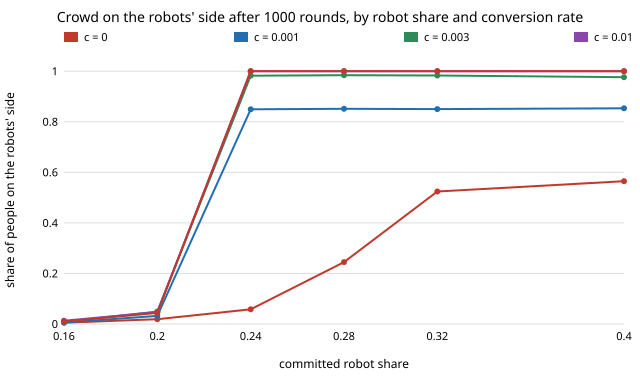

# society-converts: does a stubborn block that slowly converts let a smaller robot minority tip a crowd's walking side?

`society-stubborn` found that a fixed block of 40% stubborn walkers raises the committed-robot share that tips
a crowd (memory 9) from 0.217 to 0.283. Real stubbornness leaks. **If each stubborn person converts to an
ordinary remember-your-partners walker with probability `c` per round, a robot share that never tips a crowd
with the block fixed (0.24, between the two thresholds) tipped all 12 simulated crowds at every `c` we tried
from 0.001 up, at median round 721 for `c` = 0.001 and 59 for `c` = 0.1. At 0.28 (just under the fixed-block mean-field
threshold) the fixed-block crowds tipped in 5 of 12 runs, at median round 654; with `c` = 0.001 all 12 tipped, at median round 185. Robot shares at or below 0.20, the
`s = 0` threshold's neighbourhood, never tipped at any `c`.** Conversion therefore moves the threshold from the fixed-block
value down towards, but not below, the no-stubborn value (0.217), and mostly buys speed. Produced with AI
assistance (Claude). Track 17 (`society`, `PROJECTS.md`), the first "convert slowly" step listed in `society-blocs`.
Every result is about simulated people following a stated rule, not real crowds.

**Live page:** https://duncan-haywood.github.io/oss-monorepo/research/society-converts/

## Why this question

`society-blocs` and `society-stubborn` both listed "stubborn people who adapt with a small probability instead of
never" as a next step. This asks what that changes about the fixed-block conclusion, and in particular whether the
conclusion "you need 0.283 robots" is really "you need 0.283 robots or enough patience".

## Builds on

`society-stubborn` (same memory rule, error `eps = 0.02`, stubborn people always walk right); Young (1993),
*Econometrica* 61(1):57–84; Xie et al. (2011), *Phys. Rev. E* 84:011130; Centola et al. (2018), *Science*
360(6393):1116–1119. **Lab tags:** HIRO and CAIRO only in the loose sense of `society-robotnorms`; no method of theirs is used.

## Model

Well-mixed, `N = 200`, `n/2` meetings per round. Committed robots (share `ρ` of everyone) walk L. Of the humans, a
share `s = 0.4` start stubborn (always R, apart from error). Each round every stubborn person converts with probability `c`; a convert has memory
all R, then follows the majority of its last `M = 9` partners and never turns back. Tipped means at least half of
non-robot humans have a majority-L memory. 1000 rounds, 12 seeds per cell. A mean-field relaxation (section D of
`results.txt`) iterates the `society-stubborn` map one step per round while the stubborn share decays by `1 − c`;
its steps are not meetings, so it is a rank-order check, not a clock.

## Results

From `experiments/results.txt` (`experiments/run.py`, seeded). `ρ` rows, `c` columns.

| ρ | c = 0 | 0.001 | 0.01 | 0.1 |
|---|---|---|---|---|
| 0.20 tipped | 0/12 | 0/12 | 0/12 | 0/12 |
| 0.24 tipped (median round) | 0/12 | 12/12 (721) | 12/12 (139) | 12/12 (59) |
| 0.28 tipped (median round) | 5/12 (654) | 12/12 (185) | 12/12 (61) | 12/12 (31) |
| 0.32 tipped (median round) | 12/12 (63) | 12/12 (51) | 12/12 (36) | 12/12 (24) |



At `c = 0.001` the crowds that tipped do not all finish: the mean final share on L is about 0.85 at
`ρ ≥ 0.24`, because some stubborn people are still unconverted at round 1000 (`0.4·0.999^1000 ≈ 0.15` of humans). The
mean-field relaxation agrees with simulation in order (more conversion, earlier; more robots, earlier; no tipping at
0.16 and 0.20) and, at `ρ = 0.24`, `c = 0.001`, in size (round 755 against 721), but is much faster at 0.28 (76 against 185), so we do not
claim it predicts times.

## Limitations

Stylised: no geometry or speed; conversion is spontaneous and independent of what the robots do (a real convert
might follow the robots, or the other way); one starting stubborn share and memory; the `c = 0` row is a finite-population run, where 5 of 12 crowds tip
at 0.28 just under the mean-field line 0.283; 12 seeds, 200 people; the mean-field clock is only indicative.
Results about simulated walkers, not real people.

## Reproduce

```
cd research/society-converts
python3 -m unittest discover -s tests            # 8 tests, <1 s
PYTHONPATH=src python3 experiments/run.py        # writes results.txt (~1.5 min)
python3 experiments/figure.py
```

## Next steps

1. Conversion that depends on exposure (stubborn people convert after meeting robots) instead of a constant rate.
2. Fit `c` and `s` to measured side preference (Moussaïd et al. 2009) rather than sweeping.
3. Allies and slow conversion together (`society-blocs`).

## Owner steps

None.

## Outside dependencies

None: Python standard library only.
