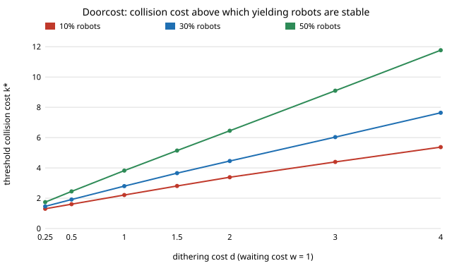

# society-doorcost: at what collision cost does a door stop tempting robots to go first?

`society-doorway` found that robots which always yield at a door are also individually best, so no
dilemma appears, but it tested one cost set (collision `k = 3`, waiting `w = 1`, dithering `d = 1`)
and said the result hinged on it. This project sweeps the costs. **With 30% robots and `d = 1`, a
fleet that always yields is individually stable only when the collision cost is above `k* = 2.80`
(`w = 1`). Below that, one robot gains by going first, although yielding is still the best fleet
rule for the whole crowd: a dilemma (at `k = 1.5` a deviator gains 0.219 per encounter).** The
threshold rises with dithering cost (`k* = 1.46` at `d = 0.25`, 4.46 at `d = 2`, 7.64 at `d = 4`)
and with robot share (2.21, 2.80, 3.82 at 10%, 30%, 50% robots, `d = 1`). When a collision is cheaper
than waiting (`k = 0.5`) going is best for everyone and no dilemma appears. `society-doorway`'s `k = 3`
sat just above the threshold, which is why it saw none. Produced with AI assistance (Claude). Track 17
(`society`, `PROJECTS.md`), the first next step named in `society-doorway`. Every result is about
simulated agents following a stated rule, not real people or robots.

**Live page:** https://duncan-haywood.github.io/monorepo-projects/research/society-doorcost/

## Builds on

`society-doorway` (same game, people, mean field and simulator, imported unchanged), and through it
Smith and Price (1973), *Nature* 246:15–18 (Hawk–Dove), McKelvey and Palfrey (1995), *Games and Economic
Behavior* 10:6–38 (logit response), Young (1993), *Econometrica* 61(1):57–84 (memory of recent partners) and
Leibo et al. (2017), AAMAS (sequential social dilemmas). Nothing is reproduced; the rules are standard.
**Lab tags:** HIRO and CAIRO only loosely; no method of theirs is used.

## Method

Fleet share `r` of robots all going with probability `g`; people as in `society-doorway` (`m = 9`,
`beta = 8`). Let `q` be the share of partners who go at the mean-field equilibrium.
- *Individual test:* a single extra robot gains by going when `k q < w q + d (1 − q)`. The gain
  `deviation_gain` is yielding's cost minus going's, so positive means going pays.
- *Crowd test:* the `g` on a 51-point grid that minimises the crowd's mean cost.
- *Dilemma cell:* the crowd-best `g` is not individually stable (pure `g = 0` stable if going does not pay,
  pure `g = 1` if yielding does not pay, a mixed `g` if the gain is within 0.001 of zero).
- `threshold_k` bisects the `k` at which the gain at `g = 0` crosses zero.

## Results (`experiments/results.txt`, seeded and deterministic)

**A. Dilemma map, 30% robots, `w = 1`.** Rows are `d`, columns `k`; D = dilemma, `.` = none (a yielding fleet is stable and
crowd-best), G = going fleet best and stable. Crowd-best `g` is 0 in every D cell except `d = 2, k = 1` (0.36) and `d = 4, k` 1 to 3
(0.96, 0.82, 0.64, 0.36), where dithering is so costly that partial going beats full yielding.

| d \ k | 0.5 | 1 | 1.5 | 2 | 3 | 5 | 10 |
|---|---|---|---|---|---|---|---|
| 0.25 | D* | D | . | . | . | . | . |
| 0.5 | D* | D | D | . | . | . | . |
| 1 | G | D | D | D | . | . | . |
| 2 | G | D | D | D | D | . | . |
| 4 | G | D | D | D | D | D | . |

`D*` at `k = 0.5`, `d <= 0.5`: crowd cost is nearly flat in `g` (0.474 to 0.500), a near-tie, not a clear dilemma.

**B. Robot share.** At `d = 1` the yielding fleet is stable from `k = 3` at 10% robots, `k = 3` at 30%, and only from
`k = 5` at 50% (a deviator at `k = 3` still gains with half the crowd robots).

**C. Threshold.** `k*` (section D of `results.txt`):

| d | 10% robots | 30% | 50% |
|---|---|---|---|
| 0.25 | 1.305 | 1.462 | 1.740 |
| 1 | 2.210 | 2.799 | 3.824 |
| 2 | 3.382 | 4.457 | 6.451 |
| 4 | 5.370 | 7.638 | 11.769 |



**D. Simulation check** (200 agents, 12 seeds, 30% robots): the robots' simulated cost matches the mean field within 0.04
at all 12 checked settings, and people's go share within 0.002 (section C of `results.txt`).

## What this does and does not show

- Whether robots that yield are "polite" or "exploited" depends on how costly a collision is relative to waiting
  and dithering; in this game the break point is a collision costing about 2.8 times a wait when dithering costs one wait.
- A designer who sets a yielding rule for a fleet should check that the rule holds without enforcement: below `k*`,
  each robot is tempted to go, and a fleet of individually adaptive robots would not stay yielding.
- Nothing here says real doors have these costs. `k`, `d`, `w` are free parameters, not measured.

## Limitations

Mean field with random pairing; costs identical for people and robots; people homogeneous; robots follow a fixed `g` and do not
learn (the deviation test is a one-step best response, not a learning dynamic); grid of 51 values of `g`; a mixed `g`
counts as stable only within 0.001; 12 seeds in the simulation check; no geometry, queues or real data.

## Reproduce

```
cd research/society-doorcost
python3 -m unittest discover -s tests      # 6 tests
python3 experiments/run.py                 # about 15 seconds, writes results.txt
python3 experiments/figure.py              # writes threshold.svg
```

Stdlib only (Python 3.9+); imports `research/society-doorway/src`.

## Next steps

1. Robots that learn `g` from their own payoffs: does a fleet below `k*` drift to going, and where does it settle?
2. A mixed population with urgent people (higher `w`) and a robot rule that reads urgency.
3. A door with geometry (a social-force crowd), joining `society-plaza`.

## Owner steps

None.

## Outside dependencies

None: Python standard library only.
