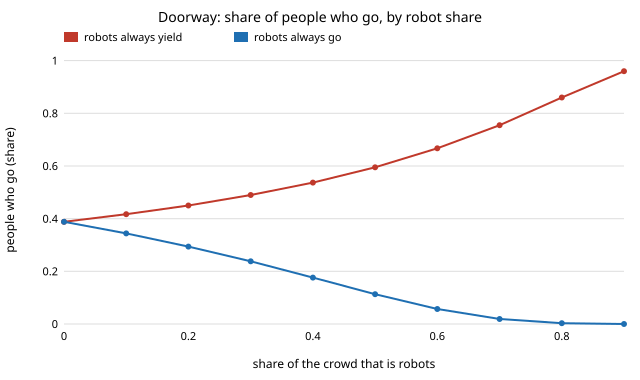
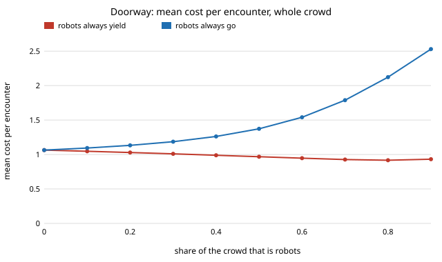

# society-doorway: when robots always yield at a door, do people learn to walk through first, and who pays?

Track 17 asks who yields at a door. The earlier projects there study walking sides, lifts and trust;
none plays the door itself as a go-or-yield game. People pick go or yield from the actions of their last 9
partners, and robots follow a fixed rule. **Always-yielding robots make people go: the share of people who
go rises from 0.388 with no robots to 0.490 at 30% robots, 0.595 at 50% and 0.860 at 80%, and everyone's
mean cost per encounter falls (people 1.064 to 0.936 at 50% robots; the robots' own cost stays at 1.000).
Always-going robots do the opposite: at 30% robots only 0.238 of people go, and the robots' cost is 1.399, so
the whole crowd's cost rises from 1.064 to 1.186. In this payoff set a robot that goes is worse off than one
that yields (1.399 against 1.000 in a fleet of goers), and the best fixed go probability for the whole crowd is
0 at every robot share tried.** Mean field (an exact binomial memory average) and simulation (200 agents,
12 seeds) agree within 0.003 on people's go share at six mixes. Produced with AI assistance (Claude).
Track 17 (`society`, `PROJECTS.md`), a new question after the milestones. Every result is about simulated
agents following a stated rule, not real people or robots.

**Live page:** https://duncan-haywood.github.io/oss-monorepo/research/society-doorway/

## Why this question

The track names "who yields at a door" as a convention robots may set. The earlier milestones leave the
door itself untested: `society-robotnorms` and its follow-ups are about a symmetric choice of walking side,
where two people coordinate by matching. A door is the opposite structure, anti-coordination: you want to
do the opposite of your partner (the game of Chicken, or Hawk–Dove). A robot that always yields is the
polite default; this asks what a crowd learns from it and what it costs. The new question is not a micro-variant of the
walking-side chain (a different game, different payoffs, a cost to both groups).

## Builds on

- Smith and Price (1973), *Nature*
  246:15–18: the Hawk–Dove game, the standard model of anti-coordination.
- McKelvey and Palfrey (1995), *Games and Economic Behavior* 10:6–38: logit quantal response, the
  noisy best-response rule used for people.
- Young (1993), *Econometrica* 61(1):57–84: agents who best-respond to a sample of their last partners'
  actions, the memory mechanism reused from `society-robotnorms`.
- Leibo et al. (2017), AAMAS: sequential social dilemmas, for the question of whether yielding is individually costly.

This project reproduces none of them; it applies their standard rules. **Lab tags:** HIRO (social intelligence)
and CAIRO (human-robot collaboration) only loosely; no method of theirs is used.

## Model

- Each round agents are paired at random. Costs per agent (lower is better): both go, collision `k = 3`;
  one goes, the goer pays 0 and the yielder waits `w = 1`; both yield, dithering `d = 1` each.
- A person remembers the last `m = 9` partners' actions and goes with probability
  `1 / (1 + exp(beta (cost_go − cost_yield)))` (`beta = 8`), computed from the fraction who went. Goes
  and yields cost the same at a fraction 1/3 of partners going, `d / (d + k − w)`.
- A robot goes with fixed probability `g`: `g = 0` always yields, `g = 1` always goes.
- Mean field: the fraction of partners who go, `q`, solves `q = (1 − r) · E[go prob | m draws of q] + r g`, with the
  expectation taken over `Binomial(m, q)`; the right side minus `q` is decreasing, so bisection finds the unique root.

## Results

All numbers are from `experiments/results.txt` (`experiments/run.py`, seeded).

**A. Simulation matches mean field.** At six mixes (robot share 0 to 0.5, `g` = 0, 0.33 or 1), people's go
share differs by at most 0.003 between mean field and the 12-seed simulation, and mean costs for people by at most 0.002; robots' costs by at most 0.013.

**B. Yielding robots pull people into going.**

| robot share | people who go | people's cost | robots' cost | crowd cost |
|---|---|---|---|---|
| 0.0 | 0.388 | 1.064 | | 1.064 |
| 0.3 | 0.490 | 1.014 | 1.000 | 1.010 |
| 0.5 | 0.595 | 0.936 | 1.000 | 0.968 |
| 0.8 | 0.860 | 0.584 | 1.000 | 0.917 |



**C. Going robots push people into yielding, at a cost to everyone.** With always-going robots, people who
go fall to 0.294 at 20% robots and 0.113 at 50%; the robots' cost rises to 1.305 and 1.670. People's cost
barely moves (1.064 to about 1.09) but robots pay for the collisions, so the crowd's cost rises to 1.133 and 1.373.



**D. Yielding is the individually best rule too, here.** In a fleet of 30% going robots, a robot that
switches to yielding drops from 1.399 to 1.000; in a fleet of 30% yielding robots, a robot that switches to going
rises from 1.000 to 1.029. The best fixed go probability for the crowd's total cost is 0 at robot shares 0.1,
0.2, 0.3, 0.5 and 0.7. So unlike the shared lift of `society-commons`, deferring is not a sacrifice at a door: no
dilemma appears. This hinges on a payoff coincidence (`w = d`, so yielding always costs 1) and on `k = 3`; it is
a result of this parameter set, not a general law.

**E. Longer memory and sharper responses shift people more.** At 30% yielding robots the rise in people's go
share is +0.075 (m = 3, beta = 2) and +0.116 (m = 25, beta = 20).

## What this does and does not show

- It shows that, in an anti-coordination door game, a robot that always yields exploits-nothing: it
  teaches people to go, lowers everyone's cost, and costs the robot nothing relative to being alone. A fleet that goes
  first harms the crowd (and itself).
- It does not show that real people respond to robots like this, or that costs are `k = 3`, `w = d = 1`. Real doors
  differ with hurry, size and vulnerability; a robot that blocks a wheelchair user needs a rule this model lacks.
- "People who learn to go" is a norm shift raised by robots. Nothing here is a design for concealed persuasion;
  the cost to people is reported (it falls).

## Limitations

Two-player encounters with random mixing (no queue, geometry or visibility); costs fixed, not varied (except `m`, `beta`);
people are homogeneous; robots do not learn; one parameter set for costs; 12 seeds; no real data or human subjects.

## Reproduce

```
cd research/society-doorway
python3 -m unittest discover -s tests      # 7 tests, a few seconds
PYTHONPATH=src python3 experiments/run.py  # about a minute, writes results.txt
python3 experiments/figure.py              # writes the two SVGs from results.txt
```

Stdlib only (Python 3.9+).

## Next steps

1. Vary the cost ratio `k / w` and `d / w` and find where going robots stop being individually worse (a dilemma).
2. Robots that learn `g` from payoffs, and a mixed population with urgent people.
3. A door with geometry (a social-force crowd), joining `society-plaza`.

## Owner steps

None.

## Outside dependencies

None: Python standard library only.
