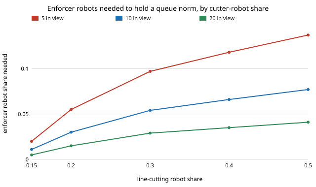

# society-enforcers: how many queue-enforcing robots hold a queueing norm against line-cutting robots?

`society-lineup` found that committed line-cutting robots break a queueing norm once they are 12.7% of
the crowd, because bystanders' objection fades as cutting spreads. This asks the reverse: if some
robots *queue and object*, and their objection does not fade, how many hold the norm?
**With people who remember the last 9 cut attempts they saw, a lone-cut human objection chance of 0.9,
10 people in view of each cut and an enforcer stop chance of 0.5, the cutter-robot share that breaks the
norm rises from 12.7% with no enforcers to 20.1% with 3% enforcers and 27.7% with 5%. Holding the
norm against 30% cutters needs 5.4% enforcers (9.7% with 5 people in view, 2.9% with 20); against 50%
cutters, 7.7%.** Simulation (200 people, 12 seeds) agrees: the norm holds in 0 of 12 crowds at 4.4%
enforcers, 4 of 12 at the mean-field 5.4% and 12 of 12 from 6.4%. Enforcement is cheap per robot but
tips sharply: 4% enforcers leave 95.5% of people cutting, 6% leave 18%. Produced with AI assistance
(Claude). Next step 3 of `society-lineup`, milestone of research track 17 (`society`, `PROJECTS.md`).
Every result is about simulated agents following a stated rule, not real people or robots.

**Live page:** https://duncan-haywood.github.io/oss-monorepo/research/society-enforcers/

## Why this question

The track asks what robots do to social conventions. `society-lineup` studied the harmful minority;
the design question for a fleet operator is the opposite one: what share of robots must police? Xie et
al. (2011) show a committed minority tips a convention; here the committed minority is on the norm's
side, against a minority on the other.

## Builds on

`society-lineup` (model, tipping definition, mean field against simulation; its `p0 = 0.9, k = 1, M = 9`
case reproduces here at `e = 0`, tested). Young (1993); Xie et al. (2011); Milgram et al. (1986).
**Lab tags:** HIRO and CAIRO only in the loose sense of the track (human-robot social behaviour).

## Model

As in `society-lineup`: a share `ρ` of cutter robots always cut; people remember the last `M` watched
attempts and cut iff most succeeded; people's objection stops a cut with probability
`p0 (1−z)^k`. New: a share `e` are enforcer robots, who never cut. A cut faces `L` people in view; each is
an enforcer with probability `e` and then stops the cut with probability `q`, so enforcers stop it with
probability `1 − (1 − q e)^L`, whatever `z` is. An attempt succeeds iff neither stops it. `z` is the
cutting share of the whole crowd, `z = ρ + (1 − ρ − e) x`.

**Parameters.** `M = 9`, `p0 = 0.9`, `k = 1`, `ε = 0.02` as in `society-lineup`. `L` and `q` have no source
I could find (they describe an unbuilt fleet), so they are swept: `L` 5, 10, 20 and `q` 0.25 to 1.

## Results

From `experiments/results.txt` (`experiments/run.py`, seeded). Least enforcer share that holds the norm:

| cutter share ρ | L = 5 | L = 10 | L = 20 |
|---|---|---|---|
| 0.15 | 0.020 | 0.011 | 0.005 |
| 0.20 | 0.055 | 0.030 | 0.015 |
| 0.30 | 0.097 | 0.054 | 0.029 |
| 0.40 | 0.118 | 0.066 | 0.035 |
| 0.50 | 0.137 | 0.077 | 0.041 |



- **Only `q·L` matters to first order:** `q = 0.25` at `L = 10` gives 0.055, 0.098, 0.119 at ρ = 0.2, 0.3, 0.4, the same as `q = 0.5` at `L = 5`. Halving the chance each enforcer stops a cut costs about as much as halving how many people see it.
- **Weaker human objection needs more:** at ρ = 0.30, e_min is 0.036, 0.054, 0.065, 0.074 for `p0` = 1.0, 0.9, 0.8, 0.7.
- **Sharp transition, no hysteresis:** at ρ = 0.30 the cut share is 99.7% at e = 0.02, 95.5% at 0.04, 18.3% at 0.06, 8.2% at 0.08, and a crowd that already cuts ends at the same value (one fixed point).
- **Simulation (ρ = 0.30):** norm held in 0, 0, 4, 12, 12, 12 of 12 crowds at e = 0.034, 0.044, 0.054, 0.064, 0.074, 0.094. At the threshold the simulation (0.561 cut share) is above mean field (0.342): finite crowds sit on the knife edge.

## Limitations

Enforcers are a probabilistic sum with no positions: nothing about where they stand, no cost to the robot of
objecting, no retaliation. `L` and `q` are swept and unsourced, and since only `q·L` matters the fleet
numbers cannot be read as "5% of robots" without knowing both for a real site. Cutters and enforcers do not
adapt. Binary one-counter model, 200 people, 12 seeds. Not evidence about real queues.

## Reproduce

```
cd research/society-enforcers
python3 -m unittest discover -s tests            # 6 tests, ~1 s
python3 experiments/run.py                       # writes results.txt (~1 min)
python3 experiments/figure.py
```

## Next steps

1. Place enforcers on a line or ring so that "in view" is geometric, and see if clustering them wastes them.
2. Enforcers that cost something (a fee per objection) and learn when to object.
3. Fit `L`·`q` to a published figure for how often bystanders intervene in line intrusions (Milgram et al. 1986).

## Owner steps

None.

## Outside dependencies

None: Python standard library only.
