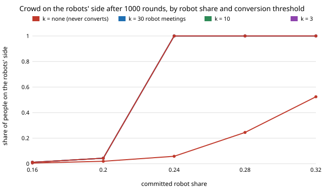

# society-exposure: do stubborn walkers who convert after meeting robots let a smaller robot minority tip a crowd's walking side?

`society-converts` let a stubborn block (40% of people, always walking right) leak away at a constant rate per round,
whatever the robots do. Real conversion needs a reason: seeing robots walk the other way. **If a stubborn person
converts after meeting a committed robot `k` times, then at 24% robots (a share that never tips the fixed-block
crowd) all 12 simulated crowds tip for every `k` tried from 1 to 30, at median round 48 for `k` = 1 and 171 for
`k` = 30; at 28% robots, where the fixed-block crowd tips in 5 of 12 runs, all 12 tip, at median rounds 24 to 110.
At 16% and 20% robots no crowd tips, although every stubborn person has converted by round 1000: the threshold falls
from the fixed-block value to the no-block value (0.217), not below it.** An exposure-blind rate with the same mean
time to convert (`c = ρ/k`) gives the same tipping set but is sooner at larger `k` and later at `k` = 1 and 3 (28% robots, `k` = 30: median round 62
against 110), because it converts a few people from the first round. Produced with AI assistance (Claude).
Track 17 (`society`, `PROJECTS.md`); the first next step of `society-converts`. Every result is about simulated
people following a stated rule, not real crowds.

**Live page:** https://duncan-haywood.github.io/monorepo-projects/research/society-exposure/

## Why this question

A fleet that wants to change a walking convention meets the people who resist it. If those people change their mind
because they keep meeting robots, then conversion speed rises with robot share, and a small fleet both converts slowly and
has fewer to convert with. `society-converts` assumed a constant rate; this asks whether tying it to robot meetings changes
the threshold or only the clock.

## Builds on

`society-converts` (same model; `k = None, c = 0` reproduces its simulation exactly for a seed, and a test checks it);
`society-stubborn`; Young (1993), *Econometrica* 61(1):57–84; Xie et al. (2011), *Phys. Rev. E* 84:011130; Centola et al.
(2018), *Science* 360(6393):1116–1119. **Lab tags:** HIRO and CAIRO only in the loose sense of `society-robotnorms`; no
method of theirs is used.

## Model

Well-mixed, `N = 200`, `n/2` meetings per round, error `ε = 0.02`, memory `M = 9`, 1000 rounds, 12 seeds per cell.
Committed robots (share `ρ` of everyone) walk L. A share `s = 0.4` of humans start stubborn (always R, apart from error). A
stubborn person counts meetings with a robot partner and, at the `k`-th, becomes an ordinary memory-rule walker with memory all
R, never turning back. Meetings with other humans do not count. Tipped means at least half of non-robot humans have a
majority-L memory. Each person is in about one meeting per round and the partner is a robot with probability `ρ`, so conversion
takes about `k/ρ` rounds; the comparison column uses the exposure-blind rate `c = ρ/k`.

## Results

From `experiments/results.txt` (`experiments/run.py`, seeded). Cell: crowds tipped of 12 (median tipping round).

| ρ | k = ∞ (fixed block) | k = 30 | k = 10 | k = 3 | k = 1 |
|---|---|---|---|---|---|
| 0.16 | 0/12 | 0/12 | 0/12 | 0/12 | 0/12 |
| 0.20 | 0/12 | 0/12 | 0/12 | 0/12 | 0/12 |
| 0.24 | 0/12 | 12/12 (171) | 12/12 (86) | 12/12 (57) | 12/12 (48) |
| 0.28 | 5/12 (654) | 12/12 (110) | 12/12 (48) | 12/12 (28) | 12/12 (24) |
| 0.32 | 12/12 (63) | 12/12 (63) | 12/12 (36) | 12/12 (22) | 12/12 (19) |



- Every stubborn person has converted by round 1000 for every `k` and every `ρ` from 0.16 up (section C), but below
  `ρ_c(s = 0) = 0.217` the converts are not enough: the final share on L is 0.011 at 16% and 0.043 at 20%.
- The median tipping round tracks the conversion time: `k/ρ` = 107 rounds against 110 at 28%, `k` = 30; 125 against 171 at
  24% (a guess, untested here: the crowd waits for most of the block, not the first convert).
- Matched exposure-blind conversion (section B) tips the same cells. It is clearly faster at `k` ≥ 10 where robots are
  plentiful (`k` = 30: 62 against 110 at 28%, 36 against 63 at 32%; `k` = 10: 44 against 48, 30 against 36), tied at 24%
  for `k` = 10 and 30 (85 against 86; 171 both), and slower at `k` = 1 and 3 (`k` = 1, 24%: 55 against 48). A threshold
  delays everyone until about `k/ρ` rounds, a rate converts a few people at once; we did not isolate which of the two
  drives the gap at small `k`.

## Limitations

Stylised: well-mixed meetings, no geometry or speed; robots are the only conversion trigger, and converts do not later reverse; one
stubborn share and memory; threshold, not probability, per exposure (a person who converts with probability `p` per robot meeting is
between `k = 1` and these); `ρ` is the only exposure source, so a fleet that is visible but rarely meets individuals (a plaza edge) is not
modelled; 12 seeds, 200 people, so medians differ by several rounds between runs; times are in rounds of `N/2` meetings, not seconds.
The "k/ρ" estimate is a rough mean-time argument, checked only against these medians. The side-preference figures of Moussaïd et al.
(2009, *Proc. R. Soc. B* 276:2755) could not be fetched in this run (the container blocks arXiv and PMC), so `s` is still swept, not fitted.

## Reproduce

```
cd research/society-exposure
python3 -m unittest discover -s tests            # 6 tests, <1 s
PYTHONPATH=src python3 experiments/run.py        # writes results.txt (~1.5 min)
python3 experiments/figure.py
```

## Next steps

1. Fit `s` and the conversion rule to measured side preference (Moussaïd et al. 2009) once the source is readable.
2. Conversion with probability `p` per robot meeting, and conversion that also needs a human convert nearby (social proof).
3. Allies placed together and exposure in the ring model of `society-robotnorms`, where meeting robots depends on position.

## Owner steps

None.

## Outside dependencies

None: Python standard library only (the test imports `society-converts` from this repository).
