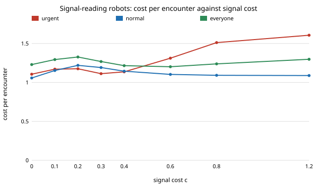

# society-fakeurgency: can a robot that yields to people in a hurry survive people faking a hurry?

`society-urgentdoor` found that a robot fleet that yields only to urgent people cuts their cost by 40% (1.130
to 0.676) — **if the robot can read urgency perfectly**. Real robots can only read a *signal* (a hurried gait, a
button), and a signal can be faked and misread. This project adds both and asks how much of the gain survives.
**Answer: almost none. With 30% robots and 20% urgent people, no signal cost on a 0 to 1.2 grid lets the
signal-reading fleet beat plain yield-all for the crowd (the best case costs the crowd 1.201 against 1.047),
and the most it saves urgent people is 0.025 per encounter (1.105 against 1.130), about 6% of the 0.45 they gain
from perfect reading. A free signal is sent by 95% of normal people; a dear one is sent by few fakers but also
taxes the urgent, who pay it themselves. A 10% misreading rate wipes out most of what is left.** Produced with
AI assistance (Claude). Track 17 (`society`, `PROJECTS.md`). Every result is about simulated agents following
a stated rule, not real people or robots.

**Live page:** https://duncan-haywood.github.io/oss-monorepo/research/society-fakeurgency/

## Builds on

`society-urgentdoor` (urgent share `u`, waiting cost `wu`, robots with `gU`, `gN`; its mean-field solver is
the reference the tests check against), `society-doorway` (logit people with memory `m = 9`, `beta = 8`;
imported unchanged) and Spence (1973), "Job market signaling", *Quarterly Journal of Economics* 87(3):355–374
(a signal separates types only if it costs the high type less than it gains them). Nothing is reproduced.
**Lab tags:** HIRO and CAIRO only loosely; no method of theirs is used.

## Method

- People of two types, urgent (share `u = 0.2`, waiting cost `wu·w`, `wu = 3`) and normal (`w = 1`). Each round a
  person signals urgency at private cost `c` or not, with a logit response (sharpness `bs = 8`) to the door-cost
  gain from signalling minus `c`. Urgent people gain more from a yielding robot, which is what could separate them.
- A robot sees a signaller as one w.p. `1 − e` and a non-signaller as one w.p. `e` (misreading), and goes with
  probability `gS` against what looks like a signaller and `gQ` otherwise. The fleet rule studied is the reader of
  `society-urgentdoor`: `gS = 0`, `gQ = 1`. Robot–robot meetings use `gQ`.
- Door play as in `society-doorway`. A person's memory covers many rounds in which they signalled or not, so their
  go probability depends on the mixture of their own signalling history, not this round's signal; the first draft
  of this model conditioned on this round's signal and disagreed with the simulation by 0.04, which is why.
- Mean field with a damped fixed-point iteration on `(sU, sN)`; agent-based check (400 agents, 500 rounds, 5 seeds)
  of the door part with the signalling probabilities held fixed.

## Results (`experiments/results.txt`, seeded and deterministic)

**A. Reference** (`urgentdoor`, perfect reading): urgent 1.130 (yield-all) vs 0.676 (reader).

**B. Costlier signal, reader fleet, 30% robots, `e = 0`.** Cost per encounter, signal cost included.

| `c` | urgent send | normals fake | share of signals that are urgent | urgent | normal | robots | everyone |
|---|---|---|---|---|---|---|---|
| 0.0 | 1.00 | 0.95 | 0.21 | 1.105 | 1.057 | 1.606 | 1.229 |
| 0.2 | 1.00 | 0.68 | 0.27 | 1.175 | 1.219 | 1.598 | 1.326 |
| 0.4 | 0.98 | 0.13 | 0.65 | 1.136 | 1.144 | 1.384 | 1.215 |
| 0.6 | 0.92 | 0.03 | 0.90 | 1.311 | 1.103 | 1.335 | 1.201 |
| 1.2 | 0.08 | 0.00 | 0.99 | 1.606 | 1.088 | 1.544 | 1.297 |

Yield-all costs 1.130 / 1.051 / 1.000 / 1.047 (urgent / normal / robots / everyone). A cheap signal is used by
everyone, so robots yield to nearly all and nothing is learned; a signal dear enough to deter fakers (`c ≥ 0.6`) is
dearer than a yielding robot is worth to urgent people (their gain from perfect reading is 0.45 before paying `c`),
so they stop sending it. The two curves never meet at a `c` where the reader wins.

**C. Control:** under yield-all nobody gains by signalling and the signal is unused (`c` large), or used at random
(`c = 0`, indifference), costing nothing at `c = 0`.

**D. Misreading, `c = 0.3`.** Urgent people's cost rises with `e`: 1.112 (0), 1.202 (0.1), 1.319 (0.2), 1.422 (0.3);
at `e = 0.2` they are worse off than under yield-all (1.130) by 0.19, because fewer of them send the signal and
the signal buys less.

**E. Robot share and `c` grid.** Signal-reader minus yield-all at the same `c`: the crowd's cost is higher in all
24 cells (+0.02 to +0.64), at 10%, 30% and 50% robots. Urgent people gain in 6 of 24 cells, at most 0.17.
There are likely multiple equilibria near `r = 0.5`, `c = 0.3–0.4` (the sign flips between neighbouring cells);
the iteration reports one.

**F. Urgency.** Past `wu = 3` urgent people simply go every time (the logit saturates), so a bigger waiting cost
changes nothing further: 0.99 send, 0.32 fake for `wu = 3, 5, 8`.

**G. Simulation vs mean field** (`c = 0.3`, `e = 0.1`, signalling probabilities fixed): urgent 0.902 ± 0.009 (mean
field 0.913), normal 1.092 ± 0.001 (1.095).

## Limitations

- Signalling is a logit choice with a fixed cost `c`, swept, not measured; no real signal (a button, a gait) has a
  measured cost or error rate here. The simulation check holds signalling fixed; it does not test the equilibrium.
- Urgent people do not differ from normal people except in waiting cost; a more realistic urgency also makes them
  faster, easier to spot, or both. If real urgency leaks a free, hard-to-fake cue, the reader works better than here.
- Robots do not change `gS`, `gQ` in response to faking; a fleet that discounts signals when they are common
  (a learning reader) is the obvious next step. Random pairing, fixed costs, no geometry.
- Possible multiple equilibria (see E); a continuation method would map them.

## Next steps

1. Robots that learn `gS` and `gQ` from their payoffs, so they discount a signal that is sent by everyone.
2. A signal with a cost that is lower for the urgent (a cue that is cheap for them and hard for others to fake).  Done: `society-cheapcue`.
3. Map the multiple equilibria near 50% robots by continuation.

## Reproduce

`python3 experiments/run.py` (a few seconds); tests: `python3 -m unittest tests/test_model.py`.

## Owner steps

None.

## Outside dependencies

None: Python standard library only.
