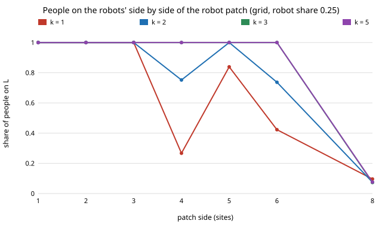

# society-grid: does the "robot block must be smaller than the neighbourhood" rule carry over from a ring to a 2D grid?

`society-allies` found on a ring that committed robots stop tipping a crowd's passing-side convention once a block is wider
than the neighbourhood people meet within, and listed "a 2D grid where a block is a patch" as its first next step. **On a
16 × 16 torus (256 people, memory 9) with partners within Chebyshev radius `k`, robot patches tip every crowd up to a side of
about `2k + 1` sites, the width of the neighbourhood, and tip few or none beyond it. At robot share 0.25 (above the
well-mixed threshold 0.2165) a 3 × 3 patch tips every crowd at k = 1, a 4 × 4 patch tips 10% of them, and 6 × 6 patches tip
none; at k = 3 and 5 patches up to 6 × 6 still tip every crowd, but one 8 × 8 patch (all 64 robots together) tips none at
any k.** The ring's rule was "block ≲ k" in sites each way, which is "block ≲ neighbourhood width"; the grid agrees in
width, not in radius. Results are about simulated people following a stated rule, not real crowds.

**Live page:** https://duncan-haywood.github.io/monorepo-projects/research/society-grid/

## Why this question

A robot fleet that clusters (a charging bay, a loading dock) is a patch, not a scatter. The ring result may be an artefact of
one dimension, where a block cuts the crowd in two; on a grid a patch has a perimeter that grows more slowly than its area.
The model has an exact well-mixed limit, so the simulation can be checked against a number computed independently.

## Builds on

`society-allies` (ring version; same rule), `society-blocs` and `society-stubborn` (the well-mixed mean-field threshold
0.2165 for M = 9, ε = 0.02, reproduced here in `meanfield_threshold`), `society-robotnorms`. Committed-minority literature:
Xie et al. (2011), *Phys. Rev. E* 84:011130; Centola et al. (2018), *Science* 360(6393):1116–1119. **Lab tags:** none; no
lab's work is built on.

## Model

Agents on a `16 × 16` torus meet in pairs (each picks a side, L or R; unequal sides is a conflict). People take the majority of
their last `M = 9` partners, with error `ε = 0.02`, starting on R. A share `ρ` of sites hold committed robots that always walk L, in
patches of `b` sites (a `ceil(√b)`-wide square, filled row by row) on an evenly spaced lattice; `b = 1` is evenly spread. A partner is
uniform over the `(2k+1)² − 1` other sites within Chebyshev distance `k`. 500 rounds, 20 seeds per cell.

## Results (`experiments/results.txt`, seeded; `experiments/run.py`, about 3 minutes)

**A. Check.** `k = 7` on a 16-wide torus reaches 225 of the 255 other sites, close to well mixed. Evenly spread robots tip no crowd
at ρ = 0.14 (mean 0.008 of people on L) and 0.18 (0.020) and every crowd at 0.22 (1.000), bracketing the mean-field threshold
0.2165 (the unit test pins that value).

**B. Patch size, k = 2** (share of crowds with at least 90% of people on L):

| b (side) | ρ = 0.12 | 0.20 | 0.25 | 0.35 |
|---|---|---|---|---|
| 1 (1) | 0.00 | 0.95 | 1.00 | 1.00 |
| 4 (2) | 0.00 | 1.00 | 1.00 | 1.00 |
| 9 (3) | 0.00 | 1.00 | 1.00 | 1.00 |
| 16 (4) | 0.00 | 0.35 | 0.70 | 1.00 |
| 25 (5) | 0.00 | 0.80 | 1.00 | 1.00 |

**C. Neighbourhood radius and patch side, ρ = 0.25** (share of crowds with at least 90% of people on L):

| b (side) | k = 1 | 2 | 3 | 5 |
|---|---|---|---|---|
| 1 (1) | 1.00 | 1.00 | 1.00 | 1.00 |
| 9 (3) | 1.00 | 1.00 | 1.00 | 1.00 |
| 16 (4) | 0.10 | 0.70 | 1.00 | 1.00 |
| 25 (5) | 0.45 | 1.00 | 1.00 | 1.00 |
| 36 (6) | 0.00 | 0.45 | 1.00 | 1.00 |
| 64 (8, one patch) | 0.00 | 0.00 | 0.00 | 0.00 |



At ρ = 0.35 every patch up to 6 × 6 tips every crowd at every k, and the single 8 × 8 patch tips 5% (k = 1), 95% (k = 2) and all
crowds at k ≥ 3: a larger robot share buys back what clustering loses, as on the ring. Conflicts per human meeting rise for
partial patches (0.15 to 0.21 at ρ = 0.25, sides 4 to 6, k ≤ 2) against 0.03 to 0.06 for scattered robots.

## What this does and does not show

- The width rule transfers: failing patches are the ones wider than about `2k + 1`. The ring needed block ≲ `k`, but there the
  neighbourhood is `2k` wide, so both say "no wider than the neighbourhood".
- The curve is not monotone in `b` at k = 1 and 2 (the 5 × 5 patch beats the 4 × 4). At ρ = 0.25 a 25-site patch makes
  3 patches (25, 25, 14) and a 16-site patch makes 4, so patch count and layout change with `b`; the sweep does not separate patch
  size from patch count and the "about `2k + 1`" threshold is read off these cells, not derived.
- 16 × 16 with 20 seeds is small; cells with 0.10 to 0.90 are noisy (a standard error up to ±0.11).

## Limitations

Stylised: binary choice, a square torus, Chebyshev neighbourhood, one memory length and error rate (ε = 0.02, M = 9 from
`society-robotnorms`, not fitted), a 500-round horizon ("no tip" means not within the run), square patches only. No real
crowd data and no lab tag. Norm-shifting raises consent questions; this reports a cost, not a recipe for steering crowds.

## Next steps

1. Separate patch size from patch count (fixed count, varying size; fixed size, varying count).
2. Larger tori and a Euclidean-disc neighbourhood, to test whether `2k + 1` survives.
3. A pair approximation for local share thresholds (as the ring needed in `society-ringmf`).

## Reproduce

```
cd research/society-grid
python3 -m unittest discover -s tests
PYTHONPATH=src python3 experiments/run.py
python3 experiments/figure.py
```

## Owner steps

None.

## Outside dependencies

None: Python standard library only.

*Produced with AI assistance (Claude).*
