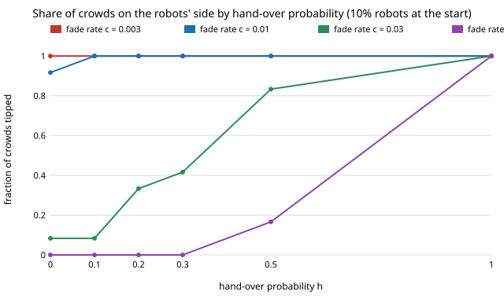

# society-handover: can robots take over from allies as they fade, and is it cheaper than buying them upfront?

`society-allyfade` showed that an ally bloc that fades forces the robot share up. This asks whether robots
that replace each ally as they fade (a hand-over) keep the crowd tipped at a lower cost.
**It does not beat buying robots at the start. With 20% allies and 10% robots at the start, a hand-over probability `h`
of 0.5 (half of fading allies become robots) tips 10 of 12 crowds at `c` = 0.03 but ends with 0.19 robots, while
`society-allyfade` tips 10 of 12 at that fade rate with 0.15 robots bought upfront.** Hand-over helps only where the
crowd is already near the edge (10% robots, slow fade) and, below about 5% initial robots, only a full replacement
(`h` = 1, ending near the no-ally threshold 0.2165 plus the initial robots) tips anything.
Produced with AI assistance (Claude). Next step 2 of `society-allyfade` in research track 17 (`society`,
`PROJECTS.md`). Every result is about simulated people following a stated rule, not real crowds.

**Live page:** https://duncan-haywood.github.io/oss-monorepo/research/society-handover/

## Why this question

`society-allyfade` next step 2: a fleet planning on a cheap ally bloc could schedule robots to replace allies
as they drift off. Whether that is cheaper than fielding the robots first is a pricing question for the robots.

## Builds on

`society-allyfade` (same model; its results are the `h = 0` column), `society-blocs`, `society-robotnorms`;
Young (1993), *Econometrica* 61(1):57–84; Centola et al. (2018), *Science* 360(6393):1116–1119.
**Lab tags:** HIRO and CAIRO only in the loose sense of `society-robotnorms`.

## Model

As `society-allyfade`: well-mixed, `N = 200`, memory `M = 9`, error `ε = 0.02`, 20% allies who always walk L (the
robots' side, subject to the same errors), committed robots (no errors, always L), the rest take the majority of their
last 9 partners; memories start all R; tipped means most non-robots have an L majority after 2000 rounds. Each round,
every remaining ally fades with probability `c`; with probability `h` the faded ally becomes a committed robot,
otherwise an ordinary walker. Robot cost is the robot share at the end. `c` and `h` are swept, not measured.

## Results

From `experiments/results.txt` (`experiments/run.py`, seeded, 12 seeds per cell). Cells are crowds tipped of 12 /
robot share at the end. Initial robot share 0.10:

| c | h=0 | 0.1 | 0.2 | 0.3 | 0.5 | 1.0 |
|---|---|---|---|---|---|---|
| 0.003 | 12 / 0.100 | 12 / 0.118 | 12 / 0.131 | 12 / 0.151 | 12 / 0.190 | 12 / 0.279 |
| 0.01 | 11 / 0.100 | 12 / 0.122 | 12 / 0.139 | 12 / 0.156 | 12 / 0.185 | 12 / 0.280 |
| 0.03 | 1 / 0.100 | 1 / 0.118 | 4 / 0.137 | 5 / 0.160 | 10 / 0.191 | 12 / 0.280 |
| 0.1 | 0 / 0.100 | 0 / 0.115 | 0 / 0.137 | 0 / 0.153 | 2 / 0.185 | 12 / 0.280 |



- **Not cheaper than robots upfront.** `society-allyfade` (static robots, same allies) tips 10 of 12 at `c` = 0.03
  with 0.15 robots and 7 of 12 at `c` = 0.1 with 0.20. Hand-over reaches 10 of 12 at `c` = 0.03 only after ending with
  0.19 robots, and 2 of 12 at `c` = 0.1 with 0.185. Robots that arrive late do not help the early tip, which forms in about 50 rounds.
- **Hand-over helps on the margin.** At 10% robots and `c` = 0.003 to 0.01, `h` = 0.1 lifts 11 to 12 of 12 for about 2 points of robot share.
- **Too few robots at the start cannot be rescued.** At 0 to 2% initial robots, no `h` below 1 tips any crowd
  (`results.txt`); `h` = 1 tips all but ends with 0.20 to 0.215 robots, about the no-ally threshold of `society-blocs` (0.2165).
- At 5% initial robots, hand-over helps only for slow fading (`c` = 0.003: 6 to 9 of 12 for `h` 0 to 0.5).

## Limitations

Stylised: no geometry, one binary decision per meeting; `c` and `h` are swept, not measured; robots replace allies
at the moment of fading with no delay or deployment lag; thresholds come from 12 crowds per cell (±~3 crowds
of noise), `N = 200`, a 2000-round horizon (`society-allyfade` used 4000). Results about simulated walkers.
Recruiting allies is a consent question (track 17 guardrails); nothing here designs covert recruiting.

## Reproduce

```
cd research/society-handover
python3 -m unittest discover -s tests            # 6 tests, ~1 s
PYTHONPATH=src python3 experiments/run.py        # writes results.txt (~4 min)
python3 experiments/figure.py
```

## Next steps

1. Hand-over with a delay, or triggered when the crowd's L share drops, to see whether late robots catch a tip that is slipping.
2. Fading that depends on what allies see (`society-allyfade` next step 1).
3. Fit `c` to measured persistence of side preference.

## Owner steps

None.

## Outside dependencies

None: Python standard library only.
