# Do people keep right in a two-way corridor, and what happens to their lanes when robots share it?

**Research programme** (track 17, `society`). **Question:** which passing policy should a fleet of mobile robots use in a corridor people also walk, if the aim is to keep the lanes people form and keep the cost to them low? The crowd models used to answer it are fitted to real trajectories and cross-checked against each other. Proposal: [PROPOSAL.md](PROPOSAL.md). Log: [LOG.md](LOG.md).

**Live page:** https://marisstella.app/research/society-lanes/

**Headline (milestone 1, real data).** In the Jülich HERMES bidirectional corridor experiments (2009, 24 runs, 4,752 walkers tracked from overhead cameras), people given no instruction about where to leave walked on their own right **93.7%** of the time (1,016 of 1,084; 95% interval 0.865 to 0.993). They formed almost perfect two-lane flow: lane order 0.91 to 1.00, against 0.25 to 0.52 when walking directions are shuffled. When each walker was told to leave by the left or the right exit, the right-side share fell to **0.53** (0.50 to 0.57). Lanes still formed, but they were weaker and kept changing. A side convention that people hold almost unanimously disappeared once each person had a lateral goal. A robot heading for a side door is in that second situation, and any crowd simulator used to design robot policies now has to reproduce the drop.

**Outside the lab (milestone 7, real data).** On city pavements filmed from above, pedestrians passing head-on kept right in **65%** of encounters in Zurich (473 of 723; ETH and Hotel scenes; 95% interval 0.59 to 0.74) and **68%** in Nicosia (334 of 491; Zara scenes; 0.57 to 0.80), even though Cyprus drives on the left. The same encounter measure gives 0.935 on the HERMES no-instruction runs and 0.526 with exits assigned, matching milestone 1 by an independent route. So the keep-right bias exists in the wild, but it is far weaker than in a laboratory corridor, and on these Nicosia pavements it did not follow the left-hand road rule.

**Replication (milestone 2, real data).** In the independent BaSiGo corridor experiment (Jülich, Düsseldorf 2013, 15 runs, 8,155 walkers, 4 m corridor), people with no exit instruction kept right **92.4%** of the time (2,001 of 2,165; 0.877 to 0.973), inside the HERMES interval. Telling each person which side exit to use cut it to **0.689** (0.566 to 0.839; difference +0.235, 0.073 to 0.365): the collapse replicates in direction, though less deeply than at HERMES. The share stepped down when the instruction began and did not keep drifting with run order. In the last two runs, which kept the exit instruction and added information on screens (content not documented by the archive), **1,212 of 1,218 walkers (99.5%)** kept right, the strongest convention in either experiment.

**Crowd twin (milestone 3, simulation fitted to the real runs).** Does a social-force crowd simulator reproduce this? Plain social force (JuPedSim 1.4.2, the Helbing, Farkas and Vicsek 2000 parameters) has no side convention: 0.51 of walkers on their right. One added parameter, a slight turn to one's own right when someone is coming the other way, fitted on the nine free-choice runs, brings it to 0.89 to 0.97 with realistic lanes (lane order within 0.10 in 7 of 9 runs). But it is too uniform (only 3 of 9 runs inside their intervals), and it cannot congest beyond about 1.5 walkers/m² (1.2 with the fitted bias), while the densest real runs reached 3.8/m² at 0.24 m/s. **On the assigned-exit runs it never saw, the twin keeps 0.78 of walkers on their right where people kept 0.54**, and it overstates the share in all 14 held-out runs. A social-force twin over-trusts the convention, so a robot policy chosen in it would understate how easily goal-driven walkers break the lanes. H3 fails for this model family.

**Is that a social-force artefact? (milestone 4a, simulation).** No. Moving the exits of the assigned walkers from a quarter width in to the walls, the assumption milestone 3 flagged as most likely to matter, lowers the social-force twin's held-out share from 0.78 to **0.68**, still above people's 0.54 in 13 of 14 runs. A second model family, JuPedSim's anticipation velocity model (Xu, Chraibi and Seyfried 2021), fitted the same way, does worse: it forms near-perfect lanes on its own, needs a stronger side bias (β = 0.35) to match the free-choice runs, and then keeps **0.996** of walkers on their right in the held-out assigned-exit runs, where an exit goal barely moves it. Both families, given a side bias that matches the free-choice runs, keep the convention where people drop it. H3 fails for the anticipation model too (4 of 9 runs in their intervals, lanes within 0.10 in 5 of 9, and it cannot reach the measured densities).

**A bias that yields to the goal (milestone 4b, simulation).** If the problem is the rule rather than the model, a bias that switches off when a walker's exit is on its left should fix it, without refitting anything: walkers with no lateral goal, the only ones in the free-choice runs, are unaffected, so β stays as fitted. It mostly does. On the 14 held-out runs the mean share error falls from 0.210 to **0.079** for social force, from 0.353 to **0.118** for a third family added here (JuPedSim's collision-free speed model, Tordeux, Chraibi and Seyfried 2016), and from 0.395 to 0.260 for the anticipation model. Pooled over the HERMES runs (people 0.541): social force 0.781 → **0.610**, collision-free speed 0.931 → **0.623**, anticipation 0.996 → 0.877. A version weighted by how far the goal sits from the walker's right was worse than the on/off rule in all three families. The fix has a price in social force, whose lanes under the new rule fall below the people's (lane order within 0.10 in 5 of 14 runs, from 11); the collision-free speed model with the yielding bias is the one combination that gets both roughly right (share error 0.118, lanes within 0.10 in 12 of 14). No rule reproduces the spread between runs (BaSiGo b_03 0.754 against b_08 0.505: social force gives 0.615 and 0.576), and the rule was chosen after the "always on" failures were seen, so this is a strong candidate, not a confirmed mechanism. The collision-free speed model on its own fails H3 like the other two (4 of 9 free runs in their intervals; it cannot reach the densest real crowd, 1.96 against 3.79/m²).

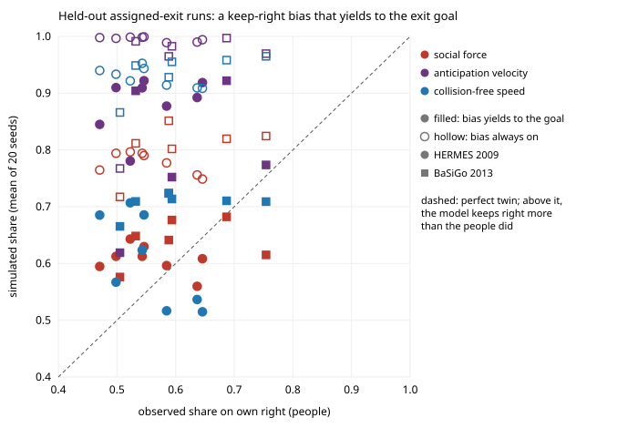

**A fourth family from another code base (milestone 4c, simulation).** Is that a JuPedSim habit? The anticipatory power law of Karamouzas, Skinner and Guy (2014), the time-to-collision interaction measured from pedestrian data, implemented here in numpy with the closed-form force and every parameter of Inria's open UMANS simulator (k = 1.5, &tau;0 = 3 s; checked against a finite-difference gradient), was fitted the same way. It has no side of its own (0.56 at β = 0, each run picking a side), needs a strong bias (β = 0.35) to match the free-choice runs, and then keeps **0.971** of HERMES walkers on their right under assigned exits (people 0.541). The over-trust replicates in all four families. The yielding bias brings it to **0.698** (mean share error over 14 held-out runs 0.393 → 0.153; lanes within 0.10 in 9 of 14, from 1), better than *scaled* again (0.745), but not within 0.10. So the yielding rule fixes the held-out share in two of four families, social force and the collision-free speed model, and not in the two whose fit needed β = 0.35 (anticipation velocity, power law). That pattern was noticed after the run, from four points; it is a lead, not a result. The power law fails H3 like the other three (3 of 9 free runs in their intervals, lanes within 0.10 in 5 of 9, b_08 reaches 1.24 against 3.79/m²), so **H3 is refuted for the programme**: none of four families reproduces the free-choice side, lanes and speed-density at once.

**The fifth family, ORCA (milestone 4d, simulation).** ORCA (optimal reciprocal collision avoidance; van den Berg, Guy, Lin and Manocha 2011) is a standard multi-robot planner and a common crowd model in robot-navigation benchmarks. It is ported here line by line from RVO2 (as Inria's UMANS adapts it) to numpy and numba, with UMANS's parameters (time horizon 5 s, range 5 m), and fitted the same way. It has no side of its own (0.51 at β = 0). It needs the strongest bias of any family (β = 1.0, the grid's edge; β = 1.5 and 2.0 fit worse) and fits the free-choice runs worst (loss 244 against 43 to 107). It then keeps **0.878** of HERMES walkers on their right under assigned exits (people 0.541), so **the over-trust replicates in all five families**. The yielding bias brings it to **0.600** (mean share error over 14 held-out runs 0.312 → 0.086; lanes within 0.10 in 11 of 14, from 1). That makes three of five families, social force, collision-free speed and ORCA, within 0.10 of people with the yielding bias. It also refutes milestone 4c's lead, a registered prediction this time: the fix does not fail where the fitted bias is strong, since ORCA's is the strongest and the fix works. ORCA fails H3 too (2 of 9 free runs in their intervals; it cannot reach the densest real crowd, and many dense seeds gridlock). Milestone 4 is complete.

**Robots in the two crowds outside JuPedSim (milestone 5b, simulation).** The same four robot policies were run in ORCA, where the robots are ORCA agents too, and in the power law (1,360 runs, eight predictions registered first). Opposite-side robots are again the costliest: at 20% robots they delay people 2.3 s (ORCA) and 2.2 s (power law) per 8 m transit, against 0.01 and 0.04 s for crowd-side robots. **The main result is H5 on close passes.** The three families that passed the held-out share test (social force, collision-free speed, ORCA) rank the four policies identically at every robot share: crowd's side, then adapt, then lateral goal, then opposite (Kendall &tau; 1.00 in all 9 comparisons). At 20% robots, 0.02 to 0.08 of crowd-side robot passes come closer than 0.5 m, against 0.58 to 0.74 of opposite-side ones. **Ranked by human delay per robot pass, the same three disagree** (&tau; 0.00 to 1.00, 1 of 9 at 0.8 or above). So a passing policy picked to minimise close passes carries over between simulators, and one picked to minimise delay does not. ORCA's lanes, like the anticipation model's, barely notice contraflow robots (lane order &minus;0.06 at 20%).

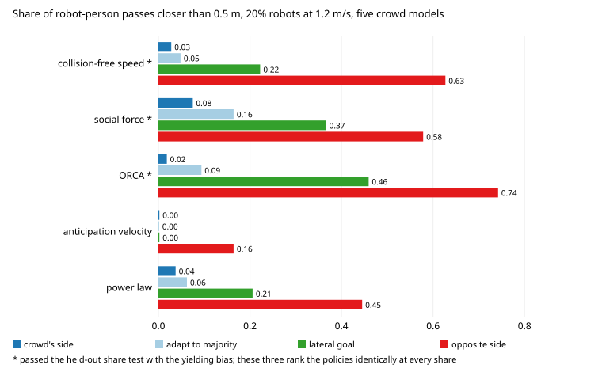

**H5 registered on close passes (milestone 6a, simulation).** Is that agreement a seed accident? A confirmatory rerun with 20 fresh seeds per cell (3,120 runs, seven predictions registered first) says no. Social force, collision-free speed and ORCA again rank the four robot policies identically by close passes at every robot share, **Kendall &tau; = 1.00 with a 95% bootstrap interval of [1.00, 1.00]** in all 9 comparisons. The ranking also holds at half each family's fitted keep-right bias (&tau; 1.00, lower bound 0.67 in two cells at 5% robots), where the social-force crowd's own-right share falls from 0.95 to 0.80, close to the 0.65 to 0.68 seen on city pavements. Ranked by human delay per robot pass the families still disagree (&tau; 0.00 to 1.00, 2 of 9 at 0.8 or above). Halving the bias barely moved the other two crowds (0.95 and 1.00 on their right), so the weaker-convention check is strong for one family only.

**A policy learned in each crowd twin (milestone 6b, simulation).** What does a robot policy *trained* in a crowd simulator learn, and does it carry over to the other simulators? A five-parameter lateral policy (not SARL; its family contains the hand-written ones) was trained by the cross-entropy method in each of the three twins on equal budgets (720 runs each), to minimise close passes plus 0.05 &times; human delay per transit, then evaluated on 20 fresh seeds in all three (six predictions registered first). **All three learned to hold the crowd's side harder than the hand-written lane**, near the right wall, and to move further over when oncoming people drift toward the robot's side. At 10% robots they cut close passes from 0.019 to 0.006 to 0.009 in ORCA, from 0.022 to 0.001 or below in the collision-free speed model, and from 0.093 to 0.026 to 0.060 in social force, and **every learned policy beat every hand-written one in every crowd, including the two it was not trained in**. The surprise: in social force, the policy trained in social force did worst of the three learned ones (J 0.078 against 0.017 for the one trained in the collision-free speed model, non-overlapping intervals). Its training signal was the noisiest. Ranked by close passes, the seven policies keep nearly the same order in all three twins (Kendall &tau; 0.81 to 0.90); by delay they do not (0.33 to 0.52). The twins model walls as nearly free, so how close to the wall a real robot can go is not settled here.

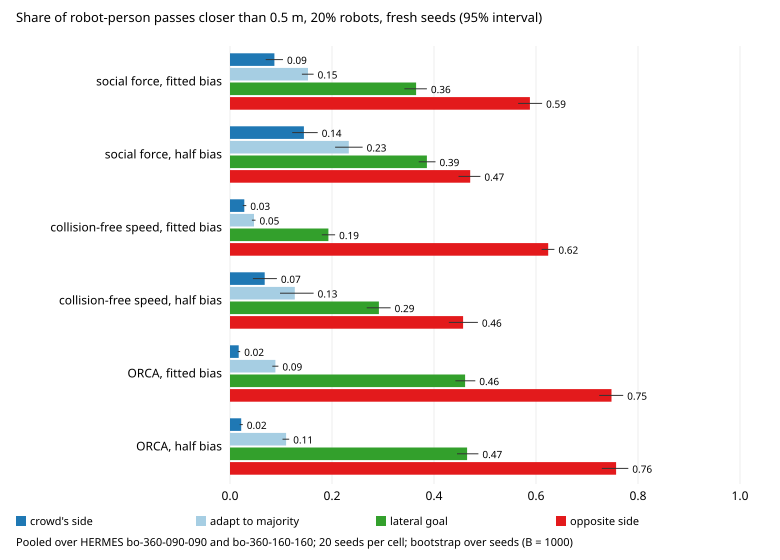

**Does a robot's side matter more than its presence? Yes (milestone 6d, simulation).** A registered test with 40 fresh seeds per cell (2,800 runs, seven predictions written first) adds a same-bodies arm to 6c's control: robots that walk to a lateral goal drawn 50/50, the same bodies at the same speed, without holding a side. In the social-force crowd at 20% and 30% robots and a quarter to three quarters of the fitted keep-right bias, **robots that hold the crowd's side give people 0.12 to 0.21 more lane order and 1.8 to 3.6 s shorter transits than the same number of lateral-goal robots** (every 95% interval clear of zero). Against no robots at all (the density-matched control), crowd-side robots raise people's lane order by 0.04 to 0.07 in all six cells (intervals above zero; 6c's post-hoc read replicates) and shorten their transit by 0.07 to 0.69 s (intervals below zero in three of six), while lateral-goal robots cost people 1.7 to 2.9 s. In the collision-free speed crowd the side still matters (lateral-goal robots cost 0.3 to 0.7 s more than crowd-side ones), but any robots slow people against the control: crowd-side robots by 0.5 to 0.9 s, with no lane gain (lanes there are near the ceiling, 0.94 to 0.97). At a quarter of its fitted bias that crowd keeps 0.77 on its right with no robots, so it does move toward the street value, contrary to the prediction. For a fleet operator: the cost comes from robots that do not hold the crowd's side; holding it is free or better in one model and cheaper than not holding it in both.

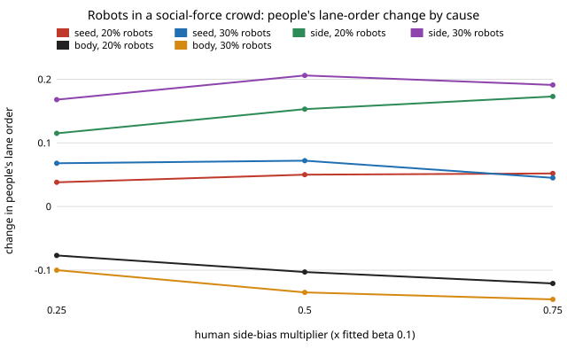

**Does the side still matter in ORCA, and is robot speed why robots slow people? Yes, and no (milestone 6e, simulation).** The same four arms in ORCA (3,040 runs with the speed sweep below, eight predictions written first), at keep-right biases from street-like (0.72 of people on their right with no robots) to the fitted one (0.999): **robots that hold the crowd's side give people 1.1 to 4.1 s shorter transits and 0.04 to 0.15 more lane order than the same robots heading for a lateral exit**, every 95% interval clear of zero at 20% and 30% robots. The side-holding advantage is now clear of zero in all three crowd families that passed the held-out test. Against no robots at all, though, ORCA agrees with collision-free speed and not social force: crowd-side robots slow people by 0.05 to 0.99 s (intervals above zero in 5 of 8 cells) and give no lane gain, even in the street-like crowd. In collision-free speed, raising robot speed from 0.8 to 1.2 m/s halves the slow-down (+1.08 to +0.51 s), but 1.6 and 2.0 m/s leave it at +0.57 and +0.52 s, so the speed cap is not the reason. Faster robots do shrink the side's advantage there (&minus;0.70 s at 0.8 m/s to &minus;0.12 s, interval touching zero, at 2.0 m/s), because a fast lateral-goal robot is gone sooner. For a fleet operator: hold the crowd's side, above all with slow robots; do not trust any one twin's claim that robots speed people up.

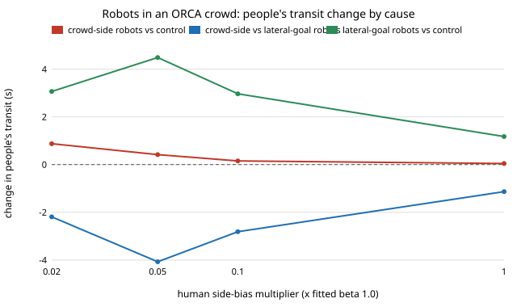

**Do robots slow people, or do extra bodies? Bodies (milestone 6f, simulation).** 6d and 6e found that robots holding the crowd's side slow people against a density-matched control in collision-free speed and ORCA, but speed them up in social force. A robot here differs from a person in two ways only: it holds a fixed lane line, and it is capped at 1.2 m/s. A registered 2 &times; 2 factorial (1,920 runs, 40 fresh seeds per cell, seven predictions written first) switched each one, with a "labelled person" arm (a robot on the people's steering and speed, indistinguishable from a person: every check interval contains zero) as the reference. **A crowd-side robot costs people less than the person it replaces in every twin**: 0.70 s shorter transits per person in social force, 0.42 s in collision-free speed, 0.78 s in street-like ORCA (interval touching zero) and 0.04 s at ORCA's fitted bias. The apparent slow-down is the control having fewer bodies: k extra people cost the rest +0.83 s in collision-free speed and +1.88 s in street-like ORCA, but +0.28 s in social force. **The whole gain is the steering** (the crowd-side line against the people's rule: &minus;0.33 to &minus;0.95 s, every interval below zero); the 1.2 m/s cap has no effect clear of zero in any setting. So the twins agree on the robot and disagree on the cost of any extra walker, which real data at several densities can settle.

**What does one more walker really cost? The twins mis-price it (milestone 6g, real data and simulation).** 6f left the twins disagreeing by 6&times; on what any extra body costs in the 3.6 m corridor, so this step measures it. In the five HERMES free-choice runs (1,084 crossings), the time to cross the 8 m section rises from **5.5 s at 0.35 persons/m&sup2; to 11.5 s at 1.85/m&sup2;** (about 4.0 s per person/m&sup2; at the median density 1.12/m&sup2;), and the eight assigned-exit runs give the same curve (density cost within 5%). Against that curve, four twin settings (1,600 runs, seven predictions registered first) all mis-price an extra walker at 6f's 60-walker point: thinning the crowd by 20% saves people **0.30 to 0.76 s** in reality at the densities each twin produced, but **1.57 s in collision-free speed (2&times;), 1.31 s in street-like ORCA (3&times;) and 0.08 s in fitted ORCA (about 7&times; too little)**; social force's +0.74 s has an interval (&minus;0.46 to +1.98) too wide to tell. The deeper reason is level, not slope: at the same density, every twin but fitted ORCA is 2.3 to 3.9 s slower than people (8.8 to 11.1 s against 6.5 to 7.4 s), because milestone 3 calibrated walker count to the real *speed*, and the twins reach that speed at about half the real density (0.82 to 1.09/m&sup2; against 1.72/m&sup2; in the run they stand in for). So 6f's density costs are not real-world numbers, and the next calibration target is the transit-density curve itself.

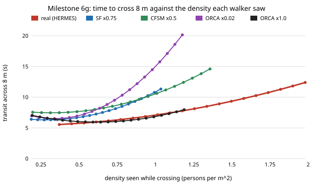

**Can the twins be recalibrated on that curve? Two of four, and only in level (milestone 6h, real data and simulation).** Each family has one parameter for how much room a walker keeps, unfitted until now: social force's interaction strength A, collision-free speed's time gap T and ORCA's time horizon &tau;. Fitting it to the HERMES transit-density curve (five-value grids bracketing each default, 1,440 calibration runs, then 960 runs on fresh seeds; seven predictions registered first) fixes the curve's level in two families: the calibration error falls from **8.87 to 0.55 s in collision-free speed (T 1.0 &rarr; 0.3 s)** and **5.40 to 0.78 s in fitted ORCA (&tau; 5 &rarr; 2 s)**, and both stay within about half a second on fresh seeds (curve gap 0.54 and 0.58 s) and on the eight **assigned-exit runs the fit never saw (0.55 and 0.50 s)**. Social force (best A = 1000 N, still 2.2 s off) and street-like ORCA (gridlock at every &tau;) cannot be fitted this way. Two limits remain. Matching the level does not match the slope: at the 0.9 m run's density (0.83/m&sup2;) the recalibrated twins put the saving from 20% fewer walkers at **+0.19 s and +0.01 s, against a real +0.40 s**. And no twin can reach the dense run's 1.72/m&sup2;: cell density plateaus near 1.3/m&sup2; above about 75 walkers, because extra walkers queue at the entrance (a walker enters only where 0.55 m is free). So the next fix is the corridor's inflow, not the walkers.

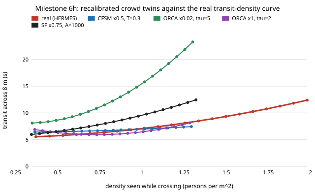

**Can two parameters make one crowd model fit the whole real density curve? No: it fits the dense end or the light end (milestone 6j, real data and simulation).** After 6i, collision-free speed was the one twin that reached the dense HERMES run, but it was too flat near 0.8/m&sup2; and too fast above 1.3/m&sup2;. Fitting its time gap and body radius together (a 5 &times; 4 grid, 2,160 runs, nine predictions registered first) to the real transit-density curve on level and slope picks **T 0.8 s with a 0.15 m radius**. On 16 fresh seeds that twin **matches the dense run**: 10.56 s to cross 8 m against a real 10.61 s, and 20% fewer walkers save +1.16 s against a real +1.38 s [+0.96, +1.85]. But it **crosses the light run 1.4 s too slowly** (7.92 against 6.55 s) and still **under-prices the marginal walker there** (+0.18 against +0.41 s [+0.29, +0.56]). Its fit to the whole curve (1.06 s) is no better than 6i's one-parameter twin (1.01 s). Wider bodies jam rather than slow smoothly, and the model holds walkers at full speed until the gap runs out. So the light end needs a model whose speed falls smoothly with headway, and a robot experiment at 1.72/m&sup2; can use the dense-end twin.

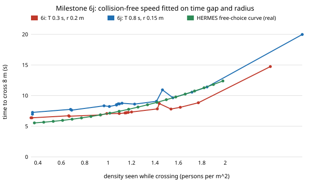

**Was the density ceiling the entrance? In two of three twins, partly (milestone 6i, real data and simulation).** 6h blamed the twins' plateau near 1.3/m&sup2; on the entrance rule: a re-entering walker is placed just inside its own end, among the walkers leaving it. Moving re-entry 0.3 to 1.2 m behind the end, where leavers are already gone, and changing nothing else (1,640 runs, seven predictions registered first) raises the highest density at the 1.6 m entrance **from 1.58 to 2.06/m&sup2; in collision-free speed and from 1.32 to 1.58 in social force, and not at all in ORCA** (1.43 &rarr; 1.38), which jams on its own above about 120 walkers (11 to 17 s to cross 8 m). So only collision-free speed reaches the dense HERMES run's 1.72/m&sup2; (at 129 walkers). There it **prices the marginal walker right** (20% fewer walkers save +0.66 s [&minus;0.00, +1.45] against a real +0.72 s [+0.50, +0.96]) and people keep right (0.94), but it crosses 1.7 s too fast (8.6 against 10.3 s), and at the 0.9 m run's density it still under-prices (+0.13 against +0.37 s). Its fit to the whole real curve loosens from 0.54 to 0.90 s once it can reach the dense end. One spacing parameter is not enough; a two-parameter fit is next.

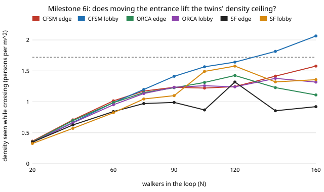

**Robots as lane seeds? Mostly not (milestone 6c, simulation).** Milestone 6a noticed, after its run, that crowd-side robots seemed to speed people up in a weak-convention social-force crowd. Robots there replaced people, so those crowds were also thinner. A density-matched control (the same number of people, no robots; 1,120 runs, fresh seeds, six predictions registered first) splits the two. At half the fitted keep-right bias and 20% robots, people's transit fell by 0.91 s against the full crowd, and **0.80 s of that (88%) is the lower density**; the robots' own effect is &minus;0.11 s with a 95% interval of [&minus;0.74, +0.66]. Across a bias sweep from 0.25 to 1.0 times the fitted value, crowd-side robots never shortened transit beyond the control with an interval excluding zero. What they do, at 20% robots, is tidy the lanes a little: people's lane order rises by 0.080 [0.031, 0.127] at a quarter of the bias and 0.055 [0.024, 0.087] at three quarters (read after the run, not registered). Opposite-side robots lengthen people's transit against the same control in all 8 cells, by 1.2 to 4.3 s. At a quarter of the fitted bias the crowd keeps 0.68 on its right, the street value (0.65 to 0.68) the programme had not yet reached in simulation.

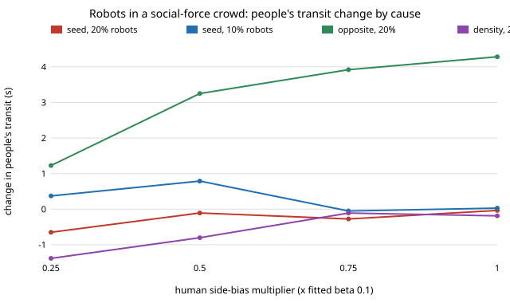

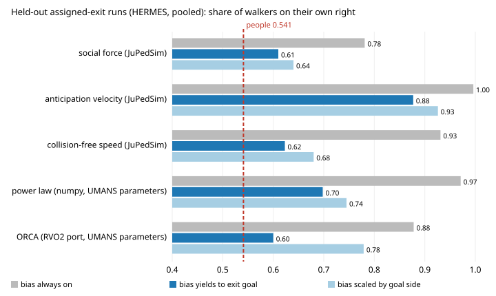

**Robots in the crowd (milestone 5a, simulation).** Which passing side should a corridor robot hold? Robots the size of a person, capped at 1.2 m/s (the lower of the MiR250's two rated speeds), replaced 5, 10 or 20% of the agents in the three fitted JuPedSim crowds (social force, anticipation velocity, collision-free speed), on two HERMES corridor runs with 20 seeds per cell, under four policies: hold the crowd's side, hold the other side, follow the local majority, or head for a lateral exit. **Holding the side opposite the people's convention is the worst policy in every model and at every share**: at 20% robots it adds **3.98 s** to each person's 8 m transit in social force (2.05 s and 0.45 s in the other two), and 0.58, 0.16 and 0.63 of its passes come within 0.5 m of a person. **Holding the crowd's side is safe in all three**: close passes at 0.10 or below, and the people's side share moves by at most 0.03. But the three models rank the reasonable policies differently (Kendall τ 0.00 to 1.00 between models). The lateral-exit robot costs people 1.85 s per transit in social force and nothing in the other two. So the preview of H5 fails: a policy tuned in one crowd simulator need not keep its rank in another. Five of eight registered predictions were refuted (LOG.md). Robots use the crowd's own operational model here, so people can push them; ORCA and the power law with robots come next.

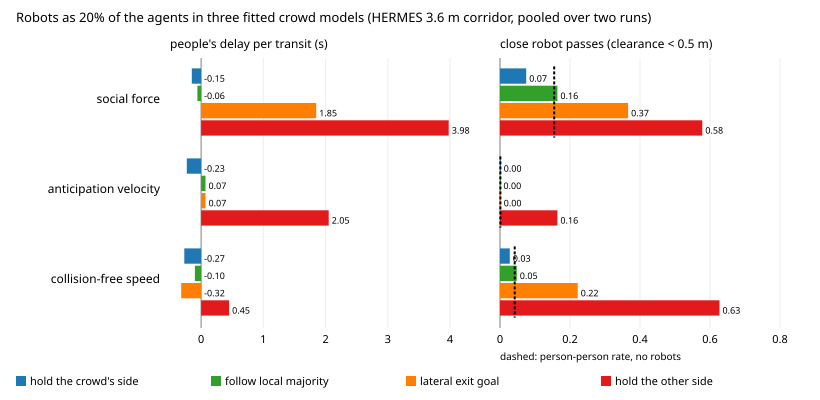

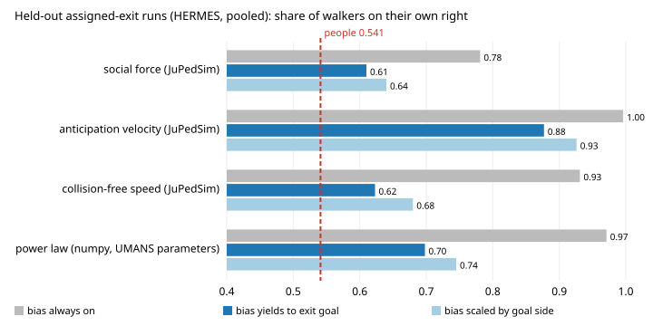

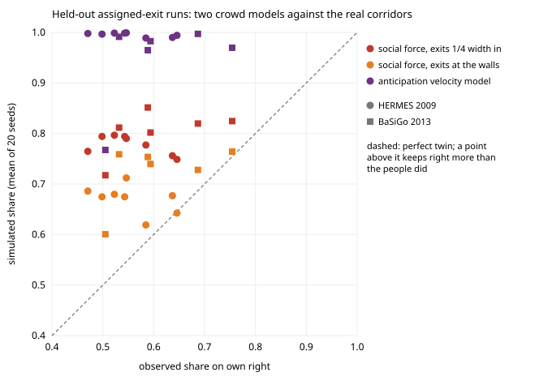

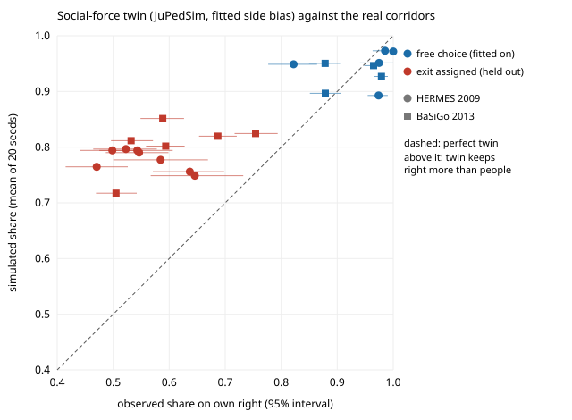

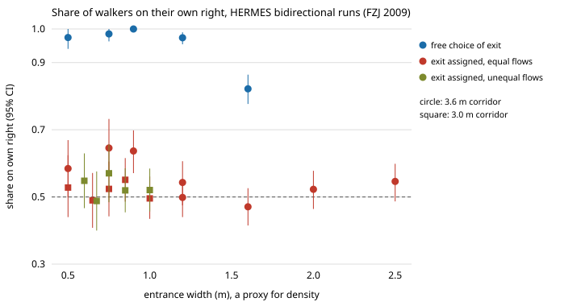

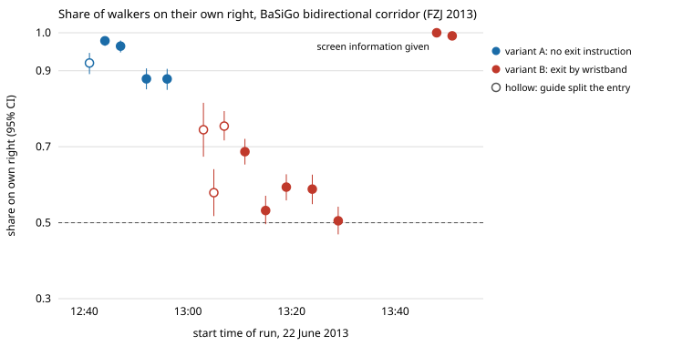

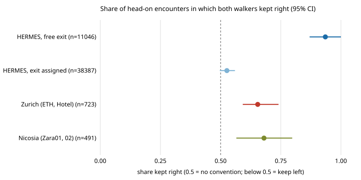

## Motivation

Delivery and logistics robots (hospital carts, airport and warehouse AMRs) increasingly share corridors with people. The 31 earlier `society-*` projects here studied how robots could shift a crowd's walking convention, but on uncalibrated models: a 1D memory game (`society-robotnorms`), a social-force corridor (`society-plaza`), and a side bias read off a published figure (`society-sidefit`). `society-twinfidelity` found that the size of the robot effect depends strongly on which crowd model is used. This programme fits the crowd models to real trajectories first, and treats agreement between models as a result that has to be earned. Related labs: HIRO (social intelligence) and CAIRO (simulated human models for human-robot collaboration), as framing only. No result here comes from those labs.

## Data

Forschungszentrum Jülich pedestrian data archive, HERMES project (BMBF grants 13N9952 to 13N9960), Düsseldorf 2009:
bidirectional flow with free choice of destination (doi:10.34735/ped.2009.12), with ordered destination and symmetric flow (doi:10.34735/ped.2009.11), and with ordered destination and asymmetric flow (doi:10.34735/ped.2009.10). Trajectories were extracted with PeTrack (Boltes and Seyfried 2013, doi:10.1016/j.neucom.2012.01.036) at 16 fps. The experiments are described in Zhang et al. (2012), doi:10.1088/1742-5468/2012/02/P02002. The script downloads the archives into `experiments/data_cache/` (gitignored); they are not redistributed here. The archive gives no licence beyond its request to cite the project and the DOIs, and this repository does both.

In-the-wild data (milestone 7): the ETH and Hotel sequences of the ETH Walking Pedestrians dataset (Zurich; Pellegrini et al. 2009, doi:10.1109/ICCV.2009.5459260) and the Zara01 and Zara02 sequences of the UCY Crowds-by-Example data (Nicosia; Lerner, Chrysanthou and Lischinski 2007, doi:10.1111/j.1467-8659.2007.01089.x), read from the OpenTraj collection (Amirian et al. 2020, ACCV) at commit 97ec1d5e, which also mirrors the HERMES 2D runs. The script caches the files and does not redistribute them.

## Method (milestone 1)

- The section is the 8 m corridor (y from -4 to 4 m) between walls at x = 0 and x = 3.0 or 3.6 m. A walker counts if they spend at least 1 s there and their net displacement is at least 2 m. Direction is the sign of that displacement.
- **Share on own right:** a walker counts as on their right if their mean lateral offset toward their own right is positive. Intervals come from a bootstrap over walkers for each run, and from a two-stage bootstrap over runs and then walkers for pooled figures.
- **Lane order:** every 0.5 s, the corridor width is cut into 30 cm bins and each bin scores ((N+ − N−)/(N+ + N−))² (1 means the bin holds one direction only). The score is weighted by occupancy and averaged over frames with at least 4 walkers each way. It is compared with 100 shuffles of the direction labels within each frame.
- Predictions were registered in `LOG.md` before any trajectory was read.

Reproduce: `python3 research/society-lanes/experiments/m1_hermes_sides.py` (stdlib, about 12 s plus a 12 MB download). Tests: `python3 -m unittest discover -s research/society-lanes/tests`.

## Method (milestone 2)

- The same code and measures as milestone 1 (`lanes.py`). The BaSiGo corridor runs along x between walls at y = 0 and 4 m, so its coordinates are rotated by +90 degrees (`lanes.rotate_x_corridor`, which keeps handedness) and the middle 8 m (x from -4 to 4 m) is the section.
- Primary comparison: the runs without a guide splitting the entering stream (variant A: a_02 to a_05; variant B: b_04 to b_10). The four guided runs are reported separately. The A minus B difference has a two-stage bootstrap interval in each variant (`lanes.bootstrap_diff_clustered`).
- Predictions B1 to B6 were registered in `LOG.md` before any BaSiGo trajectory was read. Data: doi:10.34735/ped.2013.5 (CC BY 4.0), 25 fps, fetched by script and not redistributed.

Reproduce: `python3 research/society-lanes/experiments/m2_basigo_sides.py` (stdlib, about 45 s plus a 54 MB download).

## Method (milestone 7)

- **Head-on encounter:** two walkers not listed as one group, both faster than 0.3 m/s, headings more than 135 degrees apart at their closest approach, closest approach under 2.0 m and strictly inside the time both are tracked (so they approached and then parted). At that moment each walker either has the other on their left (the pair kept right) or on their right (kept left).
- **Frame check:** passing side flips if the world frame is mirrored. Each scene's tracks were projected back onto its video frames: the `H.txt` homographies take (row, col), Zara02's tracks match `H-old.txt`, and the projections sit on the walkers in asymmetric frames. Each frame's handedness then follows from the sign of the homography's Jacobian (`encounters.world_handedness`).
- **Intervals:** block bootstrap over 60 s blocks for the street scenes, over runs for HERMES. Sensitivity: closest approach 1.5 and 3.0 m, heading gap 150 degrees. Predictions W0 to W4 were registered in `LOG.md` before the analysis.

Reproduce: `python3 research/society-lanes/experiments/m7_wild_sides.py` (stdlib, about 20 s plus a 30 MB download from GitHub).

## Method (milestone 3)

- **Model:** JuPedSim 1.4.2's `SocialForceModel` (Forschungszentrum Jülich's open simulator; defaults are the Helbing, Farkas and Vicsek 2000 parameters: A = 2000 N, B = 0.08 m, body force 1.2e5 kg/s², friction 2.4e5 kg/(m s), reaction time 0.5 s, mass 80 kg), body radius 0.25 m, desired speed N(1.34, 0.26) m/s (Weidmann 1993). Walkers are steered through a direct-steering stage every 0.1 s (`sftwin.py`): with an oncoming walker within 3 m ahead and 1 m sideways, a walker aims at lateral slope β toward its own right, otherwise straight ahead. β = 0 is plain social force.
- **Corridor:** straight, the run's width (3.6 or 4.0 m) and length (16 m assumed for HERMES), entrances centred. The number of walkers is fixed, as in the loop the participants walked: a walker who leaves re-enters at its own end when there is room. Measured with milestone 1's statistics in the middle 8 m, counting only walkers who entered after the start.
- **Fit:** walker count calibrated per run to the observed median speed (β = 0); β on a grid of 7 values, 5 seeds per run, loss on share (scaled by the run's interval) and lane order; scored at the fitted β with 20 seeds per run.
- **Held out:** the 3.6 m HERMES assigned-exit runs and the BaSiGo variant B runs without screens. Assigned walkers head for the far end at a quarter width from the left or right wall (50/50). For b_03 and b_08 the walker count is set from the density measured in the raw files that PedPy redistributes (pinned commit, sha256 checked; they reproduce milestone 2's counts and shares exactly).
- Predictions F1 to F7 and one design change (fixed walker count instead of an inflow, after the raw files showed the congestion does not come from the inflow) were registered in `LOG.md` before any simulation ran.

Reproduce: `PY=$(python3 platform/ci/pyenv.py jupedsim numpy)`, then `"$PY" research/society-lanes/experiments/m3_sf_twin.py` (about 35 min on 4 cores) and `python3 research/society-lanes/experiments/m3_figure.py`.

## Method (milestone 4a)

- **Part A, exit position:** the milestone 3 social-force twin at its fitted β = 0.1 and walker counts, on the 14 held-out assigned-exit runs, with each walker's exit at 0.10 (at the wall, after the body clip), 0.25 (milestone 3, rerun) and 0.40 of the width from the left or right wall; 20 seeds each.
- **Part B, a second family:** JuPedSim 1.4.2's `AnticipationVelocityModel` (Xu, Chraibi and Seyfried 2021) with JuPedSim's defaults (radius 0.2 m, time gap 1.06 s, anticipation 1.0 s, reaction 0.3 s, neighbour repulsion 8.0 over 0.1 m), the same steering stage and side bias β, and milestone 3's protocol unchanged except a finer walker-count grid (20 to 130), because this model deadlocks above about 1.3 walkers/m² in the 4 m corridor. Its lateral influence (`AnticipationVelocityModel.cpp`, v1.4.2) is left/right symmetric, so it carries no side preference of its own.
- Predictions E1 to E3 and A1 to A7 were registered in `LOG.md` before the full run (after a disclosed 16-run probe).

Reproduce: `"$PY" research/society-lanes/experiments/m4_avm_exits.py` (about 35 min on 4 cores, about 3,000 runs) and `python3 research/society-lanes/experiments/m4_figure.py`.

## Method (milestone 4b)

- **Bias rules** (`sftwin.bias_weight`, no new parameter): *always* (milestones 3 and 4a); *yield*, the bias is off for a walker whose lateral goal lies on its left half of the corridor; *scaled*, the bias is multiplied by (1 + r) / 2, r the goal's offset toward the walker's own right in half-widths. A walker without a lateral goal gets the full bias under every rule (unit-tested), so the free-choice fits and β are unchanged.
- **Part A:** social force (β = 0.1) and the anticipation model (β = 0.35) at their milestone 3 and 4a walker counts on the 14 held-out runs, exits a quarter width in, rules *yield* and *scaled*, 20 seeds. Their *always* numbers are read from the earlier CSVs.
- **Part B, a third family:** JuPedSim 1.4.2's `CollisionFreeSpeedModel` (Tordeux, Chraibi and Seyfried 2016) with JuPedSim's defaults (radius 0.2 m, time gap 1.0 s, neighbour repulsion 8.0 over 0.1 m, wall repulsion 5.0 over 0.02 m), the same steering stage and milestone 3's protocol (walker count from 20 to 130 calibrated to speed at β = 0, β fitted on the nine free runs, scored with 20 seeds), then the held-out runs under all three rules.
- Predictions Y1 to Y5 and C1 to C6 were registered in `LOG.md` before the full run (after three disclosed probe runs). The rule was chosen after milestones 3 and 4a had shown the held-out failures of the *always* rule.

Reproduce: `"$PY" research/society-lanes/experiments/m4b_yield_cfsm.py` (about 45 min on 4 cores, about 2,900 runs) and `python3 research/society-lanes/experiments/m4b_figure.py`.

## Method (milestone 4c)

- **Model** (`plaw.py`, numpy): the interaction energy E(&tau;) = k &tau;&minus;2 e&minus;&tau;/&tau;0 of Karamouzas, Skinner and Guy (2014), &tau; the time to collision of two discs on their current velocities, and the force its negative gradient in the relative position, in the closed form of Inria's UMANS (`PowerLaw.cpp`, MIT), which follows the paper's supplement. Parameters are UMANS's defaults and its `PowerLaw.xml` policy, which it says reproduces the original algorithm: k = 1.5, &tau;0 = 3 s, interactions for 0.001 &le; &tau; &le; &tau;0 within 5 m, relaxation time 0.5 s, radius 0.24 m, acceleration cap 5 m/s², maximum speed 1.8/1.4 of the desired speed, contact force 5000/80 per metre of overlap, UMANS's Euler update, dt 0.05 s. Walls act through the contact force only (UMANS's power law has none), and walkers are clipped inside the corridor. The paper's text was not read (the arXiv, APS and UMN hosts were refused by the session's proxy); UMANS's code was. `tests/test_plaw.py` checks the force against a finite-difference gradient of E, equal and opposite pair forces, no side force head-on, none for diverging pairs or beyond &tau;0.
- **Protocol:** milestone 4b's Part B unchanged, walker-count grid 20 to 200: calibration to speed at β = 0 (3 seeds), β fitted on the nine free runs (5 seeds), scored with 20, then the 14 held-out runs (b_03, b_08 calibrated to measured density) under *always*, *yield* and *scaled*, exits a quarter width in. Nothing refitted on held-out runs; the other three families' numbers come from milestone 4b's CSV.
- Predictions P1 to P8 were registered in `LOG.md` before the full run (after two disclosed timing probes).

Reproduce: `"$PY" research/society-lanes/experiments/m4c_powerlaw.py` (numpy only; about 50 min on 4 cores, about 2,000 runs) and `python3 research/society-lanes/experiments/m4c_figure.py`.

Reproduce milestone 4d: `"$PY" research/society-lanes/experiments/m4d_orca.py` (numpy, with numba for speed; about 30 min on 4 cores, about 2,000 runs; writes `experiments/m4d_orca_results.txt`, `_runs.csv`, `_fit.csv`), `M4D_EXTEND=1 "$PY" research/society-lanes/experiments/m4d_orca.py` for the unregistered β = 1.5, 2.0 extension (`experiments/m4d_orca_extended_results.txt`, `_fit.csv`), and `python3 research/society-lanes/experiments/m4d_figure.py` (writes `experiments/m4d_orca.svg`).

Reproduce milestone 5a: `PY=$(python3 platform/ci/pyenv.py jupedsim numpy)`, then `"$PY" research/society-lanes/experiments/m5_robots.py` (about 25 min on 4 cores, 2,040 runs; writes `experiments/m5_robots_results.txt` and `_runs.csv`) and `python3 research/society-lanes/experiments/m5_figure.py` (writes `experiments/m5_robots.svg`).

## Method (milestone 5b)

- `orca.simulate` and `plaw.simulate` take milestone 5a's `robots`, `policy`, `robot_speed` and `passes` options, with `robots.py`'s policies and pass tracker unchanged. Under ORCA the robots are ORCA agents (same planner, half the avoiding effort each). With no robots both runs are unchanged, random draws included (`tests/test_robots.py`).
- Protocol: milestone 5a's, unchanged (`experiments/m5b_robots.py` reuses `m5_robots.py`). The families are ORCA at &beta; = 1.0 and the power law at &beta; = 0.35, at the walker counts milestones 4c and 4d calibrated (bo-360-090-090: 30 and 40; bo-360-160-160: 60 and 130). The H5 preview over all five families reads 5a's CSV (`experiments/m5b_h5_results.txt`).
- Predictions B1 to B8 were registered in `LOG.md` before the full run, after two disclosed timing probes and with this session's independent 5a run disclosed.

Reproduce milestone 5b: `"$PY" research/society-lanes/experiments/m5b_robots.py` (numpy, numba; about 12 min on 4 cores, 1,360 runs) and `python3 research/society-lanes/experiments/m5b_figure.py`.

## Method (milestone 6j)

- `experiments/m6j_twofit.py`. `sftwin.simulate(radius=...)` (collision-free speed only; None keeps 0.2 m and every random draw). Lobby entry, bias 0.5&times; the fitted value, entrances 0.9 and 1.6 m, N in {20, 40, 60, 75, 90, 105, 120, 140, 160}, 120 s runs after a 40 s warm-up. Part A (6i's Part A seeds, SEED0 20350000, 6 seeds): T in {0.1, 0.2, 0.3, 0.5, 0.8} s &times; radius in {0.15, 0.2, 0.25, 0.3} m. Score per pair: level L (6h's RMS cell residual against the real free-choice curve), slope S (RMS of 0.5 &times; the gap between twin and real quadratic slopes, in seconds per 0.5/m&sup2;), J = &radic;(L&sup2; + S&sup2;); the pair chosen is the one with the smallest J among pairs that reach 1.72/m&sup2; at the 1.6 m entrance. Part B (SEED0 20352000, 16 fresh seeds): the chosen pair and 6i's pair, curve gaps against the free and held-out assigned-exit curves and density costs at both operating points as 6i (bootstrap B = 2,000). Predictions F0 to F8 and outcomes are in [LOG.md](LOG.md).

Reproduce milestone 6j: `"$PY" research/society-lanes/experiments/m6j_twofit.py` (jupedsim, numpy; about 35 min on 4 cores, 2,848 runs) and `python3 research/society-lanes/experiments/m6j_figure.py`.

## Method (milestone 6i)

- `experiments/m6i_lobby.py`. `sftwin.simulate(entry=...)` and `orca.simulate(entry=...)`: `"edge"` (default, unchanged, random draws included) places a re-entering walker 0.35 m inside its own end; `"lobby"` places it uniformly 0.3 to 1.2 m behind the end (`sftwin.LOBBY`), same entrance width and 0.55 m clearance. Settings at 6h's chosen values, not refitted: social force 0.75&times; bias, A = 1000 N; collision-free speed 0.5&times;, T = 0.3 s; ORCA 1.0&times;, &tau; = 2 s. Part A: both entries, entrances 0.9 and 1.6 m, N in {20, 40, 60, 75, 90, 105, 120, 140, 160}, 6 seeds (SEED0 20350000), 120 s runs, 40 s warm-up; 6h's score and operating-N rule. Part B: lobby only, 16 fresh seeds (SEED0 20351000), the grid plus each operating pair (Nop, Nop &minus; 20%); curve gaps and density costs as 6h (bootstrap over seeds, B = 2,000). Real side: 6g's committed per-walker crossings (`m6g_density_cost_real.csv`), refitted; the data host refused this session. Predictions E1 to E7 and outcomes are in [LOG.md](LOG.md).

Reproduce milestone 6i: `"$PY" research/society-lanes/experiments/m6i_lobby.py` (jupedsim, numpy, numba; about 16 min on 4 cores, 1,640 runs) and `python3 research/society-lanes/experiments/m6i_figure.py`.

## Method (milestone 6h)

- `experiments/m6h_recalibrate.py`, reusing 6g's real-data code. Spacing parameters added with defaults unchanged: `sftwin.simulate(agent_scale=..., time_gap=...)` and `orca.simulate(tau=...)`. Part A: the four 6f settings, grids A {4000, 2000, 1000, 500, 250} N, T {1.5, 1.0, 0.7, 0.5, 0.3} s, &tau; {10, 5, 3, 2, 1} s; entrances 0.9 and 1.6 m; N from 20 to 120 (nine counts); 4 seeds (SEED0 20340000); 120 s runs, 40 s warm-up; score = RMS of cell-mean transit minus the free-choice curve at the cell's density, over cells inside the real 5th to 95th density percentile; grid minimum chosen; operating N where the twin's density first reaches each run's mean crossing density. Part B: at the chosen value, 12 fresh seeds (SEED0 20341000), the grid plus the operating counts; curve gap against the free-choice and the held-out assigned-exit curves, density cost at the operating points (bootstrap over seeds, B = 2,000). Seeds were cut from 8 and 20 before the full run on a smoke run's timing. Predictions R1 to R7 and outcomes are in [LOG.md](LOG.md).

Reproduce milestone 6h: `"$PY" research/society-lanes/experiments/m6h_recalibrate.py` (jupedsim, numpy, numba; about 14 min on 4 cores, 2,400 runs) and `python3 research/society-lanes/experiments/m6h_figure.py`.

## Method (milestone 6g)

- `experiments/m6g_density_cost.py`. Real side: the five free-choice and eight symmetric (assigned-exit) 3.6 m HERMES runs, milestone 1's walker filter, the twins' transit definition (section samples spanning 7.5 m of the 8 m) and, per crossing walker, the section density it saw (counted walkers over 8 m &times; 3.6 m, averaged over its own frames); transit T(&rho;) = a + b&rho; + c&rho;&sup2; fitted to per-walker points, interval from resampling walkers in 10 s entry-time blocks within each run (B = 2,000; conditional on the runs). `sftwin.measure` reports the same per-walker density for twin runs (`transit_density`). Twin side: people only, the four 6f settings, entrances 0.9 and 1.6 m, N from 10 to 90 (ten counts that include 6f's none and control counts), 20 fresh seeds per cell (SEED0 20330000), 120 s runs with a 40 s warm-up; 1,600 runs, none failed. Density cost: the twin's cell-mean T(N) &minus; T(N &minus; k), k = 20% of N, against the real curve at the two densities the twin produced. Predictions D1 to D7 and their outcomes are in [LOG.md](LOG.md).

Reproduce milestone 6g: `"$PY" research/society-lanes/experiments/m6g_density_cost.py` (jupedsim, numpy, numba; about 6 min on 4 cores plus the 12 MB HERMES download) and `python3 research/society-lanes/experiments/m6g_figure.py`.

## Method (milestone 6f)

- `experiments/m6f_factorial.py`: six arms at a fixed total N: *none* (N people), *control* (N &minus; k people), and k robots in a 2 &times; 2 of steering (the people's rule, `policy=robots.HUMAN`, or the crowd-side line) and speed (a person's free-speed draw, `robot_speed=robots.PEOPLE_SPEED`, or the 1.2 m/s cap). Effects: steer and cap main effects, interaction, robot = line-and-cap &minus; labelled person, seed = line-and-cap &minus; control, check = labelled person &minus; none. Social force at 0.75&times;, collision-free speed at 0.5&times;, ORCA at 0.02&times; and 1.0&times; their fitted biases; 20% robots; both HERMES 3.6 m runs with 6e's walker counts; 40 fresh seeds per cell (SEED0 20320000); 120 s runs, first 40 s warm-up; percentile bootstrap over seeds within each cell (B = 2,000). Predictions V1 to V7 and their outcomes are in [LOG.md](LOG.md).

Reproduce milestone 6f: `"$PY" research/society-lanes/experiments/m6f_factorial.py` (jupedsim, numpy, numba; about 9 min on 4 cores, 1,920 runs) and `python3 research/society-lanes/experiments/m6f_figure.py`.

## Method (milestone 6e)

- `experiments/m6e_orca_speed.py`: 6d's four arms (*none*, *control*, *crowd*, *goal*) and effects. Part A, ORCA (`orca.py`, robots are ORCA agents) at 0.02, 0.05, 0.1 and 1.0 &times; the fitted bias 1.0, multipliers chosen by a disclosed no-robot calibration on separate seeds; walker counts 30/60; k = 20% and 30% of N; robots 1.2 m/s. Part B, collision-free speed (&beta; 0.1, half the fitted bias) at 20% with crowd-side and lateral-goal robots at 0.8, 1.2, 1.6 and 2.0 m/s, *none* and *control* shared across speeds; walker counts 20/60. Both HERMES 3.6 m runs; 40 fresh seeds per cell (SEED0 20310000); 120 s runs, first 40 s warm-up; percentile bootstrap over seeds within each cell (B = 2,000). Predictions U1 to U8 and their outcomes are in [LOG.md](LOG.md).

Reproduce milestone 6e: `"$PY" research/society-lanes/experiments/m6e_orca_speed.py` (jupedsim, numpy, numba; about 12 min on 4 cores, 3,040 runs) and `python3 research/society-lanes/experiments/m6e_figure.py`.

## Method (milestone 6d)

- `experiments/m6d_lane_test.py`: four arms per cell, *none* (N people), *control* (N &minus; k people, no robots), *crowd* (N &minus; k people plus k crowd-side robots) and *goal* (N &minus; k people plus k robots with a 50/50 lateral goal, robots.py "goal"); effects seed = crowd &minus; control, side = crowd &minus; goal, body = goal &minus; control, density = control &minus; none. Social force (&beta; 0.1) at 0.25, 0.5 and 0.75 &times; the fitted bias and collision-free speed (&beta; 0.2) at 0.25 and 0.5 &times;; the two HERMES 3.6 m runs with `m5_robots.RUNS` walker counts; k = 20% and 30% of N; robots 1.2 m/s; 40 fresh seeds per cell (SEED0 20300000); 120 s runs, first 40 s warm-up. People-only measures; seed means per cell, pooled over the two runs; percentile bootstrap over seeds within each cell (B = 2,000). Predictions T1 to T7 and their outcomes are in [LOG.md](LOG.md).

Reproduce milestone 6d: `"$PY" research/society-lanes/experiments/m6d_lane_test.py` (jupedsim, numpy; about 20 min on 4 cores, 2,800 runs) and `python3 research/society-lanes/experiments/m6d_figure.py`.

## Method (milestone 6c)

- `experiments/m6c_lane_seeds.py`: social force (JuPedSim 1.4.2) only, the family in which a weaker bias moves the crowd toward the street convention (6a); keep-right bias at 0.25, 0.5, 0.75 and 1.0 times the fitted &beta; 0.1; the two HERMES 3.6 m runs (N 30 and 60); conditions *none* (N people), *control* (N &minus; k people, no robots), *crowd* and *opposite* (N &minus; k people plus k robots), k = 10% and 20% of N; robots 1.2 m/s; 20 fresh seeds per cell (SEED0 20280000); 120 s runs, first 40 s warm-up. People-only measures; seed means per cell, pooled over the two runs; percentile bootstrap over seeds within each cell (B = 2,000).
- Predictions S1 to S6 were registered in `LOG.md` before the full run (a 1-seed smoke run checked the script; its numbers were not read).

Reproduce milestone 6c: `"$PY" research/society-lanes/experiments/m6c_lane_seeds.py` (jupedsim, numpy; about 10 min on 4 cores, 1,120 runs) and `python3 research/society-lanes/experiments/m6c_figure.py`.

## Method (milestone 6a)

- `experiments/m6a_h5_closepass.py` reuses milestone 5a/5b's simulators, measures and robot settings unchanged: two HERMES 3.6 m runs at the calibrated walker counts, four policies at 5, 10 and 20% robots, 1.2 m/s, 120 s runs whose first 40 s are warm-up.
- Families: social force (&beta; 0.1), collision-free speed (0.2), ORCA (1.0), the three that passed the held-out share test, each at its fitted bias and at half of it. 20 fresh seeds per cell (from 20270000, disjoint from 5a and 5b).
- &tau; interval: seeds are resampled within each family-run-policy-share cell, the pass-weighted close-pass rate is pooled over the two runs again, and Kendall &tau;-a is recomputed for every family pair (1,000 resamples, percentile interval).
- Predictions R1 to R7 were registered in `LOG.md` before the full run, after a disclosed 2-seed smoke run whose prediction lines were read.

Reproduce milestone 6a: `PY=$(python3 platform/ci/pyenv.py jupedsim numpy numba)`, then `"$PY" research/society-lanes/experiments/m6a_h5_closepass.py` (about 25 min on 4 cores, 3,120 runs) and `python3 research/society-lanes/experiments/m6a_figure.py`.

## Method (milestone 6b)

- `robots.LearnedLateral`: the robot's steering target sits 2 m ahead at a lateral offset 0.9 tanh(&theta; &middot; [1, m_same, m_opp, f_opp, u]) half-widths toward its own right, where m_same is the mean offset of people walking its way within 4 m, m_opp that of oncoming people within 4 m ahead (in the robot's frame), f_opp their count / 4, and u its own offset. &theta; = [atanh(0.5/0.9), 0, 0, 0, 0] is the *crowd* policy exactly; a run with it is identical to a *crowd* run (`tests/test_robots.py`). This is a small parametric policy, not SARL (Chen et al. 2019): no neural-network library is installed in this container.
- Training, per family on equal budgets: the cross-entropy method (Rubinstein 1999; de Boer et al. 2005), 10 iterations &times; 12 candidates, elite 3, from *crowd*'s &theta; with sd 1.0 (floor 0.05), each candidate on both HERMES 3.6 m runs &times; 3 seeds at 10% robots with common seeds inside an iteration. Objective: J = robot-person close-pass rate + 0.05 &times; human delay per 8 m transit (s).
- Evaluation: the four hand policies and the three learned ones in each family at its fitted bias, both runs, 10% robots, 20 fresh seeds (from 20290000), 120 s runs with 40 s warm-up, delay against the 0% crowd; percentile bootstrap over seeds (B = 1,000).
- Predictions L1 to L6 were registered in `LOG.md` before the full run, after a disclosed smoke run whose last lines were seen.

Reproduce milestone 6b: `"$PY" research/society-lanes/experiments/m6b_learned.py` (about 70 min on 4 cores, 3,120 runs) and `python3 research/society-lanes/experiments/m6b_figure.py`.

## Results

| Set | Runs | Walkers | Share on own right (95% CI) | Lane order (shuffled null) |
|---|---|---|---|---|
| Free choice of exit | 5 | 1,084 | 0.937 (0.865, 0.993) | 0.91 to 1.00 (0.25 to 0.52) |
| Exit assigned, equal flows | 13 | 2,782 | 0.534 (0.503, 0.568) | 0.59 to 0.85 (0.20 to 0.58) |
| Exit assigned, unequal flows (+ free-speed run) | 6 | 886 | 0.526 (0.487, 0.564) | 0.67 to 0.77 (0.31 to 0.49) |

Registered predictions: L1 (a right majority in free choice, interval excluding 0.5) **held**. L2 (share of at least 0.65) **held**. L3 (lane order above the null in every measurable run, 23 of 23) **held**. L4 (the share does not fall with density) **refuted**: it fell to 0.82 at the widest entrance. L5 (free speed 1.1 to 1.5 m/s) **refuted**: 1.73 m/s in the free-speed run. Per-run figures are in `experiments/m1_hermes_sides_runs.csv`.

Milestone 2, BaSiGo 2013 (per run: `experiments/m2_basigo_sides_runs.csv`):

| Set | Runs | Walkers | Share on own right (95% CI) | Lane order (shuffled null) |
|---|---|---|---|---|
| A: no exit instruction (unguided) | 4 | 2,165 | 0.924 (0.877, 0.973) | 0.77 to 0.84 (0.15 to 0.17) |
| B: exit by wristband (unguided, no screens) | 5 | 3,515 | 0.505 to 0.687 per run | 0.63 to 0.79 (0.15 to 0.20) |
| B: exit by wristband, screen information given | 2 | 1,218 | 0.995 (0.988, 1.000) | 0.94 to 0.98 (0.18 to 0.25) |
| B: all 7 unguided runs (registered B2) | 7 | 4,733 | 0.689 (0.566, 0.839) | |
| Guided entry (a_01; b_01 to b_03) | 4 | 1,257 | 0.767 (0.626, 0.885) | 0.84 to 0.95 |

Registered predictions: B1 (variant A keeps right) **held**. B2 (A minus B at least 0.10, interval excluding 0) **held**, +0.235 (0.073, 0.365). B3 (lane order above the null in every run, 15 of 15) **held**. B4 (no further decline with time inside variant B) **held**, Spearman +0.18. B5 (variant A inside the HERMES free-choice interval) **held**. B6 (1.0 to 1.6 m/s in the sparsest run) **held**, 1.36 m/s. Not registered: inside variant A the share fell from 0.98 to 0.88 as the corridor was shortened from 22 to 12 m, so order and length are confounded there.

Milestone 7, share of head-on encounters in which both walkers kept right:

| Scene | Encounters (decided) | Kept right (95% CI) |
|---|---|---|
| HERMES corridor, free exit (5 runs) | 11,046 | 0.935 (0.870, 1.000) |
| HERMES corridor, exit assigned (17 runs) | 38,387 | 0.526 (0.497, 0.560) |
| Zurich: ETH + Hotel | 723 | 0.654 (0.592, 0.741) |
| Nicosia: Zara01 + Zara02 | 491 | 0.680 (0.565, 0.797) |

Registered predictions: W0 (the encounter measure reproduces the lab result) **held**. W1 (Zurich keeps right) **held**. W2 (Nicosia lower than Zurich) **refuted**: difference -0.026 (-0.160, +0.119). W3 (a keep-left norm in Nicosia) **refuted**. W4 (the street convention is weaker than the corridor's) **held**. No conclusion changes under the sensitivity settings (shares move by at most 0.03). Full output: `experiments/m7_wild_sides_results.txt`.

Milestone 3, social-force twin (fitted β = 0.1; full output `experiments/m3_sf_twin_results.txt`, per run `experiments/m3_sf_twin_runs.csv`):

| Condition | Runs | Observed share on own right | Twin share | Twin lane order |
|---|---|---|---|---|
| No side bias (β = 0), free choice | 9 | 0.82 to 1.00 per run | 0.510 pooled | 0.62 mean |
| Fitted β = 0.1, free choice (fitted on) | 9 | 0.82 to 1.00 per run | 0.89 to 0.97 per run | within 0.10 of observed in 7 of 9 |
| Exit assigned, HERMES 3.6 m (held out) | 8 | 0.541 pooled | 0.781 pooled | 0.61 to 0.75 |
| Exit assigned, BaSiGo b_03 to b_08 (held out) | 6 | 0.505 to 0.754 | 0.717 to 0.851 | 0.51 to 0.72 |

Registered predictions: F1 (no convention without a bias) **held**. F2 (share inside the interval in 6 of 9 free runs) **refuted**, 3 of 9. F3 (lane order within 0.10 in 6 of 9) **held**, 7 of 9. F4 (speed within 0.15 m/s at the measured density for b_03 and b_08) **refuted**: the twin cannot reach the densities (1.19 against 3.79/m² for b_08). F5 (held-out share within 0.10) **refuted**: 0.78 against 0.54 pooled for HERMES, 0.83 against 0.75 (b_03), 0.72 against 0.51 (b_08). F6 (the share falls with crowding) **held**, Spearman -0.92. F7 (the PedPy copies match the archive) **held**.

Milestone 4a (full output `experiments/m4_avm_exits_results.txt`, per run `experiments/m4_avm_exits_runs.csv`, fit `experiments/m4_avm_fit.csv`):

| Model, exits of assigned walkers | Held-out HERMES 3.6 m, pooled (observed 0.541) | b_03 (observed 0.754) | b_08 (observed 0.505) | Runs above observed |
|---|---|---|---|---|
| Social force β = 0.1, at the walls (0.10) | 0.678 | 0.764 | 0.600 | 13 of 14 |
| Social force β = 0.1, a quarter in (0.25, milestone 3) | 0.781 | 0.825 | 0.717 | 14 of 14 |
| Social force β = 0.1, near the centre (0.40) | 0.818 | 0.871 | 0.767 | 14 of 14 |
| Anticipation velocity model β = 0.35, a quarter in | 0.996 | 0.970 | 0.767 | 14 of 14 |

Registered predictions: E1 (the rerun reproduces milestone 3) **held**, identical to four decimals. E2 (the share falls as exits move to the walls) **held**. E3 (the twin stays above people in at least 12 of 14 runs even with wall exits) **held**, 13 of 14. A1 (the anticipation model has no convention of its own at β = 0, but each run locks into one side) **held**, barely: pooled 0.585, mean seed sd 0.3003 against a 0.30 bar. A2 (share in the interval in 6 of 9 free runs) **refuted**, 4 of 9. A3 (lanes within 0.10 in 6 of 9) **refuted**, 5 of 9: its lanes are near-perfect (0.94 to 1.00) where BaSiGo's were 0.77 to 0.84. A4 (speed at the measured density) **refuted**: it reaches 0.79/m² against 3.79 for b_08. A5 (held-out share within 0.10) **refuted**. A6 (closer to people than social force) **refuted**: 0.996 against 0.781. A7 (a lower fit loss than social force) **refuted**: 106.8 against 43.2.

Milestone 4b (full output `experiments/m4b_yield_cfsm_results.txt`, per run `experiments/m4b_yield_cfsm_runs.csv`, CFSM fit `experiments/m4b_cfsm_fit.csv`):

| Family (β fitted on free runs), bias rule | HERMES pooled (observed 0.541) | b_03 (0.754) | b_08 (0.505) | Mean share error, 14 runs | Runs above observed | Lane order within 0.10 |
|---|---|---|---|---|---|---|
| Social force (0.1), always | 0.781 | 0.825 | 0.717 | 0.210 | 14 | 11 of 14 |
| Social force (0.1), yield | **0.610** | 0.615 | 0.576 | **0.079** | 10 | 5 of 14 |
| Social force (0.1), scaled | 0.640 | 0.679 | 0.572 | 0.089 | 10 | 4 of 14 |
| Anticipation velocity (0.35), always | 0.996 | 0.970 | 0.767 | 0.395 | 14 | 0 of 14 |
| Anticipation velocity (0.35), yield | 0.877 | 0.774 | 0.619 | 0.260 | 14 | 2 of 14 |
| Anticipation velocity (0.35), scaled | 0.926 | 0.909 | 0.462 | 0.326 | 13 | 1 of 14 |
| Collision-free speed (0.2), always | 0.931 | 0.965 | 0.866 | 0.353 | 14 | 2 of 14 |
| Collision-free speed (0.2), yield | **0.623** | 0.709 | 0.665 | 0.118 | 10 | **12 of 14** |
| Collision-free speed (0.2), scaled | 0.680 | 0.769 | 0.707 | 0.144 | 11 | 11 of 14 |

Registered predictions: Y1 (social force with *yield* within 0.10 of the HERMES pooled share) **held**, 0.610. Y2 (the same for the anticipation model) **refuted**, 0.877. Y3 (*yield* closer than *scaled* in all three families) **held**. Y4 (social force with *yield* within 0.10 for both b_03 and b_08) **refuted**: 0.615 against 0.754. Y5 (the error is no longer one-sided: below people in at least 5 of 14) **refuted**, 4 of 14. C1 (the collision-free speed model has no convention at β = 0) **held**, pooled 0.566 with each run locking into a side (mean seed sd 0.302). C2 (share in the interval in 6 of 9 free runs) **refuted**, 4 of 9: at the fitted β = 0.2 it gives 0.92 to 1.00 everywhere, including the HERMES 1.6 m-entrance run where people kept 0.82. C3 (lanes within 0.10 in 6 of 9) **held**, 6 of 9. C4 (speed at the measured density) **refuted**: 1.96 against 3.79/m² for b_08. C5 (the over-trust replicates with *always*) **held**, 0.931. C6 (*yield* within 0.10) **held**, 0.623. Headline (*yield* within 0.10 in all three families) **refuted** by the anticipation model. Its best fit loss is 53.9 (social force 43.2, anticipation 106.8).

Milestone 4c (full output `experiments/m4c_powerlaw_results.txt`, per run `experiments/m4c_powerlaw_runs.csv`, fit `experiments/m4c_powerlaw_fit.csv`):

| Power law (β = 0.35 fitted on free runs), bias rule | HERMES pooled (observed 0.541) | b_03 (0.754) | b_08 (0.505) | Mean share error, 14 runs | Runs above observed | Lane order within 0.10 |
|---|---|---|---|---|---|---|
| always | 0.971 | 0.995 | 0.910 | 0.393 | 14 | 1 of 14 |
| yield | 0.698 | 0.707 | 0.670 | 0.153 | 11 | 9 of 14 |
| scaled | 0.745 | 0.810 | 0.670 | 0.189 | 13 | 9 of 14 |

Registered predictions: P1 (no convention at β = 0) **held**, pooled 0.559, mean seed sd 0.260. P2 (share in the interval in 6 of 9 free runs) **refuted**, 3 of 9: at β = 0.35 it gives 0.93 to 1.00, and 0.981 in the HERMES run where people kept 0.822. P3 (lanes within 0.10 in 6 of 9) **refuted**, 5 of 9: the BaSiGo lanes (0.77 to 0.84) are less ordered than its 0.98. P4 (speed at the measured density) **refuted**: b_08 reaches 1.24/m² at 1.12 m/s against 3.79/m² at 0.24 m/s. P5 (the over-trust replicates with *always*) **held**, 0.971. P6 (*yield* within 0.10) **refuted**, 0.698. P7 (*yield* closer than *scaled*) **held**. P8 (fit loss below social force's 43.2) **refuted**, 82.2 (anticipation 106.8, collision-free speed 53.9). With *yield* the error stays one-sided in 11 of 14 runs; the two low-density HERMES runs fall below people (0.51 against 0.59 and 0.65).

## Limitations

- "Right" assumes the archive's coordinate frame is right-handed with z up, which head heights being positive suggests for HERMES (in BaSiGo the z column is a constant 176 cm and says nothing). If the frame is mirrored, people kept left. That both directions chose the same relative side does not depend on the frame.
- The free-choice and assigned-exit runs differ in more than the instruction. All 3.0 m runs had assigned exits, and run order was not randomised. BaSiGo 2013 (milestone 2) replicates the collapse in direction, but it also ran every instruction-free run first, so no data set here randomises order. The screen information in its last two runs is not documented; the 0.995 share there is a lead, not a mechanism.
- The participants were students in a hall in Germany in 2009, and laboratory crowds are not street crowds (milestone 7 checks data recorded in the wild).
- Lane order uses one bin width (30 cm). Speeds rely on the archive's stated 16 fps, which this step cannot check independently.
- The street data are two scenes per city, 6 to 13 one-minute blocks each. Scene layout (shop doors, a side street, a tram stop) can push walkers to one side for reasons other than a norm, so the Nicosia result says only that these pavements showed no keep-left norm, not that Cypriots keep right. HERMES pair encounters in a dense run are numerous and dependent; their intervals cluster by run.
- Milestone 3's twin uses assumed geometry (HERMES length, centred entrances, exits a quarter width from each wall) because the FZJ archive's WKT polygons were out of reach. Milestone 4a ran the exit position: wall exits lower the held-out share to 0.68 but leave it above people's 0.54. The steering rule's look-ahead (3 m) and lateral gap (1 m) are chosen, not fitted. In the dense BaSiGo runs the twin's crowd is lighter and faster than the real one: the calibration, done at β = 0, misses by 0.19 to 0.41 m/s, but at the fitted β = 0.1 the dense BaSiGo free runs walk at 1.10 to 1.24 m/s against 0.28 to 0.33 m/s observed (`experiments/m3_sf_twin_results.txt`, "Free runs at beta = 0.1"), and the robot milestones 5a to 6f use these crowds (6g and 6h address it), and 0 to 8 of 20 seeds in the densest cells ended when a walker was pushed through a wall; those seeds are dropped and counted.
- The anticipation velocity model runs with JuPedSim's default parameters, not ones fitted to these experiments; only the side bias and the walker count are fitted. At low density its walkers are slower than the HERMES walkers (0.95 to 1.05 m/s against 1.25 to 1.48 m/s at the smallest walker count tried, 20), because its speed is capped by spacing over a 1.06 s time gap. A model whose lane-forming strength is a free parameter might fit better; that is one reason ORCA and the power law (milestone 4b) still matter.
- The cross-simulator agreement on close passes (milestone 5b, H5) is weaker evidence than three independent models would give: all three families take their goal and side targets from one shared steering stage (`sftwin.steer_targets`), so a bias in that stage would carry into every family alike (quality audit 2026-11-22).
- Milestone 4b's *yield* rule was designed after the *always* rule's held-out failures were seen; nothing was fitted on the held-out runs, but the choice of rule was not blind to them. A fresh test needs another assigned-exit data set (the FZJ archive lists other bidirectional experiments). The collision-free speed model runs on JuPedSim defaults and, like the anticipation model, is slower than the HERMES walkers at low density (0.96 to 1.05 against 1.25 to 1.48 m/s).
- The power law is this project's own numpy implementation of UMANS's formulation, not the authors' code, which UMANS notes "cannot be freely used"; the paper's text could not be read this session. UMANS's power law has no wall force, so walls here push only on contact. Its calibration has the same artefact as the other families: the walker count is calibrated at β = 0, where counterflow is slow, and at the fitted β the lanes let the crowd walk near free speed (1.2 to 1.3 m/s against 0.3 to 0.9 m/s observed in the dense runs). ORCA (milestone 4d) is likewise this project's port of RVO2's algorithm, not a compiled RVO2 build. Its walls are two hard half-planes this project added (UMANS's ORCA has none), it caps neighbours at RVO2's example value of 10 (not swept), and many dense ORCA seeds gridlock, which the jam count (no walker crossing) does not catch. Its fitted β sits at the registered grid's edge: an unregistered extension to 2.0 left it the minimum.

## Next steps

1. Find what the BaSiGo b_09 and b_10 screens displayed (the PhD thesis by S. Holl, FZJ IAS Series vol. 32, which the archive cites for this experiment), and whether a displayed sign can restore the convention among walkers with lateral goals. If it can, signage is a fleet operator's lever alongside robot behaviour.
2. Robot experiments should sweep the human side bias from 0.53 to 0.94, with the street value 0.65 as the reference, since a twin fitted only to the lab's free-choice runs overstates the convention. Started in 6c for social force: a quarter of the fitted bias gives 0.68 on own right with no robots; the close-pass ranking has not been checked there yet.
3. Rerun milestones 3 and 4a on the archive's real geometry once the FZJ host answers (the exit test is done: wall exits narrow the gap, they do not close it).
4. Find why the yielding bias fails in the anticipation velocity model and the power law but works in three other families. Milestone 4d refuted the fitted-bias-strength explanation, and the families' own lane order at β = 0 does not separate them either. Try a bias that also decays inside a formed lane. And since none of five families passes H3, calibrate walker count at the fitted β rather than at β = 0.
5. Test the *yield* rule on assigned-exit data it was not designed on, and look for a rule that reproduces the run-to-run spread (b_03 0.754 against b_08 0.505), for example one that depends on density.
6. Milestone 6 continues: H5 on close passes is registered and held (6a), and a small learned policy trained in each twin transfers to the others and beats every hand policy (6b). Next, SARL proper (needs torch) trained against each family and scored by close passes first, against 6b's learned policies as the baseline; give the twins a wall-clearance cost so the learned wall-hugging is checked against a real robot's safety margin; and retrain 6b in social force with more seeds per candidate to test whether its weak native policy was training noise. The lane-seed lead is settled (6c: 88% of the transit cut was lower density; crowd-side robots raise lane order by at most 0.08 and do not shorten transit beyond a density-matched control). 6d registered the lane-order gain (held: +0.04 to +0.07 in all six social-force cells at 20% and 30%) and showed the side, not the bodies, carries it (crowd-side against lateral-goal robots: +0.12 to +0.21 lane order, 1.8 to 3.6 s faster); in collision-free speed any robots slow people against a density-matched control. 6e ran the same arms in ORCA (side-holding beats the lateral goal by 1.1 to 4.1 s; against no robots, ORCA sides with collision-free speed: robots slow people) and swept robot speed in collision-free speed (the slow-down plateaus near 0.5 s from 1.2 to 2.0 m/s, so the cap is not the reason; the side matters most for slow robots). 6f closed that question: against people in their place, crowd-side robots shorten people's transits in all three twins, the steering line carries it and the speed cap does not; the slow-down against the density-matched control is what any extra walker costs, 0.28 s (social force) to 1.88 s (street-like ORCA). 6g measured it on the HERMES runs: removing 20% of walkers saves people 0.30 to 0.76 s at the twins' operating densities, and every twin mis-prices it (collision-free speed 2&times; and street-like ORCA 3&times; too much, fitted ORCA about 7&times; too little), because calibrating walker count on speed put the twins at about half the real density. 6h recalibrated each family's spacing parameter on that curve: collision-free speed (T = 0.3 s) and fitted ORCA (&tau; = 2 s) now match the real time to cross within about 0.5 s, held out on fresh seeds and the assigned-exit runs, but both under-price the marginal walker at 0.83/m&sup2; (0.19 and 0.01 s against 0.40 s), social force and street-like ORCA do not fit, and no twin reaches 1.72/m&sup2; because the entrance rule caps inflow. 6i moved re-entry behind the corridor end: that lifts the ceiling in collision-free speed (to 2.06/m&sup2;, past the dense run's 1.72) and social force, not in ORCA, which jams on its own; at the dense run's density collision-free speed prices the marginal walker right (+0.66 against +0.72 s) but crosses 1.7 s too fast, and it still under-prices at 0.83/m&sup2;. 6j fitted time gap and radius together: the best pair (T 0.8 s, radius 0.15 m) matches the dense run's time to cross (10.56 against 10.61 s) and its marginal-walker cost, but crosses the light run 1.4 s too slowly and still under-prices there (+0.18 against +0.41 s), and larger radii jam. Next: refit the desired-speed mean on the real free-flow end, run 6f's factorial at 1.72/m&sup2; in the dense-end twin, and try a family whose speed falls smoothly with headway at 0.83/m&sup2;.
7. Run the robots in the assigned-exit crowd (yielding rule), where people's convention is weak (0.54), and at a human side bias swept toward the street value 0.65 (item 2). That is where the lateral-goal robot's cost, the policy the families disagree on most, should matter.

## References

Full list with notes in [PROPOSAL.md](PROPOSAL.md), "Related work". Added for milestone 3:

- Helbing, D., Farkas, I., Vicsek, T. (2000). Simulating dynamical features of escape panic. *Nature* 407, 487-490. doi:10.1038/35035023 (the social-force parameters JuPedSim uses by default; this DOI could not be looked up live on 2026-11-15, as doi.org refused the session proxy).
- JuPedSim 1.4.2, Forschungszentrum Jülich, https://github.com/PedestrianDynamics/jupedsim (LGPL-3.0-or-later; used as a library, not redistributed).
- PedPy, Forschungszentrum Jülich, https://github.com/PedestrianDynamics/PedPy (MIT), `notebooks/demo-data/bi-directional/`, commit 0604d9a: the source of the two raw BaSiGo runs read here.
- Xu, Q., Chraibi, M., Seyfried, A. (2021). Anticipation in a velocity-based model for pedestrian dynamics. *Transportation Research Part C: Emerging Technologies* 133, 103464. doi:10.1016/j.trc.2021.103464 (the anticipation velocity model, milestone 4a; DOI as JuPedSim's documentation gives it).
- Tordeux, A., Chraibi, M., Seyfried, A. (2016). Collision-free speed model for pedestrian dynamics. arXiv:1512.05597 (the collision-free speed model, milestone 4b; the arXiv id is the one JuPedSim 1.4.2's `CollisionFreeSpeedModel` docstring gives, and arxiv.org refused the session proxy, so the title and authors were not looked up live).
- Karamouzas, I., Skinner, B., Guy, S. J. (2014). Universal power law governing pedestrian interactions. *Physical Review Letters* 113, 238701. doi:10.1103/PhysRevLett.113.238701, arXiv:1412.1082 (the power law, milestone 4c; the publishers' and arXiv hosts refused the session proxy, so the formulation and parameters were taken from UMANS's code below).
- UMANS, Unified Microscopic Agent Navigation Simulator, Inria Rennes (Pettré et al. 2018-2020), MIT; read at commit 03394cc of https://github.com/ralyassi/UMANS-python, a redistribution of upstream https://gitlab.inria.fr/OCSR/UMANS commit 6ac29c7: `src/Engine/CostFunctions/PowerLaw.{h,cpp}`, `src/Engine/core/agent.{h,cpp}`, `src/Engine/core/policy.{h,cpp}`, `examples/policies/PowerLaw.xml`.
- van den Berg, J., Guy, S. J., Lin, M., Manocha, D. (2011). Reciprocal n-body collision avoidance. In *Robotics Research* (ISRR 2009), Springer Tracts in Advanced Robotics 70, 3-19. doi:10.1007/978-3-642-19457-3_1 (ORCA, milestone 4d; ported from RVO2 2.0's `Agent.cpp`, UNC Chapel Hill, Apache-2.0, as adapted in UMANS `src/3rd-party/ORCA/ORCASolver.cpp` at the commit below, with `src/Engine/CostFunctions/ORCA.{h,cpp}` and `examples/policies/ORCA.xml` for the parameters).
- Rubinstein, R. Y. (1999). The cross-entropy method for combinatorial and continuous optimization. *Methodology and Computing in Applied Probability* 1, 127-190. doi:10.1023/A:1010091220143 (the training method, milestone 6b).
- de Boer, P.-T., Kroese, D. P., Mannor, S., Rubinstein, R. Y. (2005). A tutorial on the cross-entropy method. *Annals of Operations Research* 134, 19-67. doi:10.1007/s10479-005-5724-z (elite fraction and smoothing as used in milestone 6b).
- Chen, C., Liu, Y., Kreiss, S., Alahi, A. (2019). Crowd-robot interaction: crowd-aware robot navigation with attention-based deep reinforcement learning. ICRA. doi:10.1109/ICRA.2019.8794134 (SARL, the learned baseline milestone 6c owes).
- Weidmann, U. (1993). *Transporttechnik der Fussgänger*. Schriftenreihe des IVT Nr. 90, ETH Zürich. (free walking speed 1.34 m/s; cited as used by Helbing et al. 2000, not read in this step). All identifiers are machine-checked (`cite_check.json`).

*AI-assisted research: an AI agent wrote the code and text. No affiliation with any group or lab named here is implied.*
