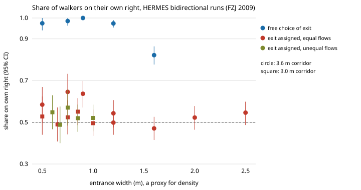

# Do people keep right in a two-way corridor, and what happens to their lanes when robots share it?

**Research programme** (track 17, `society`). **Question:** which passing policy should a fleet of mobile robots use in a corridor people also walk, if the aim is to keep the lanes people form and keep the cost to them low? The crowd models used to answer it are fitted to real trajectories and cross-checked against each other. Proposal: [PROPOSAL.md](PROPOSAL.md). Log: [LOG.md](LOG.md).

**Live page:** https://marisstella.app/research/society-lanes/

**Headline (milestone 1, real data).** In the Jülich HERMES bidirectional corridor experiments (2009, 24 runs, 4,752 walkers tracked from overhead cameras), people given no instruction about where to leave walked on their own right **93.7%** of the time (1,016 of 1,084; 95% interval 0.865 to 0.993). They formed almost perfect two-lane flow: lane order 0.91 to 1.00, against 0.25 to 0.52 when walking directions are shuffled. When each walker was told to leave by the left or the right exit, the right-side share fell to **0.53** (0.50 to 0.57). Lanes still formed, but they were weaker and kept changing. A side convention that people hold almost unanimously disappeared once each person had a lateral goal. A robot heading for a side door is in that second situation, and any crowd simulator used to design robot policies now has to reproduce the drop.

## Motivation

Delivery and logistics robots (hospital carts, airport and warehouse AMRs) increasingly share corridors with people. The 31 earlier `society-*` projects here studied how robots could shift a crowd's walking convention, but on uncalibrated models: a 1D memory game (`society-robotnorms`), a social-force corridor (`society-plaza`), and a side bias read off a published figure (`society-sidefit`). `society-twinfidelity` found that the size of the robot effect depends strongly on which crowd model is used. This programme fits the crowd models to real trajectories first, and treats agreement between models as a result that has to be earned. Related labs: HIRO (social intelligence) and CAIRO (simulated human models for human-robot collaboration), as framing only. No result here comes from those labs.

## Data

Forschungszentrum Jülich pedestrian data archive, HERMES project (BMBF grants 13N9952 to 13N9960), Düsseldorf 2009:
bidirectional flow with free choice of destination (doi:10.34735/ped.2009.12), with ordered destination and symmetric flow (doi:10.34735/ped.2009.11), and with ordered destination and asymmetric flow (doi:10.34735/ped.2009.10). Trajectories were extracted with PeTrack (Boltes and Seyfried 2013, doi:10.1016/j.neucom.2012.01.036) at 16 fps. The experiments are described in Zhang et al. (2012), doi:10.1088/1742-5468/2012/02/P02002. The script downloads the archives into `experiments/data_cache/` (gitignored); they are not redistributed here. The archive gives no licence beyond its request to cite the project and the DOIs, and this repository does both.

## Method (milestone 1)

- The section is the 8 m corridor (y from -4 to 4 m) between walls at x = 0 and x = 3.0 or 3.6 m. A walker counts if they spend at least 1 s there and their net displacement is at least 2 m. Direction is the sign of that displacement.
- **Share on own right:** a walker counts as on their right if their mean lateral offset toward their own right is positive. Intervals come from a bootstrap over walkers for each run, and from a two-stage bootstrap over runs and then walkers for pooled figures.
- **Lane order:** every 0.5 s, the corridor width is cut into 30 cm bins and each bin scores ((N+ − N−)/(N+ + N−))² (1 means the bin holds one direction only). The score is weighted by occupancy and averaged over frames with at least 4 walkers each way. It is compared with 100 shuffles of the direction labels within each frame.
- Predictions were registered in `LOG.md` before any trajectory was read.

Reproduce: `python3 research/society-lanes/experiments/m1_hermes_sides.py` (stdlib, about 12 s plus a 12 MB download). Tests: `python3 -m unittest discover -s research/society-lanes/tests`.

## Results

| Set | Runs | Walkers | Share on own right (95% CI) | Lane order (shuffled null) |
|---|---|---|---|---|
| Free choice of exit | 5 | 1,084 | 0.937 (0.865, 0.993) | 0.91 to 1.00 (0.25 to 0.52) |
| Exit assigned, equal flows | 13 | 2,782 | 0.534 (0.503, 0.568) | 0.59 to 0.85 (0.20 to 0.58) |
| Exit assigned, unequal flows (+ free-speed run) | 6 | 886 | 0.526 (0.487, 0.564) | 0.67 to 0.77 (0.31 to 0.49) |

Registered predictions: L1 (a right majority in free choice, interval excluding 0.5) **held**. L2 (share of at least 0.65) **held**. L3 (lane order above the null in every measurable run, 23 of 23) **held**. L4 (the share does not fall with density) **refuted**: it fell to 0.82 at the widest entrance. L5 (free speed 1.1 to 1.5 m/s) **refuted**: 1.73 m/s in the free-speed run. Per-run figures are in `experiments/m1_hermes_sides_runs.csv`.

## Limitations

- "Right" assumes the archive's coordinate frame is right-handed with z up, which head heights being positive suggests. If the frame is mirrored, people kept left. That both directions chose the same relative side does not depend on the frame.
- The free-choice and assigned-exit runs differ in more than the instruction. All 3.0 m runs had assigned exits, and run order was not randomised. The collapse is descriptive until milestone 2 replicates it on BaSiGo 2013, whose variants A and B differ only in the exit instruction.
- The participants were students in a hall in Germany in 2009, and laboratory crowds are not street crowds (milestone 7 checks data recorded in the wild).
- Lane order uses one bin width (30 cm). Speeds rely on the archive's stated 16 fps, which this step cannot check independently.
- No robots yet. Robots enter at milestone 5, in models fitted at milestones 3 and 4.

## Next steps

1. BaSiGo 2013 bidirectional corridor (926 participants, variants A and B): replicate, and separate the instruction from run order.
2. Fit a social-force model (JuPedSim or a checked implementation) on the free-choice runs, then test it on the assigned-exit runs without refitting (PROPOSAL.md, H3 and H4).
3. Fit ORCA and the anticipatory power law the same way.

## References

Full list with notes in [PROPOSAL.md](PROPOSAL.md), "Related work". All identifiers are machine-checked (`cite_check.json`).

*AI-assisted research: an AI agent wrote the code and text. No affiliation with any group or lab named here is implied.*
