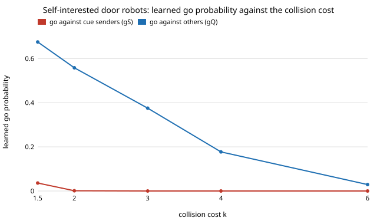

# society-learncue: do door robots that learn from their own costs keep honouring an urgency cue?

`society-cheapcue` gave the robot fleet a fixed rule: yield to a partner who sends an urgency cue, go against
everyone else. That rule cost the robots themselves 0.29 per encounter. Here every robot learns its own go
probability, separately for partners who send the cue (`gS`) and who do not (`gQ`), from its own expected cost, and
people re-equilibrate. **Answer: learning robots keep honouring the cue (`gS ≤ 0.04` in every cell) but stop going
against everyone else (`gQ` settles at 0.18 at `rho = 1` up to 0.42 at `rho = 0`, from three different starts, not 1).
That erases most of the cue's gain to urgent people: at `rho = 0.25` they are 0.005 worse off than under yield-all
(the fixed fleet gave +0.29), and they gain (+0.18) only when the cue is free for them (`rho = 0`). The crowd is
still worse off than under yield-all in every setting tried (+0.006 to +0.065 per encounter).** Produced with AI
assistance (Claude). Track 17 (`society`, `PROJECTS.md`), the second next step of `society-cheapcue`. Every result
is about simulated agents following a stated rule, not real people or robots.

**Live page:** https://duncan-haywood.github.io/oss-monorepo/research/society-learncue/

## Builds on

`society-cheapcue` (door model, cue-signalling equilibrium and fixed-fleet baselines, imported unchanged),
`society-fakeurgency`, `society-doorway`, and `society-learnrobots` (the idea of robots learning from their own
payoffs at a door). Spence (1973), *Quarterly Journal of Economics* 87(3):355–374, for the cue. Nothing is
reproduced. **Lab tags:** none used.

## Method

A robot is a negligible part of the fleet, so it takes the people's equilibrium (who sends the cue, how often people
go) as given. It meets a partner who looks like a cue sender or not (the look is wrong with probability `e`, here 0),
works out the chance the partner goes, and goes with probability `sigmoid(br · (cost of yielding − cost of going))`.
Its costs are those people have: collision `k = 3`, waiting `w = 1`, dithering `d = 1`. Robot partners never send the
cue and go with `gQ`. The fleet's `(gS, gQ)` is a fixed point of this response, found by damped iteration; people's
signalling equilibrium is recomputed at each step. Sweeps: urgent cue-cost ratio `rho`, logit sharpness `br`, and `k`.

## Results (`experiments/results.txt`, deterministic)

Yield-all baseline: urgent 1.130, normal 1.051, robots 1.000, crowd 1.047. Fixed reader fleet (`gS = 0, gQ = 1`),
`cN = 0.6`: robots 1.31 to 1.34, crowd 1.11 to 1.20.

**C. Learned fleet (`br = 8`)**; all three starts (reader, all-go, indifferent) reach the same point.

| `rho` | `gS` | `gQ` | urgent send | urgent | normal | robots | crowd |
|---|---|---|---|---|---|---|---|
| 1.00 | 0.002 | 0.181 | 0.03 | 1.218 | 1.079 | 1.034 | 1.085 |
| 0.50 | 0.000 | 0.252 | 0.36 | 1.261 | 1.087 | 1.032 | 1.095 |
| 0.25 | 0.000 | 0.375 | 0.82 | 1.134 | 1.097 | 1.021 | 1.080 |
| 0.00 | 0.000 | 0.415 | 0.95 | 0.949 | 1.100 | 1.015 | 1.053 |

Urgent people's cost against yield-all (1.130): worse at `rho ≥ 0.5`, level at 0.25, better only at 0. Because robots
go against non-senders 18% to 42% of the time, urgent people who do not send, or send too rarely, are hit.

**D. Sharpness** (`rho = 0.25`): a blunt robot (`br = 2`) goes against others 0.46 of the time and urgent people
gain 0.011; a sharp one (`br = 32`) 0.14 and urgent people lose 0.068. The crowd is +0.025 to +0.040 worse in all.

**E. Collision cost** (`rho = 0.25`, `br = 8`): `gQ` falls from 0.68 at `k = 1.5` to 0.03 at `k = 6`; urgent people
never gain over yield-all (−0.062 to −0.005), and the crowd is +0.015 to +0.065 worse.

## Limitations

- "Learning" is the fixed point of a logit response, not a simulated learning run; `society-learnrobots` found such a
  fixed point overstates going for sharp robots, so `gQ` here may be too high at `br ≥ 16`.
- Robots cannot tell a faker from an urgent person, and `gS` is nearly 0 because cue senders are mostly urgent or wait
  anyway; a world with many fakers (low `cN`) is not swept here.
- `rho`, `cN`, `br` and the door costs are swept or round figures, not sourced; no study of real cue costs was found.
- Same limits as `society-fakeurgency`: mean-field people with logit signalling, random pairing, no geometry, `e = 0`.

## Next steps

1. Simulate the learning (agent-based, per-robot memory) and compare with the fixed point.
2. Sweep `cN` and `e` so that fakers and misreading push `gS` up.
3. A cue that leaks in continuous space (speed, path) in `society-plaza`.

## Reproduce

`python3 experiments/run.py && python3 experiments/figure.py` (a few minutes); tests:
`python3 -m unittest tests/test_model.py`.

## Owner steps

None.

## Outside dependencies

None beyond the Python standard library and the sibling `society-*` projects it imports.
