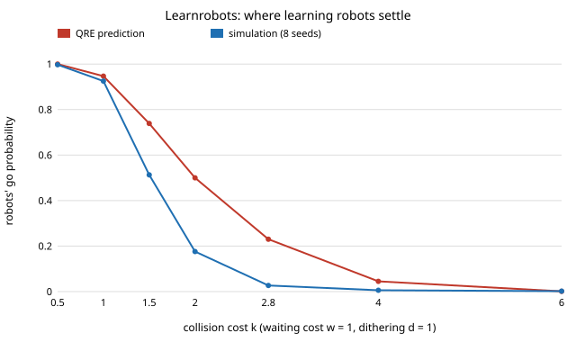

# society-learnrobots: do robots that learn at a door drift to going first when collisions are cheap?

`society-doorcost` found that below a collision cost `k* = 2.80` (waiting cost 1, dithering cost 1, 30% robots) a robot
that always yields is tempted to go, but its robots followed a fixed rule and never learned. Here each robot learns
its own go probability from its own payoffs. **Learning robots do not collapse to always-going below `k*`: they settle on a
mix that falls smoothly with the collision cost, and the start (all yielding or all going) does not matter. At `k = 1.5`
they go about half the time (0.51), at `k = 2` about 0.18, and above `k*` they are nearly always yielding (0.03 at `k = 2.8`).
Their fleet costs more than a fixed always-yield fleet for `k >= 1` (e.g. 0.935 against 0.886 at `k = 1.5`) and less only
when collisions are cheaper than waiting (`k = 0.5`: 0.501 against 0.546).** A logit quantal-response fixed point predicts
the settling point well for blunt robots (`beta_r = 4`, within 0.09) but overstates going for sharp ones (`beta_r = 16`: it predicts
0.74 at `k = 1.5`, the simulation gives 0.51). Produced with AI assistance (Claude). Track 17 (`society`, `PROJECTS.md`), the first
next step named in `society-doorcost`. Every result is about simulated agents following stated rules, not real people or robots.

**Live page:** https://duncan-haywood.github.io/monorepo-projects/research/society-learnrobots/

## Builds on

`society-doorway` (game, people with memory, mean field, imported unchanged) and `society-doorcost` (`deviation_gain`, `k*`).
Learning rule: constant-step-size action-value learning with bandit feedback and a logit (softmax) policy, the textbook
form (Sutton and Barto, *Reinforcement Learning*, 2nd ed., 2018, ch. 2); the fixed point is the logit quantal-response
equilibrium of McKelvey and Palfrey (1995), *Games and Economic Behavior* 10:6–38. Nothing is reproduced.
**Lab tags:** HIRO and CAIRO only loosely; no method of theirs is used.

## Method

Each robot keeps `Q[go]`, `Q[yield]` (cost estimates, initialised so its go probability is `g0`, clipped to 0.02 to 0.98), updates
only the action it played, `Q[a] += alpha (cost - Q[a])` with `alpha = 0.05`, and goes with probability
`sigmoid(beta_r (Q[yield] - Q[go]))`. People, pairing and costs are as in `society-doorway`. 200 agents, 3000 rounds, first
1500 discarded, 8 seeds, 30% robots, `w = d = 1`. Prediction: `g = sigmoid(beta_r * deviation_gain(g))`, solved by bisection.
`alpha` and `beta_r` are free parameters of the robots' design, not measured; `beta_r` is swept (1 to 64) rather than picked.

## Results (`experiments/results.txt`, seeded and deterministic)

**A. Settling point** (start yielding):

| k | QRE `beta_r=4` | sim | QRE `beta_r=16` | sim |
|---|---|---|---|---|
| 0.5 | 0.890 | 0.889 | 1.000 | 0.997 |
| 1.0 | 0.708 | 0.701 | 0.947 | 0.925 |
| 1.5 | 0.593 | 0.569 | 0.739 | 0.513 |
| 2.0 | 0.500 | 0.458 | 0.500 | 0.176 |
| 2.8 | 0.378 | 0.308 | 0.230 | 0.027 |
| 4.0 | 0.244 | 0.157 | 0.045 | 0.006 |
| 6.0 | 0.120 | 0.047 | 0.001 | 0.002 |



**B. Start does not matter.** From all-going and all-yielding the fleet ends within 0.011 of the same go share at every `k` (`beta_r = 16`).

**C. Sharpness.** The QRE go share at `k = 2.8` is 0.46, 0.38, 0.23, 0.10 for `beta_r` = 1, 4, 16, 64. The prediction only reaches a
go share below 0.1 at `k` of 3.50 (`beta_r = 16`) and 2.81 (`beta_r = 64`, about `k*`): only very sharp learners reproduce `k*`.

**D. Robot share** (`beta_r = 16`, 4 seeds). At `k = 3` the simulated fleet go share is 0.010, 0.020, 0.047, 0.108 for 10, 30, 50, 70% robots;
at `k = 1.5` it is 0.48 to 0.57, while the QRE prediction (0.79 to 0.67) is again higher.

## What this does and does not show

- The worry that individually adaptive robots below `k*` would all drift to going is not borne out here: they hold a mixed rule, and they
  go less as collisions get dearer. The fleet is not stable at "always yield" either; below `k*` a substantial share keeps going.
- Learning has a price: the learned fleet is worse for the crowd than a fixed always-yield fleet whenever `k >= 1`.
- **The mean-field prediction is not reliable for sharp learners.** Simulation settles below the QRE at mid `k` (`beta_r = 16`, `k = 2`: 0.18 against 0.50).
  I did not isolate why; candidate causes are the noise in constant-step estimates being amplified by the sharp response, a robot's stale estimate of an action it rarely
  plays, and the correlation between a robot's own recent actions and its partners' memories, none of which the mean field has. This is untested.

## Limitations

Mean field and simulation share one set of fixed costs for people and robots; people homogeneous; one `alpha`; no exploration
schedule or decay; 8 seeds (4 in D); a single design of learner; no geometry or real data. Costs `k`, `d`, `w` are free parameters, not measured.

## Reproduce

```
cd research/society-learnrobots
python3 -m unittest discover -s tests      # 6 tests
python3 experiments/run.py                 # about 10 minutes, writes results.txt
python3 experiments/figure.py              # writes settling.svg
```

Stdlib only (Python 3.9+); imports `research/society-doorway/src` and `research/society-doorcost/src`.

## Next steps

1. Find why sharp learners undershoot the QRE (test a decaying step size, and a mean-field with the robots' own memory).
2. A mixed population with urgent people and a robot rule that reads urgency (second next step of `society-doorcost`).
3. A door with geometry, joining `society-plaza`.

## Owner steps

None.

## Outside dependencies

None: Python standard library only.
