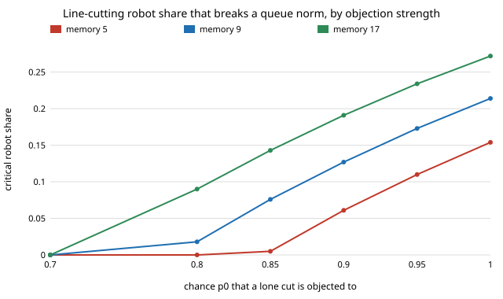

# society-lineup: how many line-cutting robots does it take to break a queueing norm?

`society-robotnorms` studied a convention that is symmetric (walk left or right). A queue is not:
cutting pays for the cutter while few others do it, and the thing that holds the norm, other
people objecting, fades as cutting becomes common. **With people who remember the last 9 cut
attempts they saw and cut when most succeeded, and an objection that stops a lone cut 90% of the
time and fades linearly as the cutting share rises, committed line-cutting robots break the norm
once they are 12.7% of the crowd (mean field). Below that share almost nobody cuts (0.2% at 0%
robots, 3.4% at 10%); at 13% every person cuts. Simulation (200 people, 12 seeds) agrees: 0 of 12
crowds tip at 0.107, 10 of 12 at 0.127, 12 of 12 at 0.147 and above.** The result depends mainly on
the one number nobody has measured here, how strongly bystanders object: at a lone-cut objection
chance of 0.80 the threshold is 1.8%, at 0.70 the norm fails with no robots at all (memory 9), and
at 1.00 it is 21.4%, close to the 21.7% that `society-robotnorms` found for a symmetric
convention. How fast objection fades with cutting (k) matters even more: 39.5% at k = 0.5, 0.7% at
k = 4. Produced with AI assistance (Claude). Free milestone of research track 17 (`society`,
`PROJECTS.md`): a new convention (queueing, named in the track goal), not another variant of the
walking-side chain. Every result is about simulated agents following a stated rule, not real
people or robots.

**Live page:** https://duncan-haywood.github.io/oss-monorepo/research/society-lineup/

## Why this question

The track asks which conventions emerge and what robots do to them, naming queueing. A fleet of
robots that cut (delivery robots at a counter, a robot skipping a taxi rank) is a committed
minority, as in Xie et al. (2011), but against a norm kept by punishment. Milgram et al. (1986,
*J. Personality and Social Psychology* 51) staged line intrusions in the field; the summary I
could verify (not the paper's numbers) is that people behind the intruder protested more than
those in front, and that protest fell when a bystander confederate stayed silent. That is the
mechanism modelled here: objection depends on what others do.

## Builds on

`society-robotnorms` (memory-majority rule, tipping definition, mean field against simulation);
Young (1993); Xie et al. (2011); Centola et al. (2018); Milgram et al. (1986). **Lab tags:** HIRO and
CAIRO only in the loose sense of the track (human-robot social behaviour); no method of theirs is used.

## Model

Population `N`; a share `ρ` are robots that always cut. Each person remembers the outcomes of the
last `M` cut attempts they watched and cuts next round iff a strict majority succeeded (a rule in
the family of Young 1993). With `z` the share of everyone who cuts, an attempt succeeds with
probability `s(z) = 1 − p0 (1 − z)^k`: `p0` is the chance a lone cut is objected to, and
objection fades as cutting becomes common. Observation error `ε = 0.02`. Mean field:
`x' = P(Bin(M, s') ≥ (M+1)/2)`, `z = ρ + (1−ρ)x`; `ρ_c` is the least `ρ` whose long-run `x`
(started from 0, a working norm) passes 1/2.

**Parameters.** `M`, `ε` as in `society-robotnorms`. `p0` and `k` have no published value I
could find, so they are swept (`p0` 0.7–1.0, `k` 0.5–4), not chosen; every claim below is stated
for the sweep.

## Results

From `experiments/results.txt` (`experiments/run.py`, seeded).

| p0 | M=5 | M=9 | M=17 |
|---|---|---|---|
| 0.70 | 0.000 | 0.000 | 0.000 |
| 0.80 | 0.000 | 0.018 | 0.090 |
| 0.90 | 0.061 | 0.127 | 0.191 |
| 1.00 | 0.154 | 0.214 | 0.272 |



Check: at `p0 = 1, k = 1` the model reduces to no fading objection and gives 0.154 / 0.214
/ 0.272 against `society-robotnorms`' 0.158 / 0.217 / 0.273 (the small gap is its different
error handling, not an identity). **Simulation (M=9, p0=0.9):** tipped crowds 0, 0, 0, 10, 12, 12,
12 of 12 at `ρ` = 0.047, 0.087, 0.107, 0.127, 0.147, 0.167, 0.207. Once tipped, objections per cut
attempt fall from 0.76–0.85 to under 0.02: at that point most attempts succeed, so the model's cutting is rewarded. (Recovery after robots leave was not run.)

## Limitations

A binary cut/queue decision at one counter; no waiting time, no queue geometry, no robots that
adapt or queue; objection modelled by a one-parameter curve nobody here measured; people watch one
attempt per round; 12 seeds; 200 people. Not evidence about real queues.

## Reproduce

```
cd research/society-lineup
python3 -m unittest discover -s tests            # 7 tests, ~1 s
python3 experiments/run.py                       # writes results.txt (~1 min)
python3 experiments/figure.py
```

## Next steps

1. Measure `p0` and `k`: fit them to a published line-intrusion dataset (Milgram et al. 1986 tables).
2. Robots that queue but are faster at service, so cutting is "efficient": does that change objection?
3. Robots that punish cutters (enforcers) as a committed minority on the other side.

## Owner steps

None.

## Outside dependencies

None: Python standard library only.
