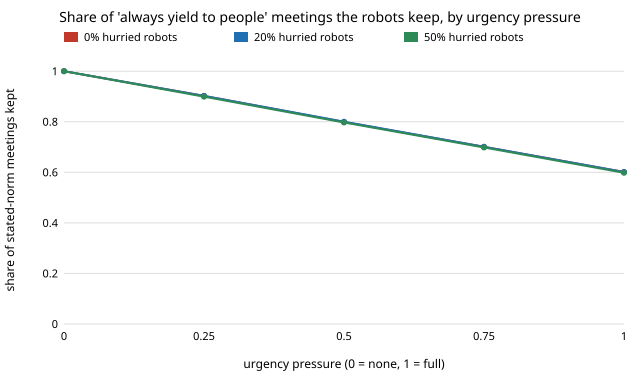

# society-llmtown: do robot agents keep the norms they state? A harness with a stub policy

When robot agents in a small town state a door norm each day and then act among scripted
people, how often do their actions match their words? **With the deterministic stub policy
shipped here (not a language model), a robot that states "always yield to people" keeps it in
`1 − 0.4·pressure` of its meetings (1.00, 0.80 and 0.60 at urgency pressure 0, 0.5 and 1),
whatever the share of hurried robots; people's mean cost per meeting rises from 0.20 to 1.08
over the same range.** These numbers follow from the stub's rule and are checked against that
closed form; they are not findings about language models. The deliverable is the harness: any
agent with `state_norm` and `act` plugs in, an optional `LLMAgent` calls a model when
`ANTHROPIC_API_KEY` is set, and no LLM result is claimed because none was run. Produced with AI
assistance (Claude). Milestone 5 of research track 17 (`society`, `PROJECTS.md`). Every result is
about simulated people and robots following stated rules.

**Live page:** https://duncan-haywood.github.io/oss-monorepo/research/society-llmtown/

## Why this question

Generative-agent studies (Park et al. 2023) show that language-model agents with memory and
plans produce believable social behaviour, and that stated intentions and actions can differ. A
robot fleet that announces a courtesy norm and then drops it under time pressure is a say–do gap
with a measurable cost to the people it meets. This project builds the measuring instrument first:
a town, a noticeboard, a norm statement and a keep-rate, with the policy swappable.

## Builds on

- Park, O'Brien, Cai, Morris, Liang and Bernstein (2023), *UIST*: generative agents with memory
  and plans in a simulated town. No code or method of theirs is used; only the setting's idea.
- Leibo et al. (2017), *AAMAS*: sequential social dilemmas; yielding is individually costly.
- Young (1993), *Econometrica*, and the other track-17 projects (`society-robotnorms`,
  `society-commons`) for the norm and cost framing.

**Lab tags:** none in the loose sense; no method of the groups in `prompt.md` is used.

## Model

- 10 robots, 30 scripted people, 20 days, 20 door meetings per robot per day. A meeting is with a
  person with probability 30/39, otherwise another robot (not scored).
- Each morning a robot sees the noticeboard (yesterday's share of robot–person meetings in which
  robots went first) and states one of three norms: `always_yield`, `yield_when_not_late`,
  `first_come`.
- Each meeting has a random urgency `u ~ U(0,1)`. The stub: `always_yield` goes with probability
  `0.8·pressure·u`; `yield_when_not_late` goes iff `u ≥ 0.5`; `first_come` goes half the time.
  A share of robots is "hurried" and always states `first_come`. Others state `always_yield`
  unless the noticeboard shows over half the robot–person meetings ended with the robot going,
  when they state `yield_when_not_late`.
- People go first with probability 0.8. Both going costs each 3 (collision); a robot that yields
  pays `u·pressure` (lateness); both yielding costs the person 1.
- **Keep rate:** a meeting keeps the norm if the action matches it (`first_come` promises
  nothing about yielding, so it is always kept).

## Reproduce

```
python3 -m unittest discover tests
python3 experiments/run.py      # writes experiments/results.txt
python3 experiments/figure.py   # writes experiments/kept.svg
```

With a model: set `ANTHROPIC_API_KEY` and call `simulate(agent_cls=LLMAgent, ...)` yourself; it
is not wired into `run.py`. That path makes real API calls, was not run here, and is tested only
for its missing-key error.

## Results



Twenty seeds per cell, full table in `experiments/results.txt`.

- Keep rate of `always_yield` is 1.000, 0.799, 0.601 at pressure 0, 0.5, 1.0 (no hurried robots)
  and within 0.003 of that with 20% or 50% hurried robots.
- People's cost per meeting: 0.200, 0.639, 1.077 at pressure 0, 0.5, 1.0 with no hurried robots;
  with half the robots hurried it is 0.749 even at pressure 0.
- The noticeboard rule rarely fires: robots' go-rate stays under 0.5 except at 50% hurried robots
  with pressure 1.0 (0.458 mean), where 8% of robot-days state `yield_when_not_late`.

## Limitations

- The stub is hand-written, so the say–do gap is an input, not a discovery. The `1 − 0.4·p`
  curve is the rule's expectation. What the harness shows is the machinery works and what a
  real agent would be measured against.
- No language model was run. Whether a model's stated norms track its actions is open here.
- Scripted people never adapt or react to robots; one town size, one parameter set.
- The cost weights (3, 1, `u·pressure`) are arbitrary.

## Next steps

1. Run `LLMAgent` (owner's key and budget) or the session as proposer for a few days, committing
   each stated norm and action as files, and compare with the stub.
2. Let people adapt (reuse `society-robotnorms` memory rule) so a norm-breaking fleet is punished.
3. Add free-text norm statements and score keeping by a scripted classifier.

## Owner steps

Spending API budget on model-driven runs; any study with real people.

## Outside dependencies

None for the stub and tests (Python standard library). `LLMAgent` needs a Claude API key and
network access.
