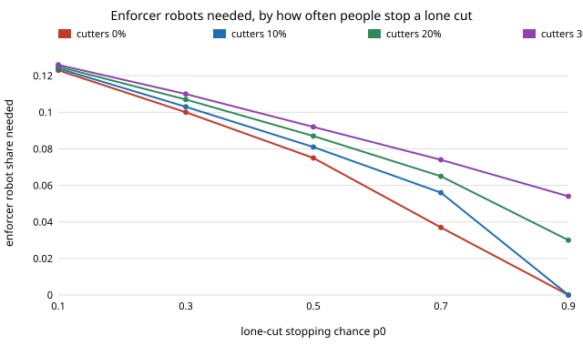

# society-milgramfit: do real objection rates to line-cutting keep a queueing norm in a robot crowd?

`society-lineup` and `society-enforcers` assumed people stop a lone line-cut with probability `p0 = 0.9`.
This checks that input against the field experiment on intrusion into waiting lines (Milgram et al. 1986).
**In the memory-9 model, people alone keep a queueing norm only if they stop a lone cut with probability
at least 0.786. Milgram's field crowds reacted to a single intruder about half the time (secondary
source, below), and physically ejected the intruder 10% of the time, so with a stop chance between 0.10
and 0.5 the norm needs enforcers even with no cutter robots at all: 7.5% enforcers at 0.5, 12.3% at
0.1 (L = 10 in view, stop chance 0.5 each).** Against 30% cutters it is 9.2% and 12.6%, compared with
5.4% at the assumed 0.9. Two intruders drew objections 91% of the time, above the 75% that independent
objectors would give, so objection is not independent across viewers. Produced with AI assistance (Claude).
Next step 3 of `society-enforcers`, track 17 (`society`, `PROJECTS.md`). Every result is about simulated
agents following a stated rule, not real people or robots.

**Live page:** https://duncan-haywood.github.io/oss-monorepo/research/society-milgramfit/

## Why this question

`p0 = 0.9` was a round figure. The track asks how many enforcer robots a fleet needs; the answer moves
from 5% to 9% of the crowd depending on a human number that a field study bounds.

## Builds on

`society-enforcers` (model imported unchanged from its `src`), `society-lineup`. Milgram, Liberty,
Toledo and Wackenhut (1986), *J. Personality and Social Psychology* 51:683-689. **Lab tags:** none
(loose link to HIRO/CAIRO human-robot social behaviour only).

## Method and inputs

| input | value | source |
|---|---|---|
| any reaction to one intruder | about 0.5 | secondary summary of Milgram et al. (spring.org.uk, 2008) |
| intruder physically ejected | 0.10 | same |
| two intruders, objection rate | 0.91 | same |
| buffer between intruder and objector | 0.05 | same |

**I did not read the 1986 paper**: the figures come from a popular summary and should be checked against the
paper before anyone relies on them. "Any reaction" includes looks and gestures, so it is an upper bound on
stopping a cut; ejection is a lower bound. I therefore sweep `p0` from 0.1 to 0.9 rather than fix one value.
Everything else (`M = 9`, `k = 1`, `ε = 0.02`, `L = 10`, `q = 0.5`) is as in `society-enforcers`; `L`, `q` still
have no source. New code: `p_star` (bisection for the least `p0` at which people alone, from a norm, end below
a 0.5 cut share) and a viewer-independence check.

## Results

From `experiments/results.txt` (`experiments/run.py`, deterministic mean field, no seeds).

| memory M | 3 | 5 | 9 | 15 | 25 |
|---|---|---|---|---|---|
| least p0 to keep a norm, people alone | 0.901 | 0.846 | 0.786 | 0.739 | 0.698 |

Enforcers needed (share of crowd), by `p0` and cutter-robot share ρ:

| p0 | ρ = 0 | 0.10 | 0.20 | 0.30 |
|---|---|---|---|---|
| 0.1 | 0.123 | 0.124 | 0.125 | 0.126 |
| 0.3 | 0.100 | 0.103 | 0.107 | 0.110 |
| 0.5 | 0.075 | 0.081 | 0.087 | 0.092 |
| 0.7 | 0.037 | 0.056 | 0.065 | 0.074 |
| 0.9 | 0.000 | 0.000 | 0.030 | 0.054 |

- At weak human objection the cutter-robot share barely matters (0.123 to 0.126 across ρ at `p0 = 0.1`): the
  enforcers are replacing the people, not out-voting the cutters.
- If 0.5 of a crowd reacts through `L = 10` independent viewers, each reacts with probability 0.067 (0.129
  with 5 in view); the two-intruder rate 0.91 against the independent 0.75 says viewers influence each other.
- The needed enforcer share at ρ = 0 is the same for M = 3, 5, 9, 15 at `p0 = 0.5` (0.075).

- **Viewer influence (added 2026-10-23, step 2).** In a model where each viewer's reaction chance rises after
  earlier reactions, the chance that *anyone* reacts is exactly `1-(1-r0)^L` whatever the boost, because
  influence only acts after a first reaction (checked numerically, results section E). So word-of-mouth between
  viewers cannot explain 0.5 to 0.91. A reaction hazard that grows as (intruders)^a with a = 1.80 does (a = 1 is
  independence, 0.75); this is one parameter fit to one secondary-source number, a description not a test. The
  0.05 buffer rate is not refitted. Step 1 (reading the 1986 paper) is still open: the paper was not reachable
  from this environment (publisher pages return 403), so the inputs remain secondary.

## Limitations

Secondary-source inputs; a reaction is not a stopped cut, hence a sweep, not a point estimate; Milgram's
intrusions were by one or two people in a single city in the 1970s-80s; `L`, `q` unsourced; no geometry,
cost or adaptation; a binary memory-majority model. Not about real queues or robots.

## Next steps

1. Read the 1986 paper and replace the table's secondary figures; fit `p0` to its stop rate directly.
2. Refit the 0.05 buffer rate too, with a model where influence also changes who is in view (done for 0.5 and 0.91 only).
3. Place enforcers on a line (`society-enforcers` step 1).

## Reproduce

`python3 -m unittest discover -s tests; python3 experiments/run.py; python3 experiments/figure.py`. Stdlib only.

## Outside dependencies

The Milgram et al. (1986) paper itself, not read here.
