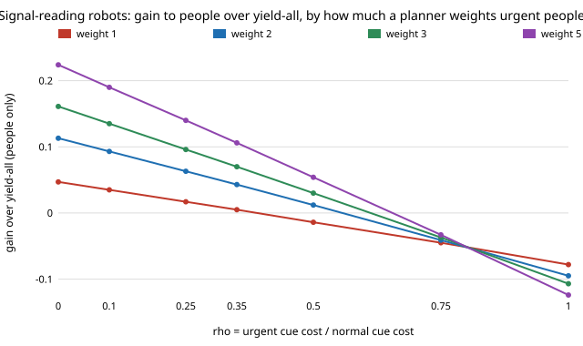

# society-peoplecost: does a signal-reading door fleet help people once robots are not counted, and for whom?

`society-cheapcue` found the crowd average, robots included, is worse under a signal-reading door fleet than under
yield-all in all 35 cells it tried, and listed "report crowd cost for people only, and for a social planner who weights
urgent waiting more" as its first next step. This does that. **Answer: scored over people alone with a plain average
(planner weight `lam = 1`), the fleet helps only if the urgent cue costs urgent people at most about 0.35 of what it
costs normal people (`rho ≤ 0.35`; gain +0.005 at 0.35, +0.017 at 0.25, +0.047 at 0, from a yield-all people cost of
1.066). With an equal-cost cue (`rho = 1`) it hurts people at every weight tried (−0.078 at `lam = 1`, −0.124 at 5).
A planner who weights urgent waiting more prefers the fleet at larger `rho`: at `rho = 0.25` from `lam ≈ 0.71`, at
`rho = 0.5` from `lam ≈ 1.5`. Reading errors and many robots erase the gain.** Produced with AI assistance (Claude).
Track 17 (`society`, `PROJECTS.md`). Every result is about simulated agents following a stated rule, not real people
or robots.

**Live page:** https://duncan-haywood.github.io/monorepo-projects/research/society-peoplecost/

## Builds on

`society-cheapcue` (signalling equilibrium and door costs, imported unchanged), `society-fakeurgency` and
`society-urgentdoor` beneath it, and Spence (1973), "Job market signaling", *Quarterly Journal of Economics*
87(3):355–374. Nothing is reproduced. **Lab tags:** none used.

## Method

For a scenario, `society-cheapcue` gives mean cost per encounter for urgent people `cU`, normal people `cN` and robots.
Here the people-only cost is `(lam·u·cU + (1−u)·cN) / (lam·u + 1−u)` with `u = 0.2` the urgent share; `lam = 1` is
the plain average, `lam > 1` a planner who counts urgent waiting `lam` times as much. "Gain" is yield-all minus
reader fleet; positive means the fleet helps. Defaults as in `society-cheapcue`: 30% robots, collision cost 3,
dithering cost 1, urgent waiting 3x, normal cue cost `cN = 0.6`, urgent cue cost `rho·cN`. `rho`, `cN` and `lam` are
swept, not measured; nothing was found that measures them in these units. A test checks the people-only and robot
parts add back to `society-cheapcue`'s crowd cost.

## Results (`experiments/results.txt`, deterministic)

**A and B. Gain over yield-all (people only), by `rho` and planner weight** (`cN = 0.6`):

| `rho` | lam 1 | lam 2 | lam 3 | lam 5 |
|---|---|---|---|---|
| 1.00 | −0.078 | −0.095 | −0.107 | −0.124 |
| 0.75 | −0.045 | −0.041 | −0.037 | −0.033 |
| 0.50 | −0.014 | +0.012 | +0.030 | +0.054 |
| 0.35 | +0.005 | +0.043 | +0.070 | +0.106 |
| 0.25 | +0.017 | +0.063 | +0.096 | +0.140 |
| 0.00 | +0.047 | +0.113 | +0.161 | +0.224 |

**C. Break-even weight** (smallest `lam` at which a people-only planner prefers the fleet): "never" (within 50) at
`rho = 1` for every `cN`; at `rho = 0.25` it is 0.71 for `cN = 0.6` and 0.64 to 6.3 across `cN` 0.2 to 1.2; at
`rho = 0` it is 0.32 to 0.47 for `cN ≥ 0.6` and 4.3 at `cN = 0.2`. A cheap cue for normal people (`cN = 0.2`) needs
a heavy urgent weight because many of them fake it.

**D. Robot share** (`rho = 0.25`, `cN = 0.6`, `lam = 1`): people's gain is −0.020 at 10% robots, +0.017 at 30%,
+0.018 at 50% and −0.109 at 70%; counting robots, the crowd loses at every share (−0.029 to −0.850).

**E. Reading error** (largest `rho` with positive `lam = 1` gain, best `cN` in 0.1 to 1.5): 0.375 (`e = 0`), 0.175
(`e = 0.1`), 0.000 (`e = 0.2`, at the edge of the `cN` grid), each with gains of 0.003 or less.

## What it means

Dropping robots from the score turns `society-cheapcue`'s "never better" into "better when the cue is cheap enough
for the urgent", so the earlier verdict was partly about robot throughput. But the conditions are narrow: a cue
roughly three times costlier for normal people than for urgent ones, few misreadings, a moderate robot share, or a
planner who values urgent waiting. Which of these hold is empirical and not answered here.

## Limitations

- `rho`, `cN` and `lam` are swept, not sourced. Which `lam` is right is an ethical choice, not a measurement; the
  table shows where the answer flips rather than recommending a value.
- Excluding robots from welfare is a framing choice; the robots' own cost (throughput) is reported in `society-cheapcue`.
- Same model limits as `society-fakeurgency`: logit signalling, random pairing, no geometry, no robot learning, no
  search for multiple equilibria; the signalling equilibrium itself was not simulated agent by agent.
- Gains at the edge (E) are tiny (≤ 0.003) and sensitive to the grid.

## Next steps

1. Robots that learn `gS` and `gQ` and discount a cue many people send (`society-cheapcue` next step 2).
2. A continuous cue (speed, path) in `society-plaza`.

## Reproduce

`python3 experiments/run.py && python3 experiments/figure.py` (about 5 minutes: the break-even and error sweeps are
slow); tests: `python3 -m unittest tests/test_model.py`.

## Owner steps

None.

## Outside dependencies

None beyond the Python standard library and the sibling `society-*` projects it imports.
