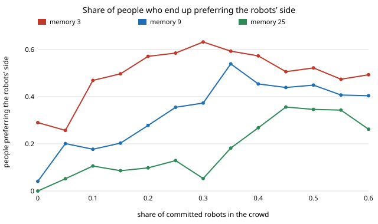
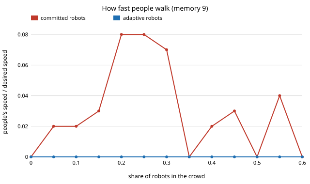

# society-plaza: do robots that keep to one side make people walk on it, or jam the corridor?

In a simulated crowd with real geometry, what happens when robots that always keep to the left
of their heading join people who keep right and copy the side most of their last partners used?
On a social-force corridor model: **robots that adapt to the people change nothing (people walk
at 0.91 of their desired speed at every robot share). Robots that hold their side do not flip the
crowd the way the one-dimensional model `society-robotnorms` predicts. At 5% of the crowd
they already cut people's walking speed from 0.91 to 0.81 of desired and put another agent
inside personal space for 2% of the time; at 30% people walk at 0.39 of desired speed and the
lanes have half collapsed (lane separation 2.75 m → 1.43 m). People's preference for the
robots' side rises gradually to about 0.4–0.55 and does not reach the whole crowd in 300 s,
for memory 9.** Produced with AI assistance (Claude). Milestone 2 of research track 17
(`society`, `PROJECTS.md`). Every result is about simulated walkers following stated rules,
not about real crowds.

**Live page:** https://duncan-haywood.github.io/monorepo-projects/research/society-plaza/ ·
**Browser replay (a labelled simulation):** [`experiments/plaza_replay.html`](experiments/plaza_replay.html)
(download and open; no network needed).

## Why this question

`society-robotnorms` found, with no geometry, a sharp tipping share (16–32% of the crowd) above
which people adopt the robots' passing side. Real corridors have width, speed and bodies that
block each other. So: does the tipping survive when pedestrians are moving discs pushed by
social forces, and what does a robot fleet that holds its side cost people along the way? The
simulated people are a behavioural twin; the question is whether a conclusion from a stylised
twin survives a more physical one, the track's tie to the digital-twin theme.

## Builds on

- Helbing and Molnár (1995), *Phys. Rev. E* 51:4282–4286: the social-force model used for motion.
- Moussaïd, Helbing, Garnier, Johansson, Combe and Theraulaz (2009), *Proc. R. Soc. B*
  276(1668):2755–2762: measured side preference in pedestrian avoidance; here a sideways push
  toward the preferred side when an oncoming agent is ahead.
- Young (1993), *Econometrica* 61(1):57–84, and Xie et al. (2011), *Phys. Rev. E* 84:011130:
  conventions and committed minorities, the framing of `society-robotnorms` (same-track sibling).
- Kruse et al. (2013), *Robotics and Autonomous Systems* 61(12):1726–1743: human-aware robot navigation.

This reproduces none of them. No lab's method is used; HIRO (social intelligence) and CAIRO
(simulated human models for training collaborative robots) are the loosely related groups.

## Model

- A 30 m × 6 m corridor, periodic along its length, walls on both sides; 60 agents (0.33 per m²),
  half walking each way, disc radius 0.25 m, desired speed 1.3 m/s ± 8%.
- **Motion:** relaxation to desired velocity (τ = 0.5 s) plus exponential repulsion from agents
  and walls (A = 12 m/s², B = 0.3 m for agents), weaker for agents behind, with small noise.
  Euler step 0.05 s.
- **Passing side:** when an oncoming agent is ahead, the repulsion gets a sideways part (0.6 of
  its size) toward the agent's preferred side of its own heading.
- **People** prefer the majority side used by their last *M* = 9 oncoming partners (a "pass" is
  two oncoming agents within 1.5 m laterally exchanging order along the corridor; the partner's
  side is the side of the partner's own heading it ended on). All start keeping right.
- **Robots** (share ρ, split evenly between directions) are *committed* (always left),
  *adaptive* (run the people's rule), and walk at the same speed as people.
- Runs last 300 s; outcomes are measured over the second half; 8 seeds per cell.
- Outcomes: *tipped* (share of people preferring left), *lane* (westbound minus eastbound mean
  lateral position, metres; positive = people keep right), *intrude* (share of agent time with
  another agent within 0.9 m), *detour* (path length over net advance), *speed* (people's mean
  speed over desired), *close* (pairs within 0.6 m per agent per minute).

## Results

All numbers are from `experiments/results.txt` (`experiments/run.py`, seeded).

**A. Committed robots, people M = 9.**

| robot share | people preferring left (last quarter) | lane separation (m) | personal-space time | detour | people's speed / desired |
|---|---|---|---|---|---|
| 0 | 0.04 | 2.75 | 0.0002 | 1.002 | 0.91 |
| 0.05 | 0.20 | 2.52 | 0.020 | 1.019 | 0.81 |
| 0.10 | 0.18 | 2.39 | 0.032 | 1.026 | 0.74 |
| 0.20 | 0.28 | 1.61 | 0.034 | 1.048 | 0.61 |
| 0.30 | 0.37 | 1.43 | 0.026 | 1.076 | 0.39 |
| 0.35 | 0.54 | 0.83 | 0.013 | 1.030 | 0.47 |
| 0.50 | 0.45 | 1.48 | 0.007 | 1.041 | 0.40 |
| 0.60 | 0.40 | 1.72 | 0.009 | 1.036 | 0.42 |

There is no jump to the robots' side. The share of people preferring left climbs gradually, peaks
at 0.54 at ρ = 0.35 and falls back to about 0.4 at ρ ≥ 0.4. People's speed falls early and stays
near 0.4 of desired from ρ = 0.3. Close calls stay rare (at most 0.08 per agent-minute).

**B. Adaptive robots** leave every outcome at the ρ = 0 value (preferring left 0.03–0.04, lane
2.66–2.75 m, speed 0.91, personal-space time 0.0002) at every share up to 0.6.

**C. Memory.** Preferring-left share in the last quarter of the run: memory 3 reaches 0.47 at
ρ = 0.10 and 0.63 at 0.30 (but already 0.29 at ρ = 0, so short memory is noisy even with no
robots); memory 9 peaks at 0.54; memory 25 stays under 0.13 until ρ = 0.30 and peaks at 0.36 at
ρ = 0.45. Longer memory resists the robots' side longer, as in `society-robotnorms`, but no memory
produced a complete flip.





## What this does and does not show

- In this twin, a fleet that holds its side is costly well below the share at which the 1D model
  says people tip, and it does not produce a clean convention flip within 300 s. The 1D result
  (sharp tipping at 22% for M = 9) did not carry over to a corridor with geometry. Whether
  that is the model of motion, the pass-detection rule or the finite run is not separated here.
- Robots that follow the local convention are free in every outcome measured. That holds in the
  1D model too and is the practical recommendation both projects agree on.
- A plausible mechanism, not tested here: robots keeping left and people keeping right meet in
  head-on pairs that both sidestep the same way, which slows both. A test would swap robot
  speeds or lane choices individually and measure pair delays.
- It does not show that real pedestrians behave like these discs, that real robots would slow a
  crowd by these amounts, or anything about any real place.

## Limitations

Stylised: one parameter set (density, force strengths, sideways weight 0.6, noise); 8 seeds and
300 s per cell, so *tipped* values carry visible noise (not computed as intervals); people's side
is read from a heuristic pass detector, with a baseline of 0.04 preferring left at ρ = 0
(0.29 at memory 3); no groups, no goals other than walking along the corridor; robots have
exactly the people's speed and body; the speed drop mixes real blocking with this force model's
known tendency to freeze in dense counter-flow. Deliberately shifting how people behave raises
consent questions: this reports the cost, it is not a recipe for steering crowds.

## Reproduce

```
cd research/society-plaza
python3 -m unittest discover -s tests          # 13 tests, ~5 s
PYTHONPATH=src python3 experiments/run.py      # ~25 min on 4 cores, writes results.txt
python3 experiments/figure.py                  # writes the two SVGs from results.txt
PYTHONPATH=src python3 experiments/replay.py   # writes plaza_replay.html (seed 7, 30% committed robots)
```

Stdlib only (Python 3.9+).

## Next steps

1. Find why the flip is missing: vary the sideways weight, pass-detection range and run length;
   test robots that are slower or faster than people.
2. Robots that fall back to the local convention when a local estimate says they are below the
   tipping point (milestone 3 of the track).
3. A more humanlike crowd (track 11's imitators) in place of the force model's walkers.

## Outside dependencies

None: the model, simulation, figures and replay use only the Python standard library and a
browser canvas.
