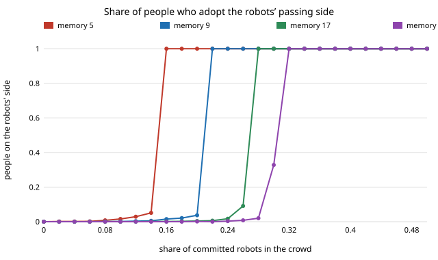
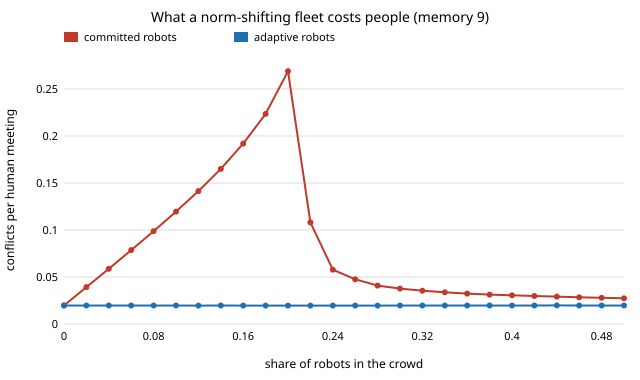

# society-robotnorms: how many robots does it take to change how a crowd walks?

When robots that always keep to one side join a crowd that keeps to the other, what share of
the crowd must be robots before people switch, and what do the robots cost people until then?
On a stylised model where people pick a passing side from memory of recent partners: **the
tipping share is 16% of the crowd when people remember 5 partners, 22% for 9, 28% for 17 and
32% for 25, within 0.02 of a mean-field prediction. Below it, people never switch, and robots
that hold their side make them collide up to 14 times as often as robots that adapt (0.27
against 0.020 conflicts per meeting at a 20% robot share). The worst place for a robot fleet to
be is just short of the tipping point. Where robots stand matters more than how many there
are: when people meet only neighbours, evenly spread robots tip everyone from 12–14% of the
crowd, while the same robots in one block convert under 10% of people even at half the crowd.** Produced with AI assistance (Claude).
First project of research track 17 (`society`, `PROJECTS.md`, milestone 1). Every result is
about simulated people following a stated rule, not about real crowds.

**Live page:** https://duncan-haywood.github.io/monorepo-projects/research/society-robotnorms/

## Why this question

Robots are arriving in pavements, corridors, warehouses and hospitals in fleets that share one
programmed behaviour. A fleet is therefore a *committed minority*: every unit does the same
thing and none of them is persuaded by the crowd. Studies of social conventions show that a
committed minority can overturn a majority convention once it passes a critical size: about
10% in a naming-game model (Xie et al. 2011) and about 25% in an online experiment with people
(Centola et al. 2018). Pedestrians do keep a side preference that interactions amplify
(Moussaïd et al. 2009). So a robot fleet's choice of passing side is a small, concrete case of
the track's question: when do robots set a society's norms, and what does trying cost the
people around them?

## Builds on

- Young (1993), *Econometrica* 61(1):57–84: conventions from players who best-respond to a
  sample of past play, with occasional mistakes. The human rule here is a sliding-window
  version of that idea.
- Shoham and Tennenholtz (1997), *Artificial Intelligence* 94(1–2):139–166: conventions
  emerging in agent populations from local update rules, including the role of memory.
- Xie, Sreenivasan, Korniss, Zhang, Lim and Szymanski (2011), *Phys. Rev. E* 84:011130: a
  committed minority of about 10% flips a binary-agreement naming game.
- Centola, Becker, Brackbill and Baronchelli (2018), *Science* 360(6393):1116–1119: tipping
  points near 25% committed minority in an online convention experiment with people.
- Moussaïd, Helbing, Garnier, Johansson, Combe and Theraulaz (2009), *Proc. R. Soc. B*
  276(1668):2755–2762: measured side preference in pedestrian avoidance, amplified by mutual
  interactions.
- Kruse, Pandey, Alami and Kirsch (2013), *Robotics and Autonomous Systems* 61(12):1726–1743,
  and Mavrogiannis et al. (2023), *ACM THRI* 12: human-aware and social robot navigation.

Full entries are in `paper/whitepaper.md`. This project reproduces none of these papers. It
borrows the committed-minority framing and applies it to a robot fleet, with a cost-to-people
measure added. **Lab tags:** HIRO (social intelligence) and CAIRO (human-robot collaboration,
simulated human models) in the loose sense that the simulated people are a behavioural twin a
robot policy is evaluated against; no method of theirs is used.

## Model

- `N` agents meet in random pairs; each picks a passing side, L or R. The same side passes;
  different sides is a head-on **conflict**.
- **People** remember the sides their last `M` partners used (odd `M`, so no ties) and take
  the majority side; with probability `ε = 0.02` they pick at random instead. Memories start
  full of R, the status quo.
- **Committed robots** (share `ρ`) always walk L. **Adaptive robots** run the human rule.
- **Space:** well-mixed (any two agents can meet), or a ring where partners sit within 2
  sites, with robots placed at random, evenly spread, or in one block.
- **Mean field:** if a share `x` of people's memories say L, a partner walks L with
  probability `q = ρ + (1−ρ)(x(1−ε) + ε/2)`, and a person's memory majority is L with
  probability `F(x) = P(Bin(M, q) ≥ (M+1)/2)`. The tipping share `ρ_c` is the least `ρ` at
  which iterating `F` from `x = 0` passes 1/2.

`N = 200`, 500 rounds (about 500 meetings per agent), 20 seeds per cell.

## Results

All numbers are from `experiments/results.txt` (`experiments/run.py`, seeded).

**A. Mean-field tipping share grows with memory, toward 1/2.** With `ε = 0.02`: 0.104 for
`M = 3`, 0.158 for 5, 0.217 for 9, 0.250 for 13, 0.302 for 25 and 0.335 for 41. People who
copy their last partner (`M = 1`) tip at any robot share. Noise lowers the threshold slightly
(0.206 at `M = 9` with `ε = 0.05`).

**B–C. Simulation agrees and the switch is sharp.** The least share that flipped at least half
of the 20 crowds within the run was 0.16, 0.22, 0.28 and 0.32 for `M` = 5, 9, 17 and 25,
against mean-field 0.158, 0.217, 0.272 and 0.302. Two grid points (0.04) below it, at most 3%
of people had switched in any `M` series (2.9% for `M` = 5 at 0.12; the 9.1% for `M` = 17 at
0.26, one point below, is one crowd of 20 that tipped). The simulation needs slightly more robots than the mean
field at large `M`, as expected from a finite run.



**D. What trying costs people (`M = 9`).** Adaptive robots leave conflicts at the error floor,
0.020 per human meeting, at every share. Committed robots below the tipping share add
conflicts almost one for one with their share, and more near the threshold as some people
waver: 0.12 at `ρ = 0.10`, 0.19 at 0.16, **0.27 at 0.20**. Past the tipping point the crowd
switches and conflicts fall to 0.11 at 0.22 (mostly the transition) and 0.03–0.05 at 0.26–0.36.
They stay a little above the floor because the run includes the transition.




**E. Where the robots stand (`M = 9`).** When people meet only partners within two sites on a
ring, placement decides the outcome:

| robot share | well-mixed | ring, random | ring, evenly spread | ring, one block |
|---|---|---|---|---|
| 0.04 | 0.000 | 0.253 | 0.227 | 0.052 |
| 0.08 | 0.001 | 0.546 | 0.628 | 0.062 |
| 0.12 | 0.003 | 0.727 | 0.992 | 0.065 |
| 0.20 | 0.037 | 0.908 | 1.000 | 0.065 |
| 0.50 | 1.000 | 1.000 | 1.000 | 0.099 |

(mean final share of people on the robots' side). Evenly spread robots tip the whole ring by
0.12–0.14, well under the well-mixed 0.22, because each person's neighbourhood, not the whole
crowd, has to pass the local threshold. Randomly placed robots convert people gradually, with
no sharp threshold, since some neighbourhoods are robot-dense and others are not. A single
block converts only the people at its two edges, 5–10% of people at every share up to 0.50.

**F. Crowd size does not move the well-mixed threshold.** With `M = 9`, no crowd of 50, 100,
200 or 400 tipped at 0.20 or below and every one tipped at 0.22 or above (20 seeds each).

## What this does and does not show

- It shows that, under this rule, a fleet's programmed side is all or nothing: below a share
  set by how much people remember, it changes nothing and costs people a lot; above it, it
  flips every simulated crowd within the run. A designer who cannot be sure of being above the threshold should
  make robots follow the local convention.
- It does not show that real pedestrians follow this rule, that their memory is any particular
  `M`, or that real robots would cause conflicts at these rates. The thresholds are properties
  of the model. That the `M = 13` value (0.25) is close to Centola et al.'s experimental 25% is
  a coincidence of numbers, not a validation: their task was a naming game, not walking.
- Deliberately shifting how people behave raises consent questions. This project reports the
  cost to people of a norm-shifting policy so that cost is visible; it is not a recipe for
  steering crowds.

## Limitations

Stylised: one binary choice per meeting, no geometry, speed, lanes or crowd density; people all
share one memory length; robots are noiseless; random matching or a 1D ring stands in for real
encounter networks; 500 meetings per agent is a finite horizon, so "never switch" means "not
within the run". The ring results depend on the neighbourhood size (`k = 2` only).

## Reproduce

```
cd research/society-robotnorms
python3 -m unittest discover -s tests      # 14 tests, ~10 s
PYTHONPATH=src python3 experiments/run.py  # ~25 min on one core, writes results.txt
python3 experiments/figure.py              # writes the two SVGs from results.txt
```

Stdlib only (Python 3.9+).

## Next steps

1. `society-plaza` (milestone 2): the same question in continuous 2D with a social-force crowd,
   lanes and a seeded browser replay.
2. Heterogeneous memories and a fraction of people who copy robots more than people.
3. Robots that hold their side only while a local estimate says the crowd is past the
   threshold, and fall back otherwise: can they get the flip without the cost?

## Outside dependencies

None: the model, simulation and figures use only the Python standard library.
