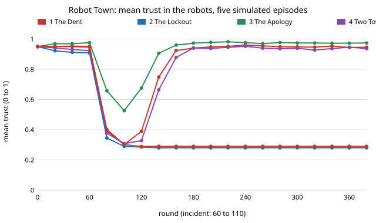

# society-show: can a simulation run be turned into a watchable, honest episode?

`society-trust` found that a robot fleet's reputation survives a bad incident unless people stop
using robots, and that gossip with a negativity bias plus avoidance can lock a town out for good.
This project turns seeded runs of that model into **five short browser episodes of a fictional
robot town**: forty-eight invented townspeople with names, a trust-coloured town grid, a
turning-point log found by code from the recorded data, and a narration whose every number comes
from the same record. **In the five episodes (seed 0 unless noted): with even-handed gossip the town
recovers in 46 rounds after the fix; when bad news counts 4× it never does (48 of 48 avoid
working robots at round 399); explaining failures keeps everyone using robots (0 avoiders) and
recovers in 29 rounds; and at 2× the same settings recover on seed 0 (54 rounds) and lock out on
seed 1.** Produced with AI assistance (Claude). Milestone 7 of research track 17 (`society`,
`PROJECTS.md`). Every episode is fiction and one seeded run, not a statistic: the rates behind
them are `society-trust`'s (20 crowds per cell), not these five runs.

**Live page:** https://duncan-haywood.github.io/monorepo-projects/research/society-show/

**Watch it:** open `experiments/robot_town_show.html` (one self-contained file, no network).

## Why this was worth doing

The track asks for entertainment that is clearly fictional and reproduces exactly. A run of a
model is a story with a cast, a conflict and turning points, but a story told by hand can drift
from the data. Here the story is generated: turning points are detected from the trust of every
person in every round, and the narration is a template filled from those values, so a test can
check each claim against the record. Episodes 4 and 5 are the useful research-communication case:
identical settings, different endings, shown side by side.

## Builds on

`society-trust` (the dynamics, copied with the same random-number order; a test checks the mean
trust equals `society_trust.simulate` run for run, when that project sits alongside).
Hancock et al. (2011), *Human Factors* 53(5):517–527 (trust in human-robot interaction), for why
failures are the driver modelled. The storytelling layer is new and cites nothing. No lab's
method is reproduced.

## What is in an episode

| part | how it is made |
|---|---|
| cast | 48 invented first names, shuffled by seed; no real person is depicted |
| trust grid | each dot is a person, colour = trust in robots, ring = has stopped using robots (trust below 0.30) |
| turning points | code finds: incident start, first person to stop using robots, half the town avoiding, lowest average trust in the incident, the fix, and then either recovery (average within 0.05 of normal) or lock-out |
| narration | one template sentence per turning point, numbers read from the record |
| labelling | a banner on the page says it is a simulation and a work of fiction, not footage |

Settings in all episodes: 48 people, 400 rounds, robots fail 80% of jobs in rounds 60–109 (normal
5%), people avoid robots below trust 0.30, gossip rate 0.05. Episodes differ in gossip negativity
(1, 4, 4, 2, 2), explanation discount (1, 1, 0.3, 1, 1) and seed (0, 0, 0, 0, 1).

## Results

From `experiments/episodes.txt` and `experiments/results.txt` (`experiments/build_show.py`):

| episode | gossip negativity | explains failures | seed | ending | avoiders at the fix / at round 399 |
|---|---|---|---|---|---|
| 1 The Dent | 1 | no | 0 | recovered, 46 rounds after the fix | 41 / 0 |
| 2 The Lockout | 4 | no | 0 | locked out | 47 / 48 |
| 3 The Apology | 4 | yes (0.3) | 0 | recovered, 29 rounds after the fix | 0 / 0 |
| 4 Two Towns, One Ending | 2 | no | 0 | recovered, 54 rounds after the fix | 43 / 0 |
| 5 Two Towns, Another Ending | 2 | no | 1 | locked out | 47 / 48 |



Across ten seeds at these settings, the endings were: 10 of 10 recovered (negativity 1), 10 of 10
locked out (negativity 4), 10 of 10 recovered (negativity 4 with explanations), and 5 of 10
recovered (negativity 2). Those counts came from a throwaway check while choosing episodes and are
not saved results (`research/society-trust` has the saved 20-crowd table); the committed, tested evidence is `society-trust`'s 20-crowd table and the five
episodes above.

## Limitations

- Fiction and stylisation: one shared reputation, a hard avoidance line, no network among
  townspeople, no fitted parameters. Nothing here says how real people trust real robots.
- The episodes were picked to show the model's three behaviours, so they are illustrative, not
  representative. Episodes 4 and 5 are seeds 0 and 1 of the mixed setting, chosen because they end
  differently (5 of the 10 seeds checked recovered), so they show that both endings occur, not how often.
- The narration is a template: it can state only what the detector finds, and says nothing about
  why a particular person's trust fell.
- The chart label overlaps the dashed baseline in the page; cosmetic.
- No viewer study: whether the episodes are watchable or help anyone understand the finding is
  untested, and testing with people is an owner step.

## Next steps

1. A second story engine for the corridor model (`society-plaza`): turning points such as the first
   lane forming or a jam.
2. Let the viewer change a setting and rerun the model in the browser.
3. Test comprehension with real viewers (owner step, with consent and ethics review).

## Reproduce

```
cd research/society-show
python3 -m unittest discover -s tests            # 10 tests, ~1 s
PYTHONPATH=src python3 experiments/build_show.py # rewrites the page, episodes.txt, results.txt (seconds)
python3 experiments/figure.py                    # writes the SVG from results.txt
```

Stdlib only (Python 3.9+). The page is deterministic: the test rebuilds it and compares it byte for byte.

Entertainment output here is fiction. Publishing it under a name or as a product is the owner's call.

## Outside dependencies

None: Python standard library only (the page uses the browser's canvas).
