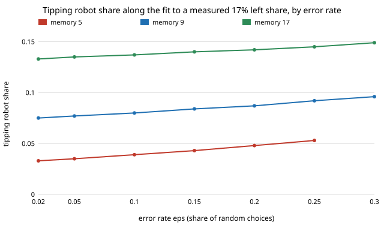

# society-sidefit: does a measured walking-side preference pin down how many robots tip a crowd's passing side?

`society-blocs` swept the share of always-left people by hand. Here the share is fitted to a measurement instead
(`society-blocs`, next step 3). **Moussaïd et al. (2009) found that two people walking head on pass on the right
about 82.5% of the time (left 17.5%); that is the left share a status-quo crowd must show. Fitted to it, the
mean-field tipping robot share is 0.075 to 0.096 for people who remember 9 partners, across error rates 0.02 to 0.30,
against 0.217 for an unbiased crowd.** The always-left share and the error rate trade off against each other (0.155 at
ε = 0.02 down to 0.019 at ε = 0.30), but the tipping share barely moves along that trade-off. Memory length
matters more (memory 5: 0.033 to 0.053; memory 17: 0.133 to 0.149) and so does a stubborn-right bloc (0.089 to 0.135 at
sr = 0.1 to 0.3, ε = 0.02). Simulation (200 people, 12 seeds) shows 0.170 to 0.171 left choices at ρ = 0 and
tips 0 of 12 crowds 0.04 below the mean-field share and 12 of 12 at 0.04 above, at all three error rates tried.
Produced with AI assistance (Claude). Track 17 (`society`, `PROJECTS.md`). Results are about simulated people
following a stated rule, not real crowds.

**Live page:** https://duncan-haywood.github.io/oss-monorepo/research/society-sidefit/

## Why this question

The tipping shares in `society-stubborn` and `society-blocs` depended on `sl`, `sr` and `ε` that were chosen, not
measured. A published passing-side experiment gives one number to pin them to. The model has an exact mean-field
form, so the fit is a one-dimensional root-find and the answer can be checked by simulation.

## Builds on

`society-blocs` (same model; `critical_share` reproduces its 0.2165 and 0.176), `society-stubborn`,
`society-robotnorms`. Data: Moussaïd, Helbing, Garnier, Johansson, Combe and Theraulaz (2009), "Experimental study
of the behavioural mechanisms underlying self-organization in human crowds", *Proc. R. Soc. B* 276(1668):2755–2762,
doi:10.1098/rspb.2009.0405 (arXiv:0908.3131), Figure 4c–d. The paper reports the bars only as a figure. **Lab tags:**
none; the cited authors are not a lab this portfolio builds on, and no affiliation is implied.

## Data and how it was read

`data/moussaid2009_fig4.json` holds bar-top pixel rows measured on page 16 of the arXiv PDF rendered at 400 dpi.
Each panel's frame spans 0 to 1 and its dotted line sits at the frame's midpoint (0.5); heights follow from that.
Reading error is about 3 px, about 0.01. Results (`experiments/results.txt`, section A):

| condition | left | right | left share of the two |
|---|---|---|---|
| 3: two walkers head on | 0.182 | 0.854 | 0.175 |
| 2: one walker, one static obstacle | 0.372 | 0.565 | 0.397 |

The bars do not sum to 1 (1.036 and 0.938), which I take to be reading error plus whatever the figure's scale does
not say; I use the left share of the two bars. The paper's text agrees in direction: a slight right preference
for a static obstacle, "significantly more pronounced" when both walkers move. Condition 3 is the observable
(the model's meetings are between two moving people); 0.17 is used, 0.14 to 0.20 swept.

## Model and fit

As `society-blocs`: share `sl` of humans always walk L (robots' side), `sr` always walk R, each erring with
probability `ε`; the rest take the majority of their last `M` partners. The crowd sits in the status-quo basin
with no robots, so the observed left share is `q`, the chance a random partner walks L, at the low fixed point `x*` of the memory map. For each `ε`
(and `M`, `sr`) `sl` is solved so that `q = ell`; `ρ_c` is then the mean-field tipping share at that `sl`.
Errors alone give `ε/2` left choices, so `ε` cannot exceed about `2·ell`.

## Results

From `experiments/results.txt` (`experiments/run.py`; the simulation section takes several minutes).

**B. The trade-off (ell = 0.17, sr = 0)**, `sl/ρ_c`:

| ε | M=5 | M=9 | M=17 |
|---|---|---|---|
| 0.02 | 0.131/0.033 | 0.155/0.075 | 0.163/0.133 |
| 0.10 | 0.100/0.039 | 0.125/0.080 | 0.133/0.137 |
| 0.20 | 0.052/0.048 | 0.079/0.087 | 0.087/0.142 |
| 0.30 | none | 0.019/0.096 | 0.028/0.149 |

The data cannot say how much of the 17% is stubborn people and how much is noise, but that matters little for the
robot share: the spread across ε is under 0.03 at every memory, smaller than the spread across memory.

**C. Sensitivity to the measurement (M = 9).** `ρ_c` is 0.139, 0.102, 0.075, 0.049, 0.016 at ell = 0.10, 0.14,
0.17, 0.20, 0.25 (ε = 0.02). Each percentage point of measured left share is worth about 0.009 of robot share, so the 0.01
reading error moves `ρ_c` by under 0.001 and the 0.14 to 0.20 range spans 0.049 to 0.102. At ell ≥ 0.30 the fit sits at the
edge where the status-quo basin disappears (`sl` = 0.219, the self-tipping share of `society-blocs`; `ρ_c` = 0):
such a crowd is not stable in the status-quo convention. With ε = 0.20, ell = 0.10 cannot be fitted ("none").

**D. A stubborn-right bloc (ell = 0.17, M = 9).** The fitted `sl` hardly changes (0.155 to 0.158) because the
measured share is mostly the left bloc; `ρ_c` rises 0.075, 0.089, 0.107, 0.135 at `sr` = 0, 0.1, 0.2, 0.3 (ε = 0.02).

**E. Simulation.** Human left share at ρ = 0 is 0.171, 0.171, 0.170 against the fitted 0.170 at ε = 0.02, 0.10, 0.20.
At ρ = ρ_c − 0.04 none of 12 crowds tips, at ρ_c + 0.04 all 12 do.

## What this does and does not show

It shows the conditional claim: if a status-quo crowd's head-on choices are 17.5% left, then in this model a robot share
near 8% to 10% tips it at memory 9, and the answer is not sensitive to how the 17.5% splits between stubbornness and
noise. It does not show that real crowds work this way.

## Limitations

- The measurement is two walkers in a corridor, not a crowd. It is not a city's convention and not a robot encounter.
- Bar heights are read from a figure, and the bars do not sum to 1; no sample size is printed for condition 3.
- One binary decision, well-mixed meetings, fixed blocs, memory known only by sweep, 12 seeds.

## Next steps

1. A published count of side choices in a real crowd (not a pair), to fit the same three parameters on two numbers.
2. Allies placed together in the ring model of `society-robotnorms`.

## Owner steps

None.

## Outside dependencies

None: Python standard library only (the figure uses `research/_shared/linefig.py`, also standard library).

*Produced with AI assistance (Claude).*
